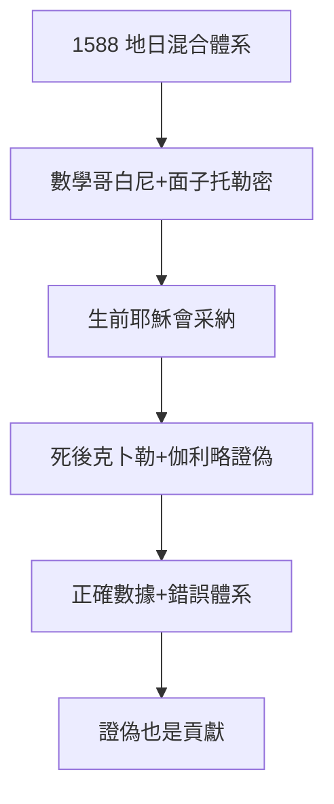

# 4.3 第谷體系（1588–1601）

## 地日混合體系

1588 年提出：地球居中不動，太陽繞地球轉，其他行星繞太陽轉——幾何上等價於哥白尼（相對運動），物理上保住地球靜止（符合聖經與亞里士多德）。這是精巧的妥協：**用哥白尼的數學，保托勒密的面子**。

## 體系的命運

- 生前：耶穌會天文學家多采納（舍納等），天主教會默許——因為地球不動；
- 死後：克卜勒用它的數據證明橢圓（日心），伽利略用望遠鏡看到金星盈虧（地繞日）——1633 年後無人再信；
- 蓋棺：正確的數據，錯誤的體系——**觀測家的體系，註定被理論家超越**。

## 保守的價值

2.2 的矛盾（觀測革命 + 理論保守）在此定格。第谷體系雖錯，卻是從托勒密到克卜勒的橋：它證明了「混合」可能，為後人指明此路不通——**證偽也是貢獻**。

**因果**：1577 彗星的困惑（3.2）逼出混合體系，混合體系逼出克卜勒的反叛（4.2）。第谷用錯誤的體系，養大了正確的答案。下一章，死亡。
