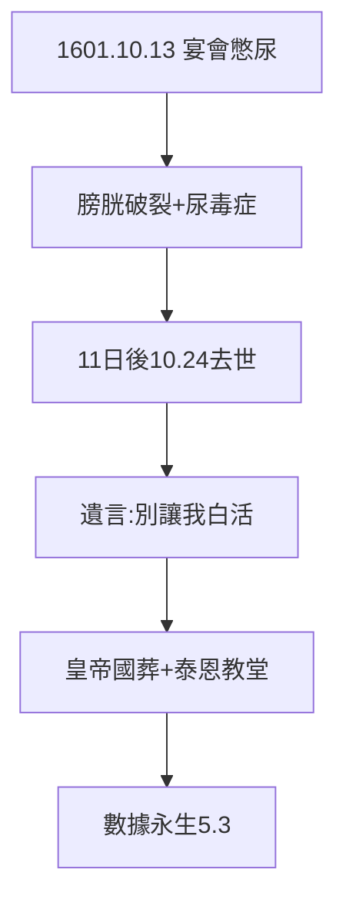

# 5.1 1601 年 10 月 24 日（1601）

## 宴會、膀胱、死亡

1601 年 10 月 13 日，第谷在羅森伯格男爵宴會上憋尿（宮廷禮儀），膀胱受損，發燒譫妄，10 月 24 日死於尿毒症，葬於布拉格泰恩教堂——天文學家少有的國葬級待遇（皇帝主辦）。

## 臨終十一日

- 清醒時整理數據，叮囑克卜勒（《克卜勒傳》3.1）；
- 譫妄時反覆念叨未完成的行星表；
- 最後的話（克卜勒記錄）：「別讓我看似白活」（Ne frustra vixisse videar）——**沒有白活，數據永生**（5.3）。

## 54 年的刻度

1546 出生 → 1560 日食立志 → 1572 新星 → 1576 汶島 → 1597 流亡 → 1599 布拉格 → 1601 身死。貴族的一生，繞著星星轉了一圈。

**因果**：決鬥的血性（1.3）+ 宮廷的禮儀 = 荒誕的死因。最精確的眼睛，死於最不精確的器官。下一節，謀殺疑雲。
