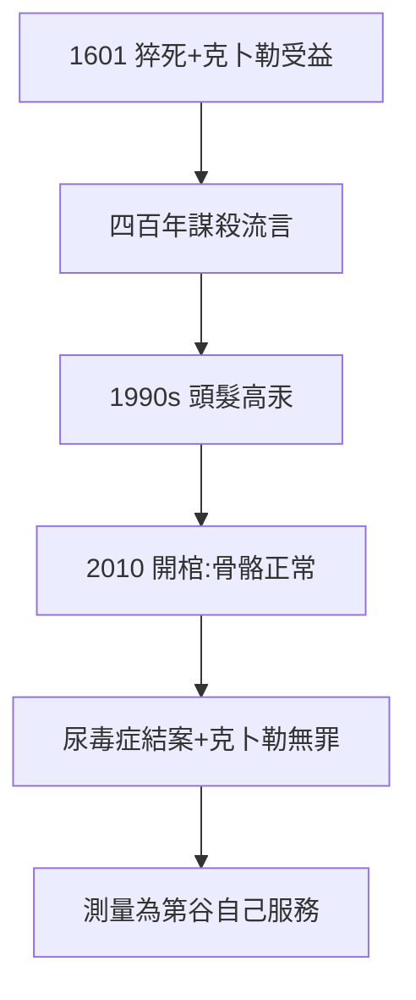

# 5.2 謀殺疑雲（1601–2010）

## 四百年的懷疑

第谷死後，流言不絕：克卜勒為奪數據下毒？丹麥國王派人暗殺（報復流亡）？表親埃里克·布拉赫（隨行布拉格）動手？1990 年代，頭髮檢測出高汞，「謀殺說」甚囂塵上。

## 2010：開棺驗證

丹麥-捷克聯合團隊開棺，骨骼汞含量正常（頭髮汞來自防腐），確認死於尿毒症/前列腺疾病。**克卜勒無罪**——四百年的冤案，吃多了防腐劑的頭髮惹的禍。

## 疑雲的意義

- 為什麼總懷疑克卜勒？因為受益者是他（4.2 的數據易主）——「誰受益誰嫌疑」的樸素邏輯；
- 真相：受益不必謀殺，死亡自有安排——歷史的幽默在於，**最大的受益恰恰最清白**；
- 2010 年的科學（法醫）為 1601 年的死亡結案：這是第谷式的方法（測量！）為第谷本人服務。

**因果**：數據易主（4.2）→ 受益嫌疑 → 開棺洗冤。用第谷的方法（測量）還第谷清白（連帶克卜勒）——科學史最漂亮的迴文。下一節，數據不朽。
