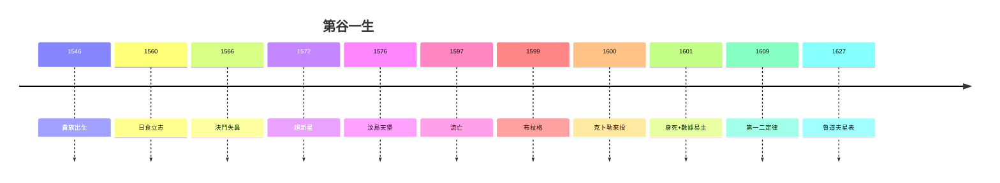

# 5.3 數據不朽（1601–1627）

## 數據的三次轉生

1. **1609**：克卜勒用火星數據得第一、二定律（《克卜勒傳》3.3）；
2. **1619**：第三定律（《克卜勒傳》4.1）；
3. **1627**：《魯道夫星表》，精度領先一個時代（《克卜勒傳》4.3）。

第谷的遺言「別讓我白活」（5.1）兌現了——以他最不希望的方式（證明哥白尼）。

## 觀測家的不朽公式

第谷證明了一個定理：**理論會死，數據永生**。托勒密死了，數據活在哥白尼裡；第谷體系死了（4.3），數據活在克卜勒裡；牛頓的理論也會被相對論修正，但格林尼治的星表永存。

## 鼻子與星星

後世記住第谷，靠兩件東西：假鼻子（1.3）和真數據（3.2）。一個是傳奇，一個是功績——傳奇讓人發笑，功績讓人立法定律。笑完之後，記得致敬：**沒有 1 弧分，就沒有橢圓**。

**因果閉環**：遺產買儀器（1.1）→ 日食立志向（1.2）→ 新星成名（2.1）→ 封島建天堡（2.3、3.1）→ 二十年數據（3.2）→ 流亡布拉格（3.3、4.1）→ 克卜勒（4.2）→ 身死易主（5.1）→ 三定律星表（本節）。貴族用錢買了精度，精度借理論永生——**第谷沒有白活，只是活在了別人的定律裡**。
