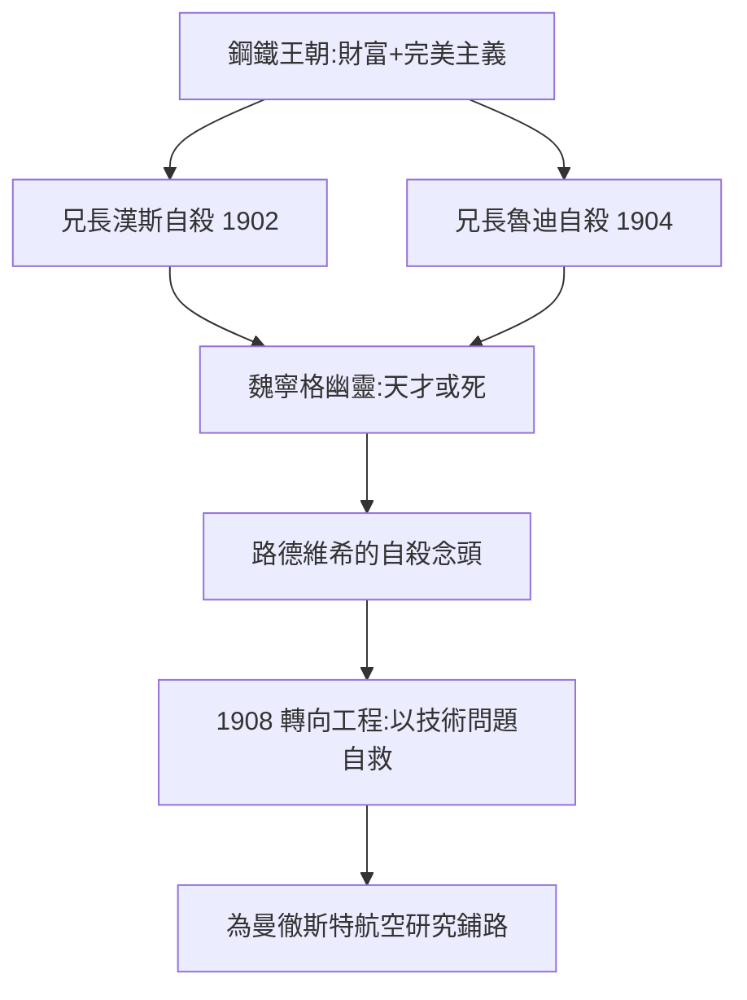

# 1.1 豪門出身與家庭悲劇（1889–1908）

1889 年 4 月 26 日，路德維希·維根斯坦（Ludwig Wittgenstein）出生於維也納，是歐洲最富有家族之一的最小的孩子（八個孩子中的老么）。父親卡爾·維根斯坦是奧匈帝國的鋼鐵大王，母親萊奧波爾丁出身同樣顯赫的銀行世家。這個家庭的文化資本驚人：

- 家中沙龍是布拉姆斯、馬勒、克拉拉·舒曼的聚會之所；
- 哥哥保羅後來成為著名鋼琴家（一戰失去右臂後，拉威爾為他寫了《左手鋼琴協奏曲》）；
- 姐姐赫爾米娜、瑪格麗特都是藝術贊助人，克林姆曾為瑪格麗特畫結婚肖像。

## 三個自殺的兒子

但財富買不到心理健康。這個家庭內部瀰漫著一種近乎殘酷的完美主義：

- 長子漢斯：音樂與數學神童，1902 年在古巴自殺；
- 三子魯迪：1904 年在柏林一家劇院服毒自盡；
- 四子庫爾特：1918 年一戰末期開槍自殺；
- 倖存的保羅與路德維希，終身都被同樣的壓力籠罩。

父親卡爾反對孩子走學術之路，堅持讓他們繼承實業。路德維希因此沒有接受正規的中學教育（林茲實科中學成績平平，據傳希特勒與他同校但低六天入學），而是在家接受家教，準備繼承父業。

## 魏寧格的幽靈

1903 年，奧圖·魏寧格的《性與性格》出版後，作者年僅 23 歲即在貝多芬故居內自殺。這本書在維根斯坦家中與維也納知識界引起地震。魏寧格的核心命題——天才要麼成為絕對的意義、要麼什麼都不是——成為壓在路德維希心頭的道德命令：**不活出天才，就不如去死**。

姐姐赫爾米娜回憶：路德維希與兄長一樣，長期在自殺念頭邊緣徘徊。九個月的深淵之後，改變他的不是心理治療，而是一個「具體的、可以窮盡解決的技術問題」——這正是 1908 年他轉向航空工程的原因（→ 詳見 1.2）。

## 鋼鐵王朝的財富規模

要具體感受這個家庭的分量：

- 卡爾·維根斯坦是奧匈帝國最大的鋼鐵托拉斯之一的核心人物，帝國鋼鐵產量的相當部分來自他的企業；
- 家族宅邸「阿爾格豪斯」（Hochreit 庄園）與維也納宮邸的規模如同小型宮殿；
- 父親卡爾本人出身並非豪門：他從移民家庭靠自學與工程才幹白手起家——這解釋了他對兒子們「必須成事」的嚴酷期待；
- 母親萊奧波爾丁的家族（卡爾姆銀行世家）帶來天主教與音樂的雙重傳統。

因此維根斯坦的出身是雙重混合：暴發戶的權力意志+舊貴族的文化修養——這也是他終身「意志狂暴+趣味精緻」的基因。

## 「維根斯坦宮殿」裡的自殺文化

後世研究（如 Waugh 的《The House of Wittgenstein》）指出家庭內部的具體致病機制：

- **表演式完美**：孩子們被期待在音樂、語言、體育上全部達到專業水準；
- **父親的羞辱文化**：失敗的孩子會被公開嘲笑（漢斯出逃、魯迪出走皆與此有關）；
- **道德絕對主義**：家族氛圍中，「妥協」是髒話，「絕望」被視為深刻的證明；
- 結果：四個兒子中三個自殺，倖存的兩個終身與自殺念頭搏鬥。

路德維希的獨特之處在於：他沒有在音樂或實業中尋找出路，而是找到了**邏輯**——一個能把「絕對要求」合法化的領域。

## 音樂：另一個被放棄的天才出口

維根斯坦家孩子的第一語言是音樂，路德維希也不例外：

- 他有絕對音感，能哼出整部樂譜、能吹單簧管與長笛；
- 家庭鋼琴五重奏（保羅等兄弟演奏）是他童年的日常；
- 他對音樂的理解力終身未衰：他說自己「只在音樂中感到完全的誠實」，並認為舒伯特與勃拉姆斯是「不可說之域」的直接表達。

正因如此，他的轉向工程與邏輯才有心理意義：**他拒絕了家庭最自然的天才賽道（音樂），選擇了一條能把道德命令形式化的路**。日後《邏輯哲學論》把音樂主題列為「不可說」的典範——那句著名的比喻「命題是世界的圖像，如同樂譜是樂曲的圖像」，正是一個被音樂餵養大的孩子的邏輯學。

## 與時代的殘酷巧合

一個流傳甚廣的細節：維根斯坦 1904–1905 年在林茲實科中學就讀時，希特勒恰在同校（低他六天入學，據校冊記錄）。二人互不相識，此說的真實細節存疑，但它象徵著維也納世紀末孕育的兩種極端出路：一種走向毀滅的狂熱，一種走向自我拷問的哲學。維根斯坦選擇了後者，而支撑這個選擇的，正是家族悲劇教給他的對「自我欺騙」的恐懼。

## 事件年表

| 年份 | 事件 | 對後續的影響 |
|------|------|--------------|
| 1889 | 出生於維也納 | 歐洲最富家庭的最後一子 |
| 1898 | 父親卡爾退休，家庭沙龍鼎盛 | 藝術與知識氣氛的搖籃 |
| 1902 | 長兄漢斯自殺 | 家庭悲劇第一聲警鐘 |
| 1903 | 魏寧格出版《性與性格》後自殺 | 「天才或死」的道德枷鎖 |
| 1904 | 兄魯迪自殺 | 路德維希的憂鬱加深 |
| 1904–1905 | 林茲實科中學 | 與希特勒同校的時代巧合 |
| 1906–1908 | 在柏林學機械工程 | 轉向具體技術問題的自救 |
| 1908 | 前往曼徹斯特研究航空學 | 邏輯哲學之路的意外起點 |

## 維也納世紀末的精神土壤

要理解維根斯坦家的悲劇，必須看到當時維也納的時代氣氛（1900 年前後的「世紀末維也納」）：

- 弗洛伊德正在同一座城市出版《夢的解析》（1900），神經症與壓抑成為公共話題；
- 克林姆的分離派、荀白克的無調音樂、波拉克的物理學——維也納是現代主義的爆發點；
- 知識分子的普遍症狀：對舊秩序的幻滅、對「誠實性」（Ehrlichkeit）的極端追求、對平庸的恐懼。

維根斯坦家正是這個時代氣氛的濃縮樣本：他們既是文化巔峰的享受者，也是其神經症的受害者。路德維希日後哲學中的那種「非黑即白」的嚴格性——要麼完全清楚，要麼沉默——與這種世紀末的絕對主義氣質一脈相承。

## 三位兄姐的不同出路

- **赫爾米娜**（大姐）：成為路德維希最重要的理解者與回憶錄作者，她寫下的家庭記憶是後世研究的第一手材料；
- **保羅**（四哥）：失去右臂後仍以左手職業演出，是家庭「以意志對抗命運」的活標本——路德維希終身敬重他，卻也在金錢事務上與他纏訟多年；
- **庫爾特**（五哥）：選擇從軍，1918 年在前線自殺——把家庭的死亡宿命帶到了戰場（→ 詳見 2.2）。

這份家庭圖譜說明：路德維希的每一次人生選擇，都同時是對兄姐命運的回應與迴避。

## 與羅素出身的對照

| | 羅素（1872） | 維根斯坦（1889） |
|---|---|---|
| 家庭 | 英國貴族政治世家 | 奧地利鋼鐵巨富 |
| 早年創傷 | 雙親早亡，孤兒 | 兄長連環自殺 |
| 驅動力 | 世界不可靠→懷疑 | 我可能平庸→恐懼 |
| 青年危機 | 自殺念頭（因數學而活） | 自殺念頭（因邏輯而活） |

兩人将在 1911 年的劍橋相遇，兩種創傷兩種驅動，鑄成二十世紀哲學最重要的師生關係（→ 詳見《羅素傳記》1.1 與本書 2.1）。

## 交叉引用

- → 詳見《羅素傳記》第 1 章：另一種貴族孤兒的哲學起點
- → 詳見《弗雷格傳記》：世紀末德語學術界的另一極——清貧而嚴格的邏輯學家
- → 詳見《圖靈傳記》第 1 章：另一種「以問題自救」的天才起點
- → 詳見本書 1.2：工程自救的展開

## 小結

維根斯坦的出身給了他兩份矛盾的遺產：一是歐洲頂級的財富與文化資源，二是三個哥哥自殺留下的死亡陰影與魏寧格式「天才或死」的道德命令。這份心理驅動將貫穿他的一生——他一生都在尋找某種「值得為之死」的嚴格性，先在工程、再在邏輯、最後在哲學中找到。與羅素的貴族孤兒出身（→ 詳見《羅素傳記》1.1）對照，兩人都是被死亡驅動進入哲學的，但維根斯坦驅動他的不是失去，而是對自身平庸的恐懼。

下一節：1908 年，這個飽受折磨的富家子登上了開往曼徹斯特的火車，去研究風箏飛行。
