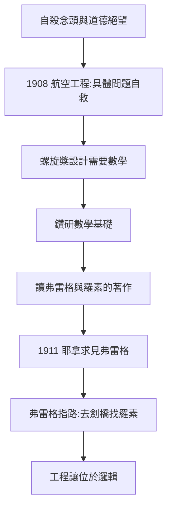

# 1.2 柏林與曼徹斯特的航空工程（1908–1911）

為逃離自殺念頭，維根斯坦做了一個典型「維根斯坦式」的選擇：不是去休息，而是投入一個比之前更嚴酷、更技術性的領域。

## 從柏林到曼徹斯特

- 1906–1908：先在柏林夏洛滕堡工業學院學機械工程；
- 1908 年：進入曼徹斯特維多利亞大學，註冊為航空工程博士生；
- 他的研究課題極其具體：**螺旋槳設計**——他甚至在實驗室頂樓搭建風箏實驗裝置，親手測試。

當時航空學還處於「前牛頓」狀態：萊特兄弟 1903 年才首飛，空氣動力學理論落後於工匠的摸索。維根斯坦發現，要做螺旋槳的數學設計，需要深入的**數學基礎**——微分方程、函數理論。

## 從螺旋槳到邏輯

1909 年前後，為了航空問題，他轉向純數學；為了理解數學，他讀到了羅素與懷特海的《數學原理》第一卷，以及弗雷格的《算術基礎》（→ 詳見《弗雷格傳記》）。這條因果鏈極為清晰：

1. 想造螺旋槳 → 需要數學；
2. 想搞清數學是什麼 → 需要邏輯基礎；
3. 想搞清邏輯基礎 → 需要親自去問弗雷格與羅素。

螺旋槳本身倒沒被放棄——他還在 1910–1911 年為改進型螺旋槳申請了專利（該專利後來確有實用價值）。但他的心理重心已完全轉移：**工程問題是他自救的容器，而容器裡裝著的問題最終把容器撐破了**。

## 為何「窮盡的問題」能救命

維根斯坦後來對友人流露：當他面對一個可以完全清楚地陳述、並有希望徹底解決的問題時，自殺念頭就會退潮。航空工程的失敗不在於他能力不足，而在於工程問題「太大、太模糊」；數學基礎問題恰好相反——它小到看似可以在幾年內窮盡，卻深到足以承載一個天才的全部自我要求。這正是魏寧格幽靈（1.1）與邏輯之謎（1.3）之間的橋樑。

## 一次典型的「維根斯坦式出走」

值得注意他離開柏林、轉赴曼徹斯特的方式：

- 不打招呼、不留計畫，說走就走——這成為他終身的行為模式（1913 出逃挪威、1947 辭職赴愛爾蘭如出一轍）；
- 他對家人宣稱工程是「我的事業」，但內心從未安定；
- 曼徹斯特的兩年半裡，他給姐姐寫信承認「我還不知道我真正想做的事」。

這種「出走—投入—厭棄—再出走」的循環，本身就是 1.1 的道德命令在操作層面的表現：**任何不夠絕對的事業都留不住他**。

## 工程師思維 vs 哲學家的初啼

在曼徹斯特他留下兩份看似無關的遺產：

1. **螺旋槳專利**（1910–1911）：葉端帶有活動葉片的改進設計——工程能力的物證；
2. **數學基礎筆記**：對數學本性的追問日記——哲學能力的物證。

兩份遺產的競爭在 1911 年夏天見分曉：他決定放棄註冊的研究，去耶拿見弗雷格。據說他做決定的方式也帶著工程風格——把問題壓縮到「我要麼繼續造槳，要麼去解決數學是什麼」的二選一。

## 為何弗雷格對他如此重要

弗雷格著作給他的三樣東西：

| 給予 | 具體內容 | 在維根斯坦身上的變形 |
|------|----------|----------------------|
| 嚴格性範本 | 概念文字：符號不留歧義 | 《邏輯哲學論》的編號體系 |
| 意義/指稱區分 | 表達式的兩個維度 | 前期的圖像論與後期的使用論都在回應它 |
| 邏輯的自主性 | 邏輯不是心理學 | 「邏輯是先天的」之終身立場 |

但弗雷格的系統化風格與維根斯坦的道德激情並不契合——這正是弗雷格建議他去劍橋的深層原因：**這個年輕人需要的是辯論與危機，不是體系**。

## 事件年表

| 年份 | 事件 | 因果意義 |
|------|------|----------|
| 1906–1908 | 柏林學機械工程 | 離開維也納的死亡氣氛 |
| 1908 | 進入曼徹斯特大學 | 正式轉入航空研究 |
| 1908–1909 | 風箏實驗與螺旋槳設計 | 需要更深的數學 |
| 1909 | 為螺旋槳申請專利 | 工程事業的最後餘暉 |
| 1910 | 讀《數學原理》 | 發現真正「值得窮盡」的問題 |
| 1911 年夏 | 赴耶拿拜訪弗雷格 | 弗雷格建議他去劍橋找羅素 |

## 航空技術的時代背景

維根斯坦選擇航空並非偶然，1908 年正是人類飛行的啟蒙期：

- 萊特兄弟 1903–1905 年完成動力飛行，歐洲各國競相追趕；
- 飛艇、風箏、滑翔機並行發展，空氣動力學尚無統一理論；
- 德國克虜伯與奧地利軍方都在投資飛行器研製，富家子弟投身此業並不丟臉。

維根斯坦在克羅伊登與曼徹斯特之間往返，研究的是**螺旋槳葉端的設計**——他關注的問題（槳葉在高速旋轉中的受力分佈）需要高階數學工具，這正是把他從工坊推向書房的槓桿。

## 工程師的思維如何塑造哲學家

這兩年工程訓練留下了終身印記，可以直接對應到他日後的哲學風格：

| 工程習慣 | 日後的哲學化身影現 |
|----------|--------------------|
| 問題必須可精確陳述 | 《邏輯哲學論》的命題編號體系 |
| 設計要窮盡所有情況 | 「命題的一般形式」的追索 |
| 拒絕含糊的容差 | 對模糊語言的終身不耐（直到後期轉向） |
| 原型要親手測試 | 哲學以「例子」反覆檢驗的方法 |

後期哲學（→ 詳見 4.3）雖然反對前期，但「用大量小例子逼近問題」的工程式做法貫穿始終。

## 家庭與金錢的張力

這段時期他也開始面對家庭的期待壓力：父親與兄姐期望他最終接管家族實業或至少管理財產。他在曼徹斯特的堅持，事實上是對「鋼鐵王朝繼承人」角色的第一次公開出走——1913 年散盡遺產（→ 詳見 2.1）只是這次出走的完成式。

## 弗雷格著作的衝擊

1909–1911 年間他細讀弗雷格，日後回憶說弗雷格是他第一位真正意義上的老師。弗雷格的影響有兩面：

- **正面**：語言與邏輯的嚴格區分、意義與指稱的劃分（→ 詳見《弗雷格傳記》）；
- **催化**：弗雷格的《算術基礎》展示了一種可能性——用極少的工具解決最大的問題。這正合維根斯坦的胃口：他一生只肯做「能窮盡」的問題。

## 交叉引用

- → 詳見《弗雷格傳記》：邏輯主義的奠基工程
- → 詳見《羅素傳記》2.1、2.2：《數學原理》的野心
- → 詳見本書 1.3：1911 年的兩次拜師
- → 詳見《圖靈傳記》第 1 章：數學基礎之謎如何吸引下一代天才

## 小結

航空工程是維根斯坦生命中的「過渡容器」：它以純技術問題暫時壓住了自殺衝動，卻又在兩年內把他推向了更根本的問題。這段經歷塑造了他終身的思維風格——**像工程師一樣對待哲學**：問題必須可以被精確陳述、逐步攻克，容不得半點含糊。日後《邏輯哲學論》中「凡是能夠說的事情，都能夠說清楚」（→ 詳見 2.3）的口吻，正是一個航空工程師的口吻。

同樣的火種也在大西洋彼岸點燃：圖靈將在 1930 年代沿著希爾伯特的問題走進同一座邏輯迷宮（→ 詳見《圖靈傳記》第 1 章）。邏輯基礎之謎，正在把兩代人吸入其中。
