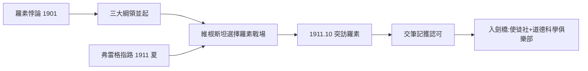

# 1.3 邁向數學基礎之謎（1911）

1911 年是維根斯坦生命軌跡的總轉折點。這一年，航空工程師路德維希正式把靈魂押給了數學基礎問題，並兩度出發拜師——先耶拿，後劍橋。

## 耶拿：弗雷格的審查

1911 年夏天，維根斯坦未經預約前往耶拿大學拜訪弗雷格（Gottlob Frege，1848–1925）。弗雷格是現代邏輯與分析哲學的奠基者（→ 詳見《弗雷格傳記》），性格孤峻，學術標準嚴苛到近乎不近人情。

會面的場景耐人尋味：這位富有的奧地利工程師向弗雷格坦白自己對數學基礎的困惑。弗雷格聽完後給出的建議冷淡而精準——**你應該去劍橋，跟羅素學**。弗雷格意識到這個年輕人的問題（數學是什麼？邏輯的本性是什麼？）正是羅素正在為之奮鬥的問題，而且這個年輕人需要的是導師制的激烈碰撞，而非書信往來。

這次會面的深層意義：弗雷格親手把一位天才從自己門下推向對手陣營。日後維根斯坦的《邏輯哲學論》將同時受惠並背叛這兩位老師。

## 劍橋：闖入羅素的生活

1911 年 10 月 18 日，維根斯坦突然出現在劍橋大學羅素的書房，未經介紹，直接要求跟羅素學邏輯。羅素起初感到為難：這個滿口「邏輯的根本問題是什麼」的年輕人，連基本的邏輯文獻都沒讀過。

羅素讓他寫點東西看看。假期結束後維根斯坦交來了短短幾頁筆記。羅素回憶：「我說，除非我看得出你大有可為，否則我不會收你；看完第一句我就相信了。」**1911 年冬至 1912 年初，維根斯坦正式成為羅素的學生**——這段師生關係的展開，是第 2 章的主題（→ 詳見 2.1）。

## 三重驅動力的匯合

此時維根斯坦的內心有三股力量同時燃燒：

- **心理驅動**：自殺念頭需要一個「可窮盡」的嚴格問題來鎮壓（1.1–1.2）；
- **智識驅動**：《數學原理》展示了邏輯的驚人野心——一切數學皆可化歸為邏輯；
- **時代驅動**：羅素 1901 年發現的羅素悖論（→ 詳見《羅素傳記》2.1）使數學基礎成為當時最尖銳的危機，弗雷格的邏輯主義因此受挫，整個領域陷入混亂。

維根斯坦在危機最盛之時闖入戰場——時機決定了他一生的問題清單。

## 弗雷格與羅素：兩位老師的雙軌影響

1911 年的兩次拜師，給了維根斯坦兩套互相競爭的思想資源：

| | 弗雷格（1848–1925） | 羅素（1872–1970） |
|---|---|---|
| 立場 | 邏輯主義+概念文字 | 邏輯主義+關係邏輯 |
| 風格 | 孤峻、系統、拒絕社交 | 熱情、辯論、導師制 |
| 對維根斯坦的給予 | 意義與指稱的區分、嚴格性 | 悖論的火線、劍橋的戰場 |
| 與維根斯坦的終局 | 終生困惑於《邏輯哲學論》 | 被「篡位」後漸行漸遠 |

維根斯坦後來說：他從弗雷格學到「哲學是對邏輯的批判」，從羅素學到「哲學可以在活人身上發生」。

## 羅素悖論：危機如何供給機會

必須強調時機的關鍵性。1901 年羅素發現的悖論（→ 詳見《羅素傳記》2.1）不僅擊穿了弗雷格的算術基礎，也讓整個基礎研究進入群雄並起的亂世：

- 羅素：類型論救火（《數學原理》1910–1913）；
- 希爾伯特：形式主義綱領（後來圖靈登場的舞台，→ 詳見《圖靈傳記》第 1 章）；
- 布勞維爾：直覺主義（1928 年講座將衝擊維根斯坦，→ 詳見 3.2）。

維根斯坦選擇跟隨羅素，是因為他需要的是「活生生的哲學戰場」，而非書齋系統。

## 使徒社與劍橋知識圈的接納

1912 年他迅速融入劍橋精英圈：

- 使徒社（Cambridge Apostles）：摩爾、羅素皆出身的精英辯論社團；
- 道德科學俱樂部：哲學系的辯論場，他在那裡以粗暴的坦率聞名；
- 凱恩斯、利頓·斯特雷奇等布魯姆斯伯里成員與他往來——經濟學家凱恩斯 1929 年開車接他重返劍橋時寫下名句：「上帝到了，我在 5 點 15 分的火車上接到了他。」

這個社交圈的氣質（精英、坦率、反傳統）與維根斯坦的家庭沙龍形成奇妙的鏡像——但他很快發現，辯論的熱鬧恰恰是他做「嚴格」哲學的障礙（→ 詳見 2.1、2.2）。

## 弗雷格會面的細節

這次耶拿拜訪留下的記錄雖少，但關鍵細節可以確認：

- 維根斯坦事前由姐姐的圈子引薦寫了介紹信，但弗雷格對「有錢的年輕工程師」興趣極為有限；
- 他的問題不是「如何為數學奠基」，而是更徹底的「邏輯本身的性質是什麼」；
- 弗雷格日後提到這位訪客「給人印象深刻」，但對其思維方式有所保留；
- 兩人的最終結局更具深意：弗雷格 1925 年去世前讀了《邏輯哲學論》，直言「一半的句子看不懂」——師徒之間的鴻溝恰恰證明維根斯坦走出了新路（→ 詳見 2.3）。

## 「蠢貨還是哲學家」的神話場景

羅素與維根斯坦的初遇已成哲學史神話，其結構值得拆解：

- 1911 年 10 月 18 日，維根斯坦按門鈴闖入，羅素正忙於《數學原理》的後續工作；
- 他的問題是：「我是個徹底的蠢貨嗎？如果是，我就去當飛行員。」
- 羅素讓他假期後交作品——那幾頁筆記令羅素當場承認「大有可為」；
- 羅素日記：「也許是我見過的最完美的人：激情、深刻、熱忱、有支配力。」

這個場景的深層結構：維根斯坦把職業選擇表述為**對自我價值的終審**——魏寧格命令（1.1）的直接作用。哲學對他不是職業，而是生死判決。

## 1911 年的世界局勢

把鏡頭拉遠，1911 年的歐洲也在醞釀巨變：

- 第二次摩洛哥危機：大戰的預演，三年後羅素與維根斯坦都將被捲入（→ 詳見 2.2 與《羅素傳記》3.1）；
- 物理學革命：索爾維會議與相對論的推進——「基礎的危機」席捲各學科；
- 兩個思想世界：維也納（道德激情）與劍橋（邏輯冷靜）的反差，正好象徵維根斯坦一生的兩極。

## 事件年表

| 年月 | 事件 | 因果意義 |
|------|------|----------|
| 1901 | 羅素悖論發現 | 基礎危機的引爆點 |
| 1910 | 數學原理第一卷出版 | 維根斯坦的入門讀物 |
| 1911 年夏 | 耶拿拜訪弗雷格 | 獲得「去找羅素」的指路 |
| 1911 年 10 月 18 日 | 突然造訪羅素書房 | 兩條哲學命運線的交會 |
| 1911 年假期後 | 交出哲學筆記 | 羅素承認其天才 |
| 1911 年冬 | 正式入學劍橋 | 工程生涯終結 |

## 交叉引用

- → 詳見《弗雷格傳記》：概念文字與邏輯主義的起點
- → 詳見《羅素傳記》2.1：羅素悖論的發現過程
- → 詳見《卡爾納普傳記》：另一種繼承弗雷格的方式
- → 詳見《圖靈傳記》第 1 章：希爾伯特綱領與可計算性

## 小結

1911 年，一個自殺邊緣的奧地利工程師，在一個夏天內完成了兩次改變哲學史的拜師：弗雷格把他推向羅素，羅素把他推向了邏輯。這一年看似只是求學，實則是三條線的匯合點——維根斯坦的心理危機、弗雷格與羅素的邏輯主義計畫、以及數學基礎的世紀危機。當這三股力在同一個人身上交會，二十世紀最奇特的哲學生命就此啟動。

下一章：劍橋與大戰——羅素如何被迫承認這個學生超過了自己。
