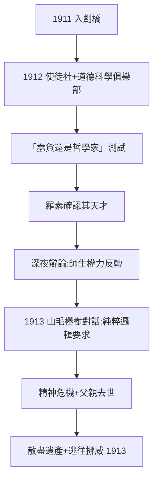
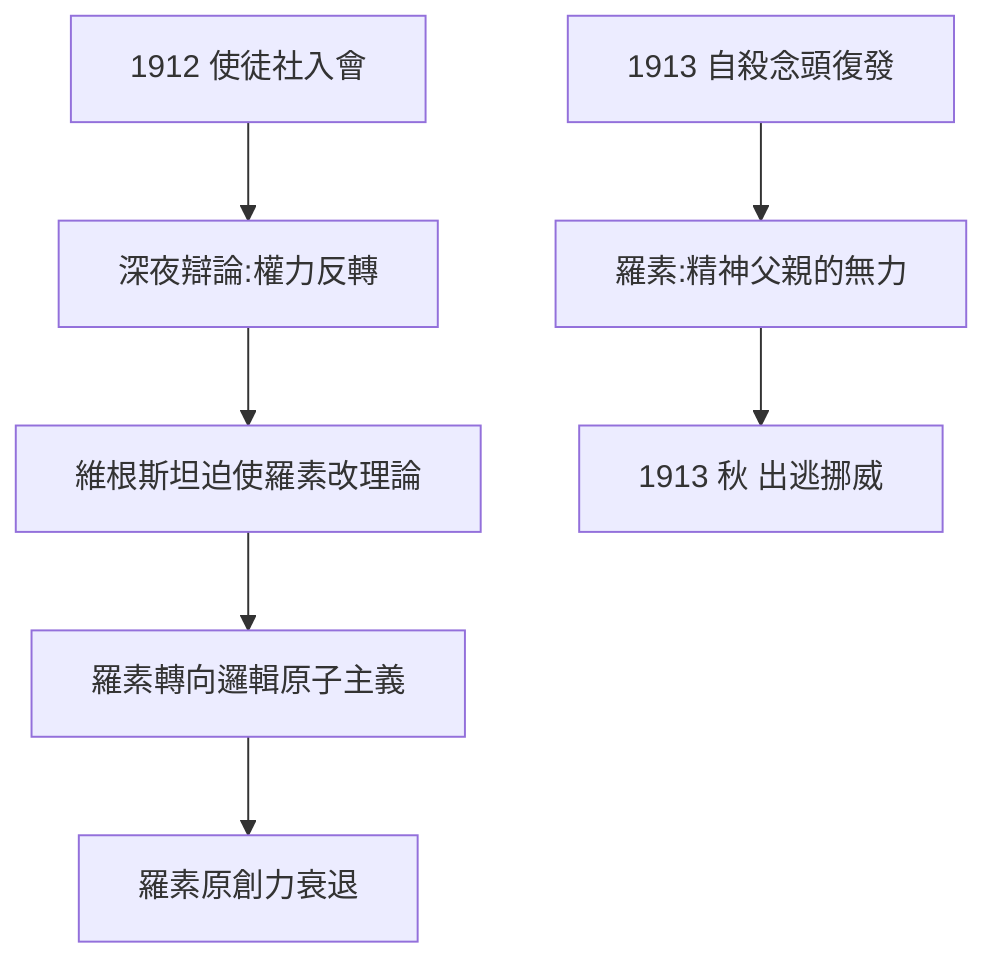

# 2.1 羅素的學生（1911–1913）

1912 年起，維根斯坦在劍橋經歷了哲學史上最著名的一場師生關係。這段關係的主角名義上是羅素，實際上很快被學生反轉了。

## 從學生到「精神兒子」

維根斯坦入學後以驚人的速度吞噬劍橋：

- 一年內被選為使徒社成員（與羅素當年同途，→ 詳見《羅素傳記》1.2）；
- 1912 年當選道德科學俱樂部核心人物，在一次聚會上宣布「俱樂部裡只有五個人有哲學頭腦」；
- 羅素在信中寫道：「我見過的所有人中最完美的典範——熱情、深刻、強烈、有支配力。」

羅素與他有長達數小時的深夜辯論，事後羅素往往疲憊到瀕臨自殺念頭。羅素後來承認：這兩年是他生命的頂點，也是他原創哲學的終結——**維根斯坦來了之後，羅素再也不是原來的哲學家**。

## 兩個標誌性瞬間

**第一瞬間（1912）**：維根斯坦問羅素：「我是個徹底的蠢貨嗎？如果是，我就去當飛行員；如果不是，我就成為哲學家。」羅素要他寫一篇假期報告，讀完第一句就回答：「不，你不該成為飛行員。」

**第二瞬間（1913）**：一次散步時，維根斯坦堅持一切存在的事物都是「偶然的」。羅素指著一株山毛櫸樹說：「這裡至少有一棵山毛櫸樹，不是偶然的。」維根斯坦回答：「是的。但如果這不是嚴格的邏輯必然，那就什麼都不算嚴格。」這句話把羅素逼到牆角——維根斯坦要求的是一種比《數學原理》更純粹的邏輯：**邏輯必須免於一切經驗內容**。

## 羅素的自殺焦慮與維根斯坦的接管

1913 年前後，維根斯坦陷入更深的精神危機：他認為自己毫無道德進步、不配活在天才之中。他向羅素坦承曾連續數小時在自殺念頭中掙扎。羅素在日記中寫下令人心驚的句子：「我覺得這孩子可能在任何時候死去……他的靈魂會是地獄。」羅素被迫以近乎父親的角色承受這份重量。

這份心理壓力有清晰的前因（1.1 的死亡氛圍與魏寧格幽靈）與後果（2.2：他逃往挪威，把孤獨制度化）。

## 父親之死與慷慨的奉獻

1913 年 1 月，父親卡爾去世，維根斯坦繼承了天文數字的遺產。他的反應是把財富視為負擔：

- 捐給詩人特拉克爾（Georg Trakl）十萬克朗；
- 資助里爾克（Rilke）等德語詩人；
- 委託建築師為姐姐設計新居（他後來親自接手該宅邸的設計，即著名的維根斯坦之屋）。

這種對金錢的「清除」與對哲學的純粹化是同一種心理驅動：**把一切偶然的、世俗的東西剝離，只留下必然的核心**。

## 山毛櫸樹對話的深層意義

1913 年的那次散步值得單獨分析，因為它是《邏輯哲學論》的搖籃對話：

- 羅素的立場：日常事實（眼前有一棵樹）是確定的，哲學不必懷疑到「什麼都不剩」；
- 維根斯坦的回答：「如果一個詞有意義，某個對應物就必須存在」——他當場拒絕了「山毛櫸樹」這個例子，因為它混入了經驗內容；
- 羅素事後承認：「那時我意識到他的邏輯比我徹底，而我做不到他那樣的純粹。」

這場對話的技術後果是羅素放棄了「親知原則」的原初版本，轉向「邏輯原子」的純形式表述。而對維根斯坦來說，這次對話確立了《邏輯哲學論》的根本要求：**邏輯必須獨立於世界可能碰巧如何**。

## 事件年表

| 年月 | 事件 | 因果意義 |
|------|------|----------|
| 1912 年初 | 正式入劍橋 | 拋棄航空事業 |
| 1912 | 當選使徒社 | 進入羅素核心圈 |
| 1912 | 「蠢貨還是哲學家」測試 | 羅素確認其天才 |
| 1912–1913 | 與平克的音樂心理學實驗 | 少數溫暖的友誼 |
| 1913 年 1 月 | 父親去世 | 繼承巨額財富 |
| 1913 | 大筆捐贈特拉克爾、里爾克 | 對金錢的「淨化」 |
| 1913 | 山毛櫸樹對話 | 邏輯純粹化立場定型 |
| 1913 年秋 | 逃往挪威 | 孤獨主義的開端 |

## 維根斯坦對羅素的哲學改造

這段師生關係的後果是雙向的。維根斯坦迫使羅素做出一系列理論讓步：

- **拋棄「命題是複雜體」的舊觀點**，轉向 1913–1918 年的「邏輯原子主義」（→ 詳見《羅素傳記》2.3）；
- **承認關係詞不需要被還原**，接受關係命題的基礎地位；
- **重新思考「知識」的定義**——維根斯坦堅持「知道」一詞在日常語言中的用法才是哲學的出發點，這是後期「語法考察」的最早萌芽。

羅素在《數學原理》第二、三卷的寫作期間飽受維根斯坦的批評，他事後承認：維根斯坦的批評使他「不再能在抽象的邏輯問題上工作」。一個學生以批評終結了老師的原創力——這在哲學史上幾乎絕無僅有。

## 「奧地利官方公務員」的性情

維根斯坦在劍橋的行為方式令同輩既著迷又害怕：

- 他對一切平庸的談話表現出公開的、近乎殘忍的不耐煩；
- 他鄙視學術職業的虛偽禮儀，卻對使徒社的「真誠」標準極度認真；
- 他與平克（David Pinsent）結為至交，一起旅行做實驗（音樂心理學），這是他少數的友誼之一；1918 年平克死於飛行事故，再次加深他的死亡焦慮。

## 自殺邊緣與羅素的「精神父親」角色

1913 年前後的深夜談話中，羅素被迫充當懺悔神父：維根斯坦坦白自己多年來「在朋友面前隱瞞真實自我」，認為自己「不配」活下去。羅素的日記與書信顯示：

- 他相信維根斯坦是「天才」，並認為自己對這個生命的存亡負有責任；
- 他同時意識到自己無法真正幫助他——維根斯坦的困境是道德性的，不是心理治療能解的；
- 這種無力感也是羅素尊重維根斯坦出逃挪威的原因之一。

這份心理驅動鏈的完整路徑是：家庭悲劇（1.1）→ 魏寧格幽靈 → 工程自救（1.2）→ 邏輯作為救贖（1.3）→ 劍橋的社交讓救贖失效 → 出逃挪威（2.2）。

## 事件年表

| 年月 | 事件 | 因果意義 |
|------|------|----------|
| 1912 | 與平克結為摯友 | 少數的情感支持 |
| 1912–1913 | 對數學原理的持續批評 | 羅素轉向邏輯原子主義 |
| 1913 | 「奧地利官方公務員」式的社交風格 | 樹敵與崇拜並存 |
| 1913 年前後 | 深夜懺悔與自殺念頭 | 羅素充當精神父親 |
| 1913 年秋 | 出逃挪威 | 救贖計畫的下一站 |

## 交叉引用

- → 詳見《羅素傳記》2.3：邏輯原子主義的維根斯坦烙印
- → 詳見《羅素傳記》1.2：使徒社的傳統
- → 詳見《弗雷格傳記》：維根斯坦從弗雷格處繼承的嚴格性
- → 詳見本書 2.2：挪威小屋的孤獨實驗

## 小結

1911–1913 是一場哲學史上的「篡位」：維根斯坦入學時是學生，離開劍橋時已事實上接管了羅素的哲學方向。羅素自己承認，維根斯坦對他的影響是「生命中最激動人心的智識冒險」，但也是原創力的終結。而維根斯坦本人則在這兩年中被迫直面一個事實：他無法在劍橋的社交與辯論氛圍中做「嚴格」的哲學——這直接驅動了他 1913 年的出逃。

下一節：挪威小屋與一戰前線——《邏輯哲學論》如何在孤獨與砲火中成形。
