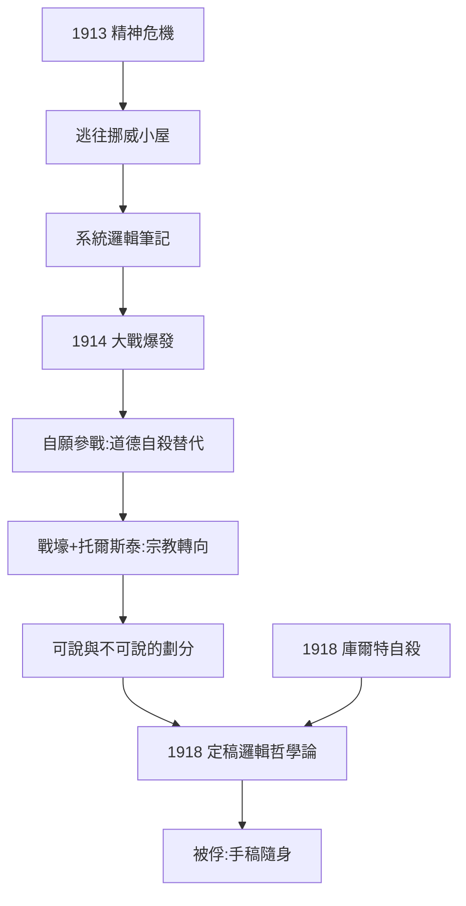
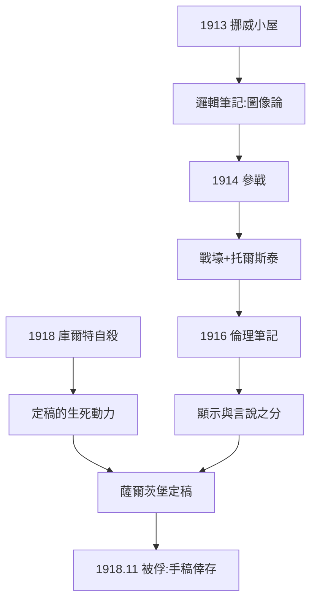

# 2.2 挪威小屋與一戰前線（1913–1918）

## 逃往挪威（1913）

1913 年 10 月，維根斯坦突然離開劍橋，獨自搬到挪威卑爾根以北的休訥峽灣（Skjolden），在絕壁上的一間小屋定居。動機有三重：

- **心理**：劍橋的社交消耗他的精神，自殺念頭復發（2.1）；
- **智識**：他需要絕對孤獨來「窮盡」邏輯問題；
- **道德**：他相信哲學家應該過一種純粹的生活，遠離金錢與名聲。

他對羅素說：「我在這裡的工作比在劍橋好十倍。」在挪威小屋，他開始系統地寫下邏輯筆記，試圖推翻並取代《數學原理》。他 1914 年曾邀請 G. E. 摩爾（G. E. Moore）來小屋做筆記員——摩爾被迫當他的聽寫員，把他的口述記錄下來；後來因摩爾拒絕繼續聽寫，兩人交惡。

## 大戰爆發：自願參戰（1914）

1914 年 8 月，第一次世界大戰爆發。維根斯坦正在奧地利度假，他做的決定震驚所有人：**自願從軍**，儘管疝氣使他本可豁免。

動機是三重的，而且互相咬合：

1. **道德自殺的替代**：他想「在面對死亡時把自己變成另一個人」——他承認自己想自殺，參戰是尋求一種高尚的死法；
2. **宗教性覺醒**：他在書店買下托爾斯泰的《福音書摘要》，戰壕中反覆誦讀，視之為救命書；
3. **哲學的需要**：他發現只有在最極端的處境裡，邏輯的界限才會顯現。

## 前線上的邏輯

戰爭期間他完成了對哲學史最奇特的一次「戰地寫作」：

- 1914–1916：東線與俄軍作戰，同時寫下筆記（後來的《戰時筆記》）；
- 1916：調至榴彈炮團，參與布魯西洛夫攻勢的防禦，因勇敢多次獲勳；
- 1918 年：調至義大利前線，利用假期在薩爾茨堡完成《邏輯哲學論》定稿。

前線經歷直接塑造了《邏輯哲學論》的內部結構：**關於世界可說的部分（邏輯、命題、圖像論）與關於倫理、美、生死不可說的部分**——後者正是戰壕中誕生的。他在 1917 年寫給保羅的信中說：「這本書的觀點是一種倫理的觀點。我願意把它作為倫理的貢獻。」

## 1918 年：庫爾特自殺與被俘

1918 年是雙重災難之年：

- 四兄庫爾特在義大利前線自殺（1.1 的家庭悲劇第四聲喪鐘）；
- 1918 年 11 月，奧匈帝國崩潰前夕，維根斯坦在特倫托被義大利軍隊俘虜，成為戰俘。

他在戰俘營（蒙泰卡西諾）仍攜帶《邏輯哲學論》手稿，並以此為條件之一與獄友討論。這部在炮火與自殺陰影中完成的手稿，即將通過一場跨國通信抵達羅素手中，並推向出版（→ 詳見 2.3）。

## 事件年表

| 年月 | 事件 | 因果意義 |
|------|------|----------|
| 1913.10 | 逃往挪威小屋 | 孤獨制度化，系統筆記開始 |
| 1914.8 | 大戰爆發，自願參軍 | 道德自救+宗教覺醒 |
| 1914–1916 | 東線作戰，托爾斯泰隨身 | 《戰時筆記》成形 |
| 1916 | 榴彈炮團，獲勳 | 極限處境淬煉倫理思想 |
| 1918 | 庫爾特自殺 | 家庭悲劇的頂點 |
| 1918.11 | 義大利被俘 | 手稿隨身，等待出版 |
| 1918–1919 | 戰俘營中保存手稿 | 邏輯哲學論倖存 |

## 挪威小屋：孤獨的哲學實驗室

休訥峽灣小屋的細節值得細看：

- 小屋建在絕壁邊，只有步行小徑可達，冬季與世隔絕；
- 他在這裡寫下 1913–1914 年的《挪威筆記》（Notes on Logic），首次形成「命題是世界的圖像」的想法；
- 他對羅素解釋：劍橋的人都在「閒聊」，他需要一個「沒有人打擾我形成思想的地方」。

1914 年摩爾來訪事件是這場實驗的註腳：維根斯坦要求摩爾每天來做聽寫員，口授筆記；摩爾因不滿被當成工具而中止合作，維根斯坦寫信羞辱他。友誼破裂——但筆記留下了，這些文本後來成為《邏輯哲學論》的直系前身。

## 戰壕裡的托爾斯泰

《福音書摘要》在戰壕中的作用是真實的救贖：維根斯坦在給保羅的信中說「托爾斯泰的福音書摘要救了我的命」。戰地閱讀帶來兩個思想後果：

1. **宗教性轉向**：他開始認為「世界的意義」是一個嚴肅問題，而且是邏輯不能回答的問題；
2. **「顯示與言說」的區分**：宗教、倫理的真理無法被言說，只能在生活中被顯示——這成為《邏輯哲學論》的核心區分（→ 詳見 2.3）。

## 1916 年筆記的倫理轉折

1916 年的《戰時筆記》中出現了全新的段落：關於上帝、勇氣、死亡、世界之意义。這些條目後來大多被壓縮進《邏輯哲學論》6.4 以下的段落。也就是說：**書的下半身（倫理、神秘之域）全部來自戰壕**，上半身（邏輯、圖像論）來自挪威小屋。

## 庫爾特之死與「家庭詛咒」的頂點

1918 年庫爾特的自殺對路德維希的意義不同於漢斯與魯迪（1.1）：庫爾特不是因病弱，而是與他一樣在戰爭中面對死亡的勇氣崩潰。路德維希在同一戰場上目睹了「另一個自己」的結局——這促使他把《邏輯哲學論》定稿視為生死攸關的任務：書若不成，死即無憾。1918 年夏他果然在薩爾茨堡完成了定稿。

## 事件年表

| 年月 | 事件 | 因果意義 |
|------|------|----------|
| 1913.10 | 定居休訥峽灣 | 挪威筆記成形 |
| 1914 年初 | 摩爾來訪充當聽寫員 | 友誼破裂，筆記留存 |
| 1914.8 | 自願參軍 | 道德自救行動 |
| 1914–1915 | 東線+福音書摘要 | 宗教轉向 |
| 1916 | 倫理筆記 | 書的下半身成形 |
| 1918 | 庫爾特自殺+定稿 | 生死攸關的衝刺 |
| 1918.11 | 被俘 | 手稿隨身 |

## 交叉引用

- → 詳見《羅素傳記》3.1、3.2：同一場戰爭中羅素的反戰抗爭
- → 詳見本書 2.3：手稿如何跨越戰爭與出版壁壘
- → 詳見本書 1.1：家庭悲劇的完整序列

## 小結

1913–1918 是《邏輯哲學論》的孕育期，而它的基因是雙重的：挪威小屋給了它邏輯的骨架（命題的圖像論、可說的界限），一戰前線給了它倫理的靈魂（不可說的領域、以沉默示意的東西）。家庭悲劇（庫爾特之死）與自殺衝動則是全書背後的心理引擎。這解釋了為何這本薄薄的邏輯書會以「對於不可說的東西我們必須保持沉默」收尾——那不是技術性結論，而是一個在死亡邊緣活過五年的人的證詞。

同時期的羅素也在做著相反方向的鬥爭：他因反戰入獄（→ 詳見《羅素傳記》3.1、3.2）。師生二人在同一場戰爭中，一個向內走向沉默，一個向外走向吶喊。
