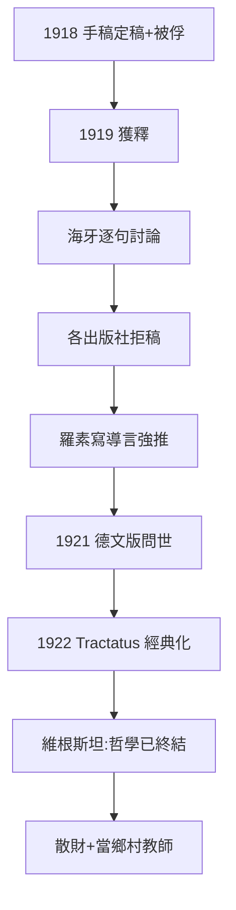
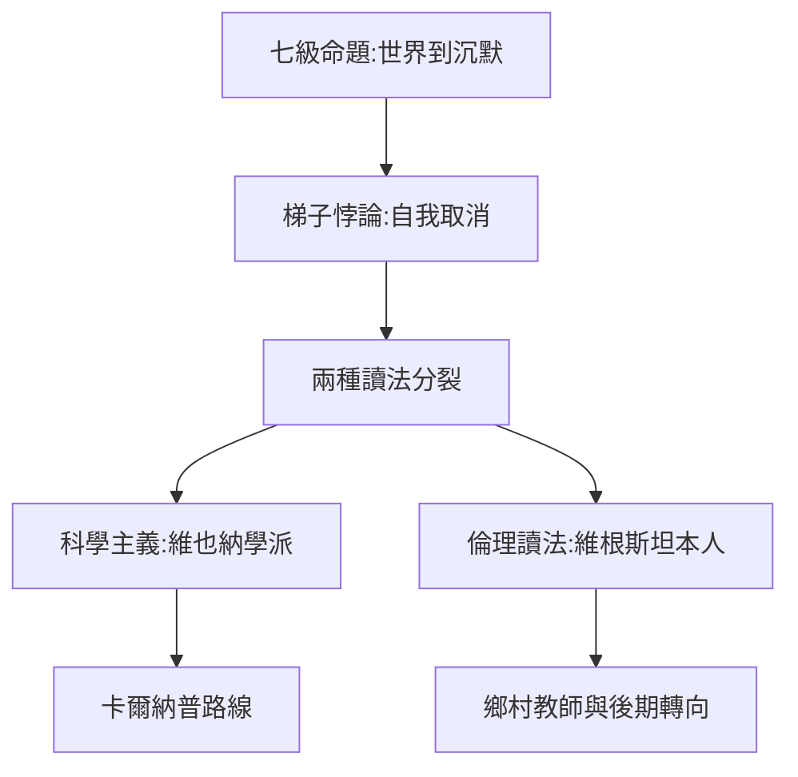

# 2.3 《邏輯哲學論》出版（1921）

## 戰俘與導師的重逢

1919 年 8 月，維根斯坦從義大利戰俘營獲釋。他做的第一件智識大事，就是與羅素在海牙見面，逐句討論《邏輯哲學論》手稿。羅素被其力量震懾，但也被其神秘主義尾巴困惑——他私下承認自己「沒有完全理解」書中關於不可說之物的部分。

接下來是漫長而荒誕的出版磨難：

- 維根斯坦拒絕修改一個字，認為任何人要麼懂、要麼不懂；
- 劍橋出版社與學術期刊先後拒稿（審稿人認為這書的命題無意義）；
- 羅素力排眾議，為書寫導言，並以「導言承擔解釋責任」的方式推動出版；
- 1921 年，全書最終以德文發表於奧斯特瓦爾德的《自然哲學年鑑》；1922 年英譯本以拉丁化書名 **Tractatus Logico-Philosophicus** 出版。

## 本書的核心結構

《邏輯哲學論》由七個主命題構成，如七級階梯：

1. 世界是一切發生的事情；
2. 發生的事情，即事實，是諸事態的存在；
3. 事實的邏輯圖像是思想；
4. 思想是有意義的命題；
5. 命題是基本命題的真值函項；
6. 命題的一般形式，邏輯由此顯現；
7. **對於不可說的東西，我們必須保持沉默。**

它宣稱已經「最終解決」了哲學問題：語言的邏輯結構映照世界的結構（圖像論）；倫理、美、生死、世界之意義全部落在可說界限之外；哲學的任務不是建構學說，而是**劃清界限、然後自我取消**（爬梯子然後扔掉梯子）。

## 羅素導言的恩怨

羅素的導言是這本書能出版的關鍵，但維根斯坦讀後大怒：他認為羅素完全誤解了核心——羅素把「不可說」處理成技術性限制，而他本意是倫理性的。兩人的裂痕由此產生，但羅素仍不計前嫌地推動出版。

## 「我已解決所有問題」之後的危機

1920 年代初，維根斯坦深信自己已終結哲學。他的行動同樣徹底：

- 拒絕劍橋的學術職位；
- 散盡剩餘財產給兄姐；
- 進入維也納的師範學院受訓，準備去鄉村當小學教師。

這一轉身不是逃離哲學，而是他對本書結論的**字面執行**：既然哲學問題已解決，哲學家就該去做誠實的體面勞動。這直接引出了第 3 章的鄉村教師歲月（→ 詳見 3.1）。

## 事件年表

| 年月 | 事件 | 因果意義 |
|------|------|----------|
| 1919.8 | 戰俘獲釋 | 手稿重見天日 |
| 1919 年末 | 海牙會羅素逐句討論 | 羅素決心促成出版 |
| 1919–1921 | 多家出版社拒稿 | 維根斯坦拒絕修改 |
| 1921 | 德文版發表於《自然哲學年鑑》 | 面世 |
| 1922 | 英譯本 Tractatus 出版 | 成為經典 |
| 1920 | 拒絕學術職位，受訓當教師 | 「解決一切」後的徹底退場 |

## 七大主命題的邏輯骨架

全書的論證走向可以壓縮成一條推進線：

1. **世界論**（命題 1–2）：世界是事實的總和，不是事物的總和——這個區分來自戰壕對「什麼是實在」的切身追問；
2. **圖像論**（命題 3–4）：命題通過邏輯形式「描畫」世界，如同樂譜描畫樂曲；
3. **真值函項論**（命題 5）：一切命題是基本命題的真值函項——這是對弗雷格、羅素邏輯的總結；
4. **一般形式**（命題 6）：邏輯命題是重言式，不說任何事；科學命題說自然之必然；
5. **沉默**（命題 7）：倫理、美、生死不可說——不是不重要，而是**最重要**，因為它們是價值本身。

## 「梯子」的悖論

全書最著名的自我指涉段落：讀懂本書的人最終會認出它「無意義」，於是「爬上梯子之後把梯子扔掉」。這意味著：

- 《邏輯哲學論》自己宣判自己為「無意義」；
- 哲學的正確活動不是命題，而是**活動的澄清**；
- 這個悖論使全書同時成為邏輯著作與倫理行動——維根斯坦說這本書由兩部分構成：寫出來的部分，與沒寫出來的部分（後者更重要）。

## 羅素導言之爭的細節

羅素導言的兩個論點激怒了維根斯坦：

- 羅素說「不可說」的領域「我們同樣無法思考」——維根斯坦認為這取消了倫理的實在性；
- 羅素把本書定位為「邏輯的貢獻」——維根斯坦堅持它首先是「倫理的貢獻」。

這場爭執預演了日後與維也納學派的全部衝突（→ 詳見 3.2）：**維根斯坦一生都在對抗對他的「科學主義化誤讀」**。

## 兩種閱讀的分裂

《邏輯哲學論》出版後立即產生了兩種對立的讀法：

| | 邏輯實證主義讀法（石里克、卡爾納普） | 維根斯坦本人的讀法 |
|---|---|---|
| 核心 | 劃清科學與形上學的界限 | 為倫理與神秘之域留出空間 |
| 沉默 | 形上學命題應被清除 | 不可說者可被**顯示** |
| 哲學 | 語言分析的工程 | 生活方式的轉變 |
| 後果 | 維也納學派綱領（→ 詳見《卡爾納普傳記》） | 鄉村教師式的道德實踐（→ 詳見 3.1） |

## 事件年表

| 年月 | 事件 | 因果意義 |
|------|------|----------|
| 1919.8 | 獲釋出戰俘營 | 手稿重見天日 |
| 1919.12 | 海牙會羅素 | 逐句討論，裂痕初現 |
| 1920 | 劍橋出版社退稿 | 維根斯坦拒絕修改 |
| 1921 | 德文版《自然哲學年鑑》 | 面世 |
| 1922 | Tractatus 英譯本 | 經典化，導言隨行 |
| 1920s | 維也納學派奉為聖經 | 科學主義誤讀開始 |

## 交叉引用

- → 詳見《卡爾納普傳記》：邏輯實證主義對本書的工程化讀法
- → 詳見《羅素傳記》3.3：羅素此期的思想狀況
- → 詳見《弗雷格傳記》：弗雷格讀不懂此書的緣由
- → 詳見本書 3.2：誤讀如何驅動重返劍橋

## 小結

《邏輯哲學論》的出版史本身就是一齣戲劇：戰俘營裡的手稿、被所有出版機構拒絕、靠一個被作者嫌棄的導言才得問世——然後十年內成為二十世紀最重要的哲學書之一。它同時催生了兩個對立的遺產：邏輯實證主義（維也納學派把它讀成「可說/不可說」的科學宣言，→ 詳見《卡爾納普傳記》與 3.2）與維根斯坦本人的倫理閱讀。這種「被誤讀的命運」將驅動他 1929 年重返劍橋。

值得注意的是：弗雷格讀到此書時同樣困惑，他對維根斯坦說自己看不懂書中一半的句子——兩代邏輯大師之間的鴻溝，恰是本書獨特性的證明（→ 詳見《弗雷格傳記》）。
