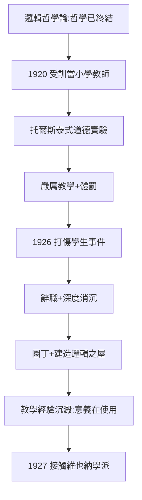
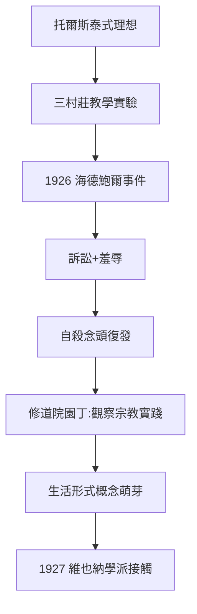

# 3.1 奧地利鄉村小學教師（1920–1926）

1920 年 9 月，世上最著名的邏輯書的作者，走進維也納師範學院的大門，開始接受小學教師培訓。1921–1926 年，他先後在下奧地利的三個窮村莊——特拉滕巴赫、哈斯巴赫、奧特塔爾——教小學生。

## 為什麼一個天才去教貧困村童

表面上，這是《邏輯哲學論》結論的字面執行（2.3：「哲學問題已解決」）。但更深的動機是托爾斯泰式的：

- 戰壕中的托爾斯泰《福音書摘要》（2.2）讓他相信，得救之路在於**成為一個普通而誠實的人**；
- 他想教貧窮的孩子「值得學的東西」：算術、語法、地理、博物學；
- 他把教育視為道德修行，而非職業。

## 三個村莊的三次災難

維根斯坦的教學法極端嚴厲且理想主義：

- 在特拉滕巴赫，他編了一本供學生背誦的《小學生詞典》，這是他生前唯一正式出版的「教育著作」；
- 他堅信直接經驗勝過抽象講授，用遊戲、實物、實驗教數學；
- 但他對「笨」學生的體罰（打耳光、揪頭髮）引發家長暴怒，被稱為「哲學家怒獅」；
- 1926 年 4 月，奧特塔爾：一名 11 歲男生海德鮑爾被打昏，家長告上法庭，維根斯坦辭職，訴訟最終因精神鑑定有利於他而不了了之。

這次羞辱式的失敗是致命打擊：**他試圖用托爾斯泰方式拯救靈魂，卻被村民視為暴力入侵者**。1926 年離開鄉村後，他陷入深度消沉，一度想在修道院當園丁，並在維也納郊外的胡特多夫修道院做了數月園丁助理。

## 教師經歷如何重塑哲學

鄉村教師歲月表面上與哲學無關，實則是《哲學研究》的孵化器：

- 他發現語言的意義不在邏輯結構，而在**具體使用**——村童學詞靠的是指、比劃、練習、糾正，而不是定義；
- 算術教學讓他意識到：數學不是鏡映世界的邏輯，而是一套人類實踐；
- 對「秩序」與「規則」的困惑在這裡生根，最終長成「遵守規則」之論（→ 詳見 4.3）。

## 從廢墟到石匠：維根斯坦之屋

1926–1928 年，失敗的教師轉而為姐姐格蕾特爾設計並監造宅邸。他像做邏輯一樣做建築：門窗比例精確到毫米，吊燈高度、暖氣片位置都親自計算。這座「無裝飾的邏輯」之屋，是《邏輯哲學論》美學的物化——也幫他熬過了心理低谷。

正是在這個低潮期，一次偶然的接觸將改變一切：1927 年，他遇見了維也納學派（→ 詳見 3.2）。

## 事件年表

| 年月 | 事件 | 因果意義 |
|------|------|----------|
| 1920.9 | 入維也納師範學院 | 執行「哲學終結」的生活結論 |
| 1921.9 | 赴特拉滕巴赫任教 | 編寫《小學生詞典》 |
| 1922–1924 | 哈斯巴赫任教 | 教學法日趨極端 |
| 1924–1926 | 奧特塔爾任教 | 體罰衝突累積 |
| 1926.4 | 打傷學生事件，辭職 | 理想主義的公開破產 |
| 1926–1928 | 修道院園丁+建造姐姐宅邸 | 心理重建期 |
| 1927 | 遇見維也納學派 | 重返哲學的引信 |

## 海德鮑爾事件始末

1926 年 4 月的奧特塔爾事件值得完整重建，因為它是維根斯坦「道德理想主義」的破產現場：

- 事件導火線：一名叫海德鮑爾的 11 歲男生在算術課上答不出問題，維根斯坦打了他的頭，孩子當場昏倒；
- 家長早對這位「瘋狂的外鄉教授」積怨已深（此前已有揪頭髮、打耳光的投訴），迅速召集村會並報案；
- 訴訟拖延近兩年，法院委託精神鑑定，結論認定維根斯坦有精神病傾向（今日看是誤判，但當時救了他免於刑責）；
- 案件最終撤訴，但維根斯坦的教師生涯與自我想像同時崩塌。

這次羞辱的心理後果是雙向的：一方面他再度陷入自殺念頭（1.1 的舊病復發），另一方面他徹底放棄「用權威改造他人」的托爾斯泰模式——**這份放棄，正是《哲學研究》反權威式哲學治療的起點**。

## 《小學生詞典》：唯一的正式出版

弔詭的是，這段失敗歲月留下了他生前唯一「官方出版」的著作：為村童編的《小學生詞典》（Wörterbuch für Volks- und Bürgerschulen, 1926）。它有兩重意義：

1. 是他「為貧苦孩子做事」理想的唯一物證；
2. 詞典按「詞的使用情境」組織例句——語言即使用的思想已在此萌芽（→ 詳見 4.1）。

## 園丁歲月與修道院的宗教氣氛

辭職後他在維也納郊外的胡特多夫修道院做園丁助理，並認真考慮入修道院修行。修士們拒收他（認為他不適合），但這段經歷使他對宗教的態度從《邏輯哲學論》的「沉默」轉向具體的「觀察儀式」：他發現宗教語言的意義不在陳述事實，而在**參與生活形式**——這直接通向後期的「生活形式」概念（→ 詳見 4.3）。

## 維根斯坦之屋：用建築做哲學

1926–1928 年為姐姐格蕾特爾建造的宅邸（Kundmanngasse 街）常被稱為「沒有裝飾的邏輯」：

- 每扇門、每個把手、每片天花板的高度都按同一比例系統精確計算；
- 他與建築師保羅·恩格爾曼合作，但他親自接管了幾乎所有細節決策；
- 姐姐赫爾米娜說：這房子是「住起來像身處邏輯裡」。

這座房子是《邏輯哲學論》美學的最後一次物化——也是前期的絕唱，因為 1927 年之後他的思想已開始轉向（→ 詳見 3.2）。

## 事件年表

| 年月 | 事件 | 因果意義 |
|------|------|----------|
| 1921–1922 | 特拉滕巴赫 | 詞典出版，教學激進 |
| 1922–1924 | 哈斯巴赫 | 體罰投訴累積 |
| 1924–1926 | 奧特塔爾 | 衝突白熱化 |
| 1926.4 | 海德鮑爾昏倒事件 | 理想主義破產 |
| 1926–1927 | 修道院園丁 | 宗教生活形式的觀察 |
| 1926–1928 | 建造維根斯坦之屋 | 前期美學的絕唱 |
| 1927 | 接觸維也納學派 | 重返哲學的引信 |

## 交叉引用

- → 詳見本書 4.1：教學經驗在藍皮書中的重生
- → 詳見本書 4.3：生活形式概念的成熟
- → 詳見《圖靈傳記》第 2 章：同一時期圖靈在舍爾伯尼的成長

## 小結

鄉村教師六年是維根斯坦的「荒野試煉」：他以殉道者姿態下鄉，以失敗者身份離開。但正是這次失敗，而非任何書本，教會了他語言的真相——意義不在命題的邏輯形式裡，而在村童學詞、算帳、吵架、祈禱的**生活形式**裡。1926 年的法庭羞辱與心理崩潰，反過來成為他重返哲學的燃料：如果《邏輯哲學論》的教條無法支撐生活，那麼需要修理的不是生活，而是教條。這條線索將在 1929 年之後的《哲學研究》中全面展開（→ 詳見 4.1、4.3）。

與此同時，劍橋那邊的年輕一代已開始行動：一個叫圖靈的學生將在幾年後走進他的課堂（→ 詳見《圖靈傳記》）。
