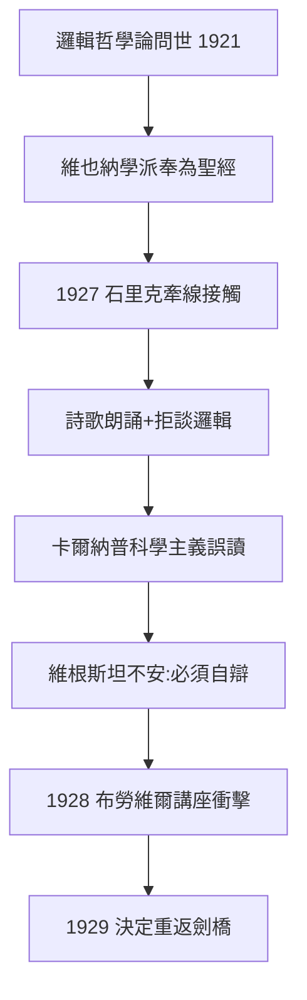
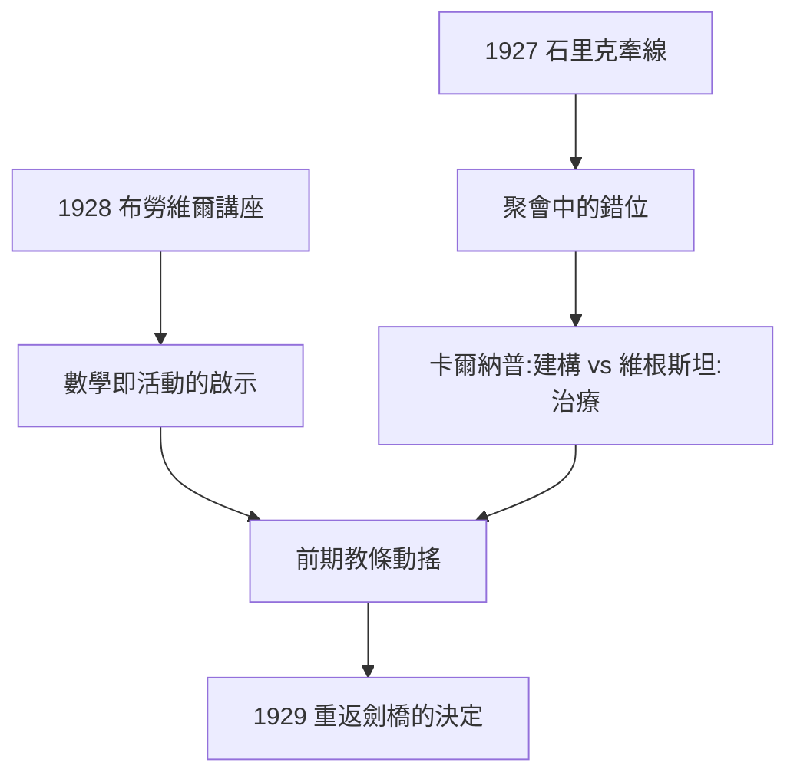

# 3.2 與維也納學派的接觸（1927–1929）

## 一場誤會的開始

1927 年前後，維也納學派（Vienna Circle）正處於 formation 期：石里克（Moritz Schlick）、卡爾納普（Rudolf Carnap）、紐拉特（Otto Neurath）、魏斯曼（Friedrich Waismann）等人以《邏輯哲學論》為聖經，提出「透過邏輯分析澄清科學命題」的綱領（→ 詳見《卡爾納普傳記》）。

石里克透過數學家哈恩夫婦的介紹，成功接觸到隱居的維根斯坦。1927 年起，學派成員定期拜訪維根斯坦（起初在石里克家中聚會）。畫面非常奇特：

- 維根斯坦面對信徒朗誦泰戈爾或印度宗教詩歌，拒絕討論邏輯；
- 他堅持自己是**倫理的**作者，而學派成員看到的是**科學的**先知；
- 卡爾納普回憶：維根斯坦的談話有一種藝術家般的穿透力，但同時極度不容異見。

## 誤讀的結構

這場「師生關係」從一開始就是誤會：

| 學派眼中的維根斯坦 | 維根斯坦眼中的自己 |
|--------------------|--------------------|
| 可說/不可說＝科學/形上學 | 不可說=倫理、美、宗教——最重要的領域 |
| 形上學命題應被清除 | 形上學家不是錯了，而是「沒有說出什麼」 |
| 語言分析的工程師 | 「梯子用完就扔」的神秘主義者 |
| 邏輯哲學論=正方法 | 邏輯哲學論=反方法的示範 |

卡爾納普與維根斯坦的關係尤其緊張：卡爾納普發展的邏輯句法與經驗主義重建，深受《邏輯哲學論》激發，但維根斯坦嫌他「像個記帳員」。這種張力後來延伸為整個分析哲學內部的兩大傳統：**卡爾納普式的建構**與**維根斯坦式的治療**（→ 詳見《卡爾納普傳記》4.x 與 5.3）。

## 指號學討論與《邏輯、語言與世界》

1929–1932 年，魏斯曼奉命整理維根斯坦談話，形成《維根斯坦與維也納學派》一書的素材。這些談話見證了轉型的發生：

- 維根斯坦開始質疑《邏輯哲學論》的核心教條：命題的統一形式並不存在；
- 「意義即使用」的萌芽思想首次出現；
- 他說出那句名言的雛形：「我過去認為語言是照相機，現在我發現它更像工具箱。」

## 決定重返劍橋

1929 年初，維根斯坦做出重返劍橋的決定。驅動力是三重的：

1. **誤讀的不安**：他看到《邏輯哲學論》被學派讀成科學主義教條，必須親自出來「糾正」；
2. **自我的懷疑**：鄉村教師的失敗（3.1）讓他意識到自己仍需要哲學；
3. **劍橋的召喚**：羅素與摩爾保證其博士學位程序上的便利。

## 事件年表

| 年月 | 事件 | 因果意義 |
|------|------|----------|
| 1927 | 石里克牽線，首次接觸 | 被封為「學派聖人」 |
| 1927–1928 | 學派成員定期聽他朗誦詩歌 | 誤讀的深化 |
| 1928 | 魏斯曼開始記錄談話 | 轉型期的文本 |
| 1928 | 布勞維爾講座「數學、科學與語言」 | 直覺主義衝擊，催生新哲學 |
| 1929.1 | 決定重返劍橋 | 從隱士回到戰場 |
| 1929.6 | 以《邏輯哲學論》獲博士學位 | 摩爾與羅素當考官 |

## 石里克的橋樑角色

石里克（Moritz Schlick）是整場接觸的關鍵中介：

- 他透過維也納的哈恩家族（數學家漢斯·哈恩與其妻、維根斯坦的遠親）說項；
- 1927 年首次會面後，石里克成為維根斯坦在學派中唯一信任的人；
- 維根斯坦對石里克的尊敬近乎對長兄——而石里克 1936 年被學生槍殺，對維根斯坦是重大打擊（→ 詳見 4.2）。

石里克的角色說明了一個結構性事實：**維根斯坦需要被理解，但只能被個別的人理解，不能被學派理解**。

## 卡爾納普的記錄：工程師對神秘主義者

卡爾納普（Rudolf Carnap）留下的回憶是研究這段關係最重要的文本。他承認：

- 維根斯坦談話的力量「像藝術的直覺，每一句都像閃電」；
- 但同時指出維根斯坦把哲學當成「個人靈魂的表達」，拒絕任何公共可檢驗的表述方式；
- 卡爾納普自己走向《世界的邏輯構造》（1928）：用最公共、最可重複的方式重建知識（→ 詳見《卡爾納普傳記》）。

這兩條路線的對立可以壓縮為：**卡爾納普要讓哲學成為科學，維根斯坦要讓哲學成為治療**。1929 年之後的英語哲學史，基本上是這兩種衝動的拉鋸史（→ 詳見 5.3）。

## 布勞維爾講座：壓垮前期哲學的一根稻草

1928 年 3 月，荷蘭數學家布勞維爾（L. E. J. Brouwer）在維也納講「數學、科學與語言」。維根斯坦聽了（據說深受震動）：

- 布勞維爾主張數學是一種**活動**（mental activity），不是靜態的邏輯結構；
- 數學語言只是這種活動的報告——這與《邏輯哲學論》的「命題的統一邏輯形式」正面衝突；
- 維根斯坦事後承認：講座讓他看到自己前期對數學實踐的忽視。

這次講座與鄉村教學經驗（3.1）合流，構成 1929 年重返劍橋後「哲學研究」方向的雙重起點。

## 事件年表

| 年月 | 事件 | 因果意義 |
|------|------|----------|
| 1927 | 石里克牽線首次會面 | 「聖人」地位的開始 |
| 1927–1928 | 定期聚會、朗誦詩歌 | 學派與作者的錯位 |
| 1928 | 卡爾納普出版邏輯構造 | 建構路線成型 |
| 1928.3 | 布勞維爾維也納講座 | 數學即活動的衝擊 |
| 1929.1 | 決定重返劍橋 | 誤讀+經驗+召喚三力合流 |
| 1929.6 | 劍橋博士口試 | 學院身分的重建 |

## 交叉引用

- → 詳見《卡爾納普傳記》：邏輯構造與句法計畫
- → 詳見《弗雷格傳記》：學派繼承的另一源頭
- → 詳見本書 3.3：重返劍橋與自我批判的開始
- → 詳見本書 5.3：兩條路線在 AI 時代的再交鋒

## 小結

1927–1929 的維也納學派遭遇，是二十世紀哲學最富反諷的一幕：一本想終結哲學的書，催生了一個以哲學為業的學派；作者想以倫理立身，卻被封為科學主義的先知。這場誤讀直接驅動了維根斯坦的「重返」——他回劍橋不是為了推廣《邏輯哲學論》，而是為了**拆毀它**。維也納學派與維根斯坦的分裂，也預告了分析哲學未來的兩條路：卡爾納普的「重建」路線與維根斯坦的「治療」路線（→ 詳見 5.3）。

下一節：重返劍橋——一場荒誕的博士口試。
