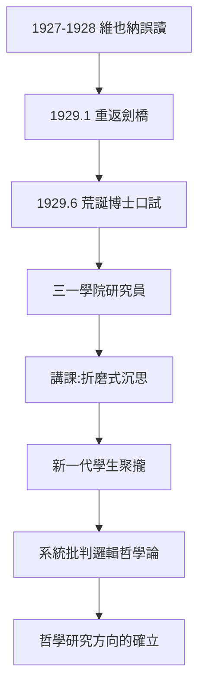
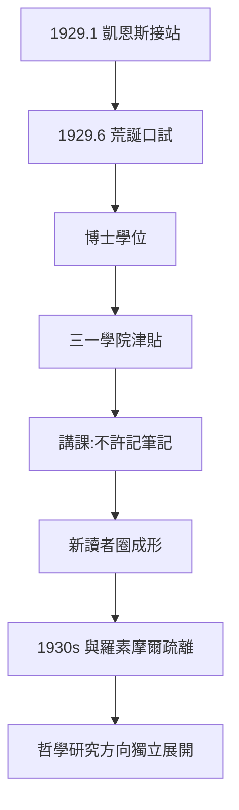

# 3.3 重返劍橋（1929）

## 一場哲學史上最荒誕的口試

1929 年 6 月 18 日，維根斯坦參加劍橋大學的博士口試。荒誕之處在於：

- 提交的論文是七年前出版的《邏輯哲學論》；
- 考官是摩爾與羅素——兩位被他折磨了多年的老友；
- 口試結束時，維根斯坦拍著兩位考官的肩膀說：「別擔心，我知道你們永遠不會理解它。」

摩爾在報告中寫道：「我個人的判斷是，《邏輯哲學論》是一項天才的工作；但是，即使它不是，它也遠遠超出了英國博士學位所要求的標準。」**維根斯坦獲博士學位時年 40 歲。**

## 教員生涯的開始

口試之後，他獲得三一學院的研究員職位（fellowship），開始在劍橋講課。劍橋為此發生了結構性變化：

- 他的講課方式聞名全校：在小房間裡來回踱步、長時間沉默、當眾折磨自己的思路；
- 聽講者（包括後來的學生）不許做筆記，下課時維根斯坦常說：「我不希望你們帶走我說的話，希望你們帶走自己的思考」；
- 一種新的師徒制在劍橋成形：學生不再讀書，而是「跟著維根斯坦思考」——麥克馬金、馬爾康姆、馮·賴特等人後來成為他的思想遺產管理人。

## 《哲學研究》的思想起點：批評舊我

1929–1932 年間，維根斯坦開始系統性地攻擊《邏輯哲學論》，包括：

- **放棄「命題的統一形式」**：承認語言沒有單一邏輯結構；
- **放棄「分析即還原」**：意義不再由基本命題的邏輯分解給出；
- **擁抱「家族相似」**：概念靠重疊的相似性聚合，而非共同本質（→ 詳見 4.3）。

這場「自我否定」的驅動力，正是 3.1 與 3.2 的遺產：鄉村教師讓他看到意義在使用中，維也納學派的誤讀讓他意識到自己的書被當成教條。兩股力量匯成一句話——**他要親手埋葬年輕的自己**。

## 與羅素、摩爾的最後裂痕

重返劍橋後，維根斯坦與羅素的關係迅速冷卻：羅素感到自己成了「被遺忘的先驅」。維根斯坦私下對學生說羅素的工作已過時。與摩爾的關係同樣緊張（1930 年代中期更因聘審問題爆發公開衝突）。老一代退場，新一代（艾耶爾、賴爾、奧斯汀、圖靈……）登場。

## 事件年表

| 年月 | 事件 | 因果意義 |
|------|------|----------|
| 1929.1 | 正式重返劍橋 | 從隱士回到戰場 |
| 1929.6.18 | 博士口試「別擔心」 | 學院制度的黑色幽默 |
| 1929 | 獲三一學院研究員職位 | 哲學新權威的確立 |
| 1929–1932 | 系統批判邏輯哲學論 | 哲學研究的種子 |
| 1930 | 開始講課 | 劍橋新師徒制成形 |
| 1930–1932 | 與羅素摩爾關係冷卻 | 老一代退場 |

## 口試的黑色幽默背後

「別擔心，我知道你們永遠不會理解它」這句口試收場白，其實透露了維根斯坦處境的尷尬：

- 劍橋的學位制度要求「論文」，而他唯一可交的正是那本已被全世界閱讀的書；
- 摩爾與羅素作為考官，面對的是一個地位早已高於自己的「考生」；
- 凱恩斯為促成此事在經濟上與制度上出力頗多——「上帝到了」的火車接站（→ 詳見 1.3）正是他寫給莉迪亞·洛帕科娃的信。

這場口試成為劍橋學院制度的永久傳說：**最高的學位授予了最低的技術難度，卻有最高的思想難度**。

## 三一學院研究員與經濟安排

口試後，羅素與摩爾推動三一學院授予他五年期的研究員津貼（fellowship）。值得注意的是：

- 維根斯坦此時已無財產（1913 年散盡，→ 詳見 2.1）；
- 他對接受劍橋的錢感到羞恥，堅持認為自己「不配」；
- 1930 年代他多次想辭職去做體力勞動，都被凱恩斯等人勸阻。

這種「接受職位但鄙視職位」的張力，將持續到 1947 年辭職（→ 詳見 5.1）。

## 蘇格蘭哲學家坎貝爾與「新聽眾」

1929 年後聚集在他身邊的第一批學生構成了《哲學研究》的第一讀者圈：

- 德斯蒙德·李（Desmond Lee）：記錄 1930–1932 年講課筆記；
- 萊特（G. H. von Wright）：日後的執行人之一（→ 詳見 5.2）；
- 麥克馬金、里斯：後期的忠實記錄者。

維根斯坦的講課規則（不許記筆記、下課不留話）使這些人的筆記成為違禁品式的珍本——正是這些筆記後來構成了《哲學講演 1930–1932》等出版物。

## 事件年表

| 年月 | 事件 | 因果意義 |
|------|------|----------|
| 1929.1.18 | 抵達劍橋，凱恩斯接站 | 「上帝到了」 |
| 1929.6.18 | 博士口試 | 「你們永遠不會理解它」 |
| 1929.6 | 獲博士學位 | 學院身分重建 |
| 1929–1930 | 三一學院研究員津貼 | 經濟依賴與羞恥的張力 |
| 1930 | 第一批講課筆記成形 | 新讀者圈確立 |
| 1932 | 與羅素關係實質破裂 | 兩代哲學分道 |

## 交叉引用

- → 詳見《羅素傳記》4.1：羅素此期轉向教育與社會活動
- → 詳見《羅素傳記》3.3：訪華歸來後的羅素
- → 詳見本書 4.1：藍皮書與棕皮書的誕生
- → 詳見本書 5.2：這些學生日後如何整理遺稿

## 小結

1929 年的重返，表面上是一次職業復出，實質是一場「二次出發」：他以《邏輯哲學論》換來博士學位，卻立刻開始拆毀這本書。維根斯坦生涯的獨特性在於：他是哲學史上極少數**以否定自己前期為後期工作**的哲學家。這次轉向的燃料全部來自前兩節——鄉村教學的經驗（3.1）與維也納學派的誤讀（3.2）。

第 4 章將追蹤這場轉向的技術展開：藍皮書、棕皮書、與圖靈的課堂對峙，以及「語言遊戲」的誕生。
