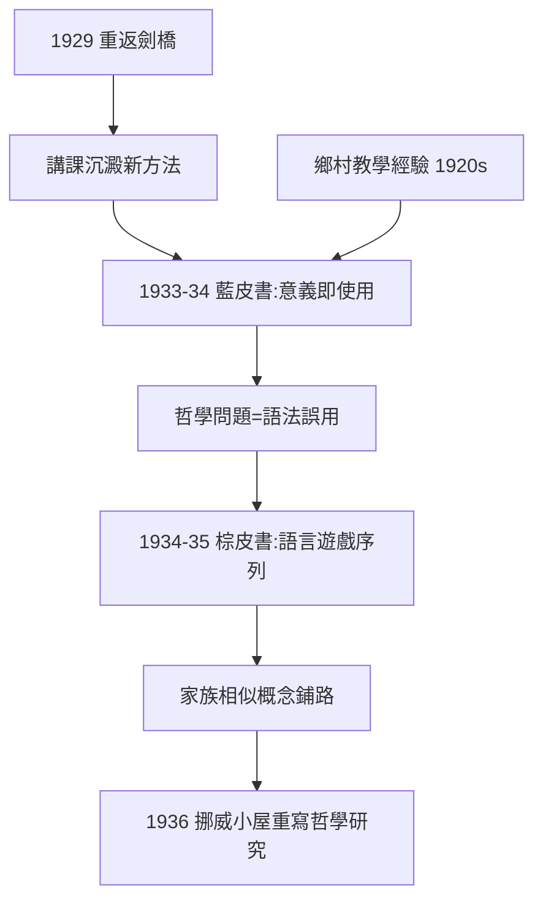
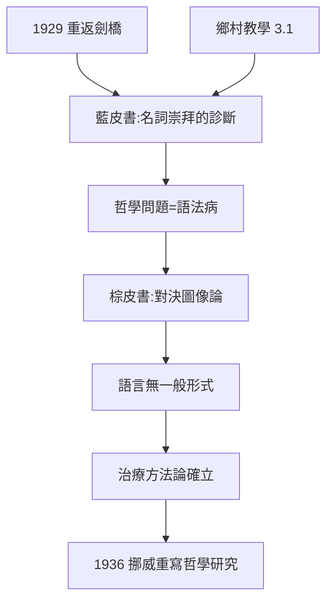

# 4.1 藍皮書與棕皮書（1933–1935）

## 從講課筆記到「新哲學」的宣言

重返劍橋後（→ 詳見 3.3），維根斯坦的講課逐漸沉澱為一套全新方法。兩部打字機謄寫的「教科書式」筆記成為中期轉型的見證：

- **藍皮書（1933–1934）**：他口述給五個學生的英文講義，正式標題《給講演用的初步研究》；
- **棕皮書（1934–1935）**：他口述給更小圈子的英文筆記，以系統化的「語言遊戲」序列展開哲學方法。

這兩本油印冊子在他生前未出版，卻以手抄本形式在劍橋與牛津流傳，成為後期哲學的「地下聖經」。它們首次系統性地使用了後來《哲學研究》的核心概念：語言遊戲、意義即使用、家族相似、治療式哲學。

## 藍皮書的三大打擊

藍皮書開篇就宣戰——它針對的是哲學家的一種根深蒂固的誘惑：**把名詞都當成指稱某個實體的標籤**。三大打擊如下：

1. **意義不在指稱**：不要問「紅」這個詞指什麼，要看它在句子、命令、遊戲中**如何被使用**；
2. **哲學問題=語法誤用**：困惑不是因為世界難解，而是因為我們被語言的表面形式誤導；
3. **治療而非理論**：哲學的目標不是建立學說，而是「給捕捉蒼蠅的瓶子打開蓋子」。

## 棕皮書的語言遊戲序列

棕皮書更進一步：它設計了一系列虛構的「語言遊戲」，從「建築工 A 遞磚、B 遞石」的原始命令語言開始，逐步複雜化。這些遊戲的功能是：

- 讓讀者**親眼看到**語言的多樣性（命令、祈使、報告、計算、祈禱……）；
- 與《邏輯哲學論》的「單一邏輯形式」對照，暴露後者的貧乏；
- 為《哲學研究》的「家族相似」概念鋪路。

## 心理驅動：為什麼要拆毀自己

維根斯坦此期的心理狀態依然緊繃：

- 1935 年他一度考慮移民蘇聯，甚至親赴莫斯科考察，最終放棄；
- 1936 年他回到挪威小屋，開始以德文重寫新哲學（即《哲學研究》的初稿）；
- 他對學生說：「哲學是對語言的治療」，而這治療首先針對**他自己**——《邏輯哲學論》是他的病，藍皮書與棕皮書是藥。

## 事件年表

| 年月 | 事件 | 因果意義 |
|------|------|----------|
| 1933–1934 | 口述藍皮書 | 「意義即使用」首次系統化 |
| 1934–1935 | 口述棕皮書 | 語言遊戲序列成形 |
| 1935 | 赴蘇聯考察後放棄移民 | 內心的極端主義仍在 |
| 1936 | 返回挪威小屋 | 開始重寫《哲學研究》 |
| 1937 | 攜手稿重返劍橋 | 後期哲學的主文本啟動 |

## 「哲學問題=語法病」的病例清單

藍皮書逐個診斷哲學的「語法病」，典型病例包括：

- **名詞崇拜**：「時間是什麼？」「數是什麼？」——以為每個名詞都對應一個實體；
- **心靈實體化**：「理解發生在大腦某處」——把過程動詞誤當成內心物件；
- **私人語言誘惑**：「痛只有我知道」——把第一人稱表達誤當成描述（此論證在《哲學研究》中完全展開，→ 詳見 4.3、5.3）。

每個病例的治法相同：**展示該詞在各種語言遊戲中的實際用法**，讓困惑「像結石一樣溶解」。

## 棕皮書與《邏輯哲學論》的正面對決

棕皮書中段有一場與前期自我的正面對決：它逐節檢驗《邏輯哲學論》的圖像論，指出命題「描畫事實」的模型只在「報告式」語言遊戲中成立；命令、許諾、祈禱、笑話都不「描畫」什麼。這場對決的技術結論是：

- 語言沒有「一般形式」；
- 「本質」是語法的投影，不是世界的結構；
- 哲學家的「理論化衝動」本身就是病。

## 「治療」概念的醫學隱喻

維根斯坦此期使用醫學隱喻談哲學，與他 1939 年後在醫院工作（→ 詳見 4.2）互相印證：

| 醫學 | 哲學 |
|------|------|
| 病症 | 哲學困惑 |
| 病因 | 語法誤用、語言的「空轉」 |
| 診斷 | 語法考察、例子展示 |
| 治癒 | 困惑消失，而非新理論問世 |
| 復發 | 哲學問題永遠會被重新觸發 |

「哲學是治療」因此不是修辭，而是方法論承諾：哲學不生產知識，只恢復語言的健康。

## 心理驅動：1935 年的蘇聯幻想

此期他的極端心理狀態還表現在 1935 年的蘇聯計畫：

- 他認真考察了莫斯科與喀山，想放棄劍橋去蘇聯做體力勞動；
- 史達林時代的現實最終令他放棄；
- 這次幻想與 1914 年參軍（2.2）、1920 年下鄉（3.1）同構：**每當學術生活令他不安，他就尋求「肉身化」的道德勞動**。

## 事件年表

| 年月 | 事件 | 因果意義 |
|------|------|----------|
| 1933–1934 | 口述藍皮書 | 語法病診斷學成形 |
| 1934–1935 | 口述棕皮書 | 語言遊戲序列完成 |
| 1935 | 蘇聯考察 | 極端道德衝動的又一次爆發 |
| 1936 | 返回挪威小屋 | 德文重寫哲學研究 |
| 1937 | 攜手稿返劍橋 | 主文本進入持續修改 |

## 交叉引用

- → 詳見本書 3.1：藍棕皮書的經驗源頭
- → 詳見本書 4.2：1936 年後的劍橋教授生活
- → 詳見本書 5.3：治療方法在 AI 哲學中的武器化
- → 詳見《卡爾納普傳記》：建構路線的對照

## 小結

藍皮書與棕皮書是《哲學研究》的雛形與基因庫：前者確立「治療」取向，後者發明「語言遊戲」這一方法武器。值得注意的是，這場轉向的原材料來自 1920 年代的鄉村課堂（→ 詳見 3.1）——村童學詞的畫面在棕皮書的「建築工遊戲」中重現。維根斯坦用六年小學教師生涯換來的洞察，最終以劍橋油印冊子的形式重生，並在十年後成為二十世紀後期哲學的主流文本（→ 詳見 5.2）。

同時，劍橋的新聽眾正在到來：一位叫圖靈的年輕人將在 1939 年坐在他的課堂裡，提出挑戰（→ 詳見 4.2 與《圖靈傳記》）。
