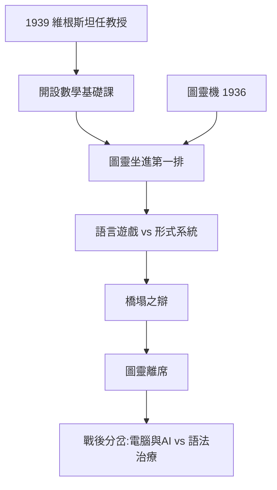
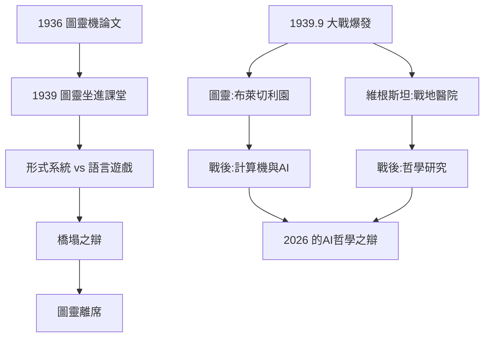

# 4.2 劍橋教授與圖靈聽課（1936–1939）

## 教授講座與道德科學俱樂部的衝突

1930 年代後期的劍橋，維根斯坦已是精神領袖。他 1936 年重返劍橋（此前在挪威小屋寫作），1937 年起擔任道德科學俱樂部核心，以極端方式主持討論：

- 他會在講課中當眾說「這裡全是廢話」，包括對自己；
- 他要求聽課者不許引用他的話，只許自己思考；
- 他與摩爾在評審事宜上公開衝突，一度憤而離場。

## 1939：接任教授講座

1939 年 2 月，維根斯坦正式獲聘為劍橋大學摩爾講座教授（Knightbridge Professor of Moral Philosophy），接替摩爾。他的就任演講以「哲學是對語法困惑的治療」為綱。

## 圖靈聽課：數學基礎的正面交鋒

1939 年，年僅 26 歲的圖靈（Alan Turing，1912–1954）坐在了維根斯坦「數學基礎」課堂的第一排（→ 詳見《圖靈傳記》第 2、3 章——圖靈 1936 年的圖靈機論文與 1938 年普林斯頓博士學位使他成為形式主義權威）。

兩人形成了哲學史上最尖銳的師生對立：

- **維根斯坦**：數學是一套人類實踐（語言遊戲），矛盾出現了就「圍起來」繞道走，不必恐慌；
- **圖靈**：矛盾是實質災難，形式系統的可靠性必須被認真對待——他的圖靈機工作正是為了對抗希爾伯特式的矛盾風險。

圖靈的著名反駁：如果橋樑工程計算中出現矛盾，橋會塌。維根斯坦的回答成為名句：「橋樑工程中會出現矛盾嗎？如果出現了，橋會塌嗎？」——他堅持**邏輯矛盾不會自動導致實踐災難**，災難只在工程本身的錯誤中出現。

圖靈聽了幾堂課後不再來了。但兩人互相記住了對方：維根斯坦後來對學生說圖靈「有個好腦子」；圖靈在自傳性自述中仍稱這門課「有趣」。

## 為什麼這場交鋒重要

這場 1939 年的課堂辯論，預演了二十世紀後半葉一場更大的分裂：

- **維根斯坦路線**：意義與規則內嵌於生活形式，形式系統不是數學的全部；
- **圖靈-邱奇路線**：計算、形式化、可判定性——最終導向電腦與 AI。

當圖靈戰後走向機器智能（→ 詳見《圖靈傳記》第 4 章「模仿遊戲」），維根斯坦則質疑「機器能否思考」這個問題本身的語法混亂（→ 詳見 5.3）。兩人 1939 年的分歧，是 AI 哲學爭論的史前史。

## 事件年表

| 年月 | 事件 | 因果意義 |
|------|------|----------|
| 1936–1937 | 挪威小屋重寫《哲學研究》 | 後期哲學主文本成形 |
| 1937 | 重返劍橋講課 | 新一代學生聚攏 |
| 1939.2 | 獲任摩爾講座教授 | 劍橋哲學最高權威 |
| 1939 | 圖靈選修其「數學基礎」課 | 兩大天才的課堂對峙 |
| 1939 | 「橋塌了嗎」之辯 | 形式主義 vs 語法治療 |
| 1939 | 圖靈離席，二人各自走向戰時工作 | 分岔點 |

## 圖靈是誰：1939 年的聽課者

要理解這場對峙，先看 1939 年圖靈的位置：

- 1936 年發表《論可計算數》，提出圖靈機與判定問題的否定解（→ 詳見《圖靈傳記》第 2 章）；
- 1936–1938 年在普林斯頓師從邱奇獲博士學位，與馮·諾伊曼共事；
- 1938 年返劍橋，尚未進入布萊切利園（1939 年 9 月大戰爆發後加入）；
- 他選修維根斯坦「數學基礎」課，是有形式系統實戰經驗的年輕權威。

也就是說：課堂上坐著的是**形式化計算的發明者**，講台上站著的是**形式化的哲學懷疑者**。

## 課堂辯論的完整邏輯

兩人的分歧可以精確重建為四個層次：

| 議題 | 圖靈立場 | 維根斯坦立場 |
|------|----------|--------------|
| 矛盾的地位 | 系統出矛盾即失敗 | 矛盾只在語法上麻煩，不必然實用災難 |
| 規則的根據 | 形式規則自足 | 規則靠實踐中的應用傳承 |
| 數學的本性 | 可證明性的形式系統 | 人類計算活動的語言遊戲 |
| 哲學任務 | 為計算建立堅實基礎 | 消除對「基礎」的形上學渴求 |

「橋塌之辯」是第四層次的縮影：圖靈說「如果工程計算藏著矛盾，橋會塌」，維根斯坦反駁「橋塌是因為物理錯誤，不是因為邏輯矛盾——你從沒見過因矛盾而塌的橋」。圖靈的工程直覺無法接受這種「把矛盾除罪化」的立場，遂不再出席。

## 辯論的歷史後果

這場未完成的辯論預言了二十世紀後半葉的兩大潮流：

- **圖靈線**：戰後通用計算機、1950 年模仿遊戲、AI 誕生（→ 詳見《圖靈傳記》第 3、4 章）；
- **維根斯坦線**：《哲學研究》1953 年出版、Dreyfus 對 AI 的批判、塞爾的中文房間（→ 詳見 5.3）。
- 2026 年的 LLM 之辯（模型「是否理解」）依然是 1939 年課堂的延長賽。

## 戰火中的分流（1939 年 9 月之後）

大戰爆發後兩人各自投入戰爭：

- 圖靈：布萊切利園，破解 Enigma（→ 詳見《圖靈傳記》第 3 章）；
- 維根斯坦：蓋伊醫院與紐卡斯爾的醫學實驗室（→ 詳見 4.3）；
- 石里克 1936 年被槍殺的舊聞仍在發酵，維也納學派已成歷史（→ 詳見 3.2）。

## 事件年表

| 年月 | 事件 | 因果意義 |
|------|------|----------|
| 1936 | 圖靈機論文發表 | 形式化計算誕生 |
| 1937 | 維根斯坦返劍橋講課 | 兩人同校 |
| 1939.2 | 維根斯坦就任講座教授 | 課堂對峙的制度前提 |
| 1939 | 圖靈選修數學基礎課 | 形式 vs 治療的正交鋒 |
| 1939 | 「橋塌之辯」 | 圖靈離席 |
| 1939.9 | 二戰爆發，雙雙投入戰爭 | 兩條路線的戰時分流 |

## 交叉引用

- → 詳見《圖靈傳記》第 2、3、4 章：圖靈機、布萊切利園、模仿遊戲
- → 詳見《羅素傳記》5.1：戰後核時代的哲學反應
- → 詳見本書 4.3：戰時醫院與哲學研究的完成
- → 詳見本書 5.3：1939 年分歧在 AI 時代的重演

## 小結

1939 年的維根斯坦到達了權力的頂點（講座教授）與思想的轉折點（後期哲學成熟）。他與圖靈的課堂辯論是兩條路線的正式分岔：一條通向計算機科學與 AI，一條通向語言治療與反本質主義。圖靈離開課堂去造解密炸彈機與通用計算機，維根斯坦則留在原地追問「計算」這個概念在語言遊戲中的位置。這場未完成的辯論，將在 5.3（AI 哲學的影響）中重新接上。

大戰再次打斷了劍橋：這次兩人都投入了戰爭——圖靈進布萊切利園，維根斯坦去蓋伊醫院當運送員（→ 詳見 4.3）。
