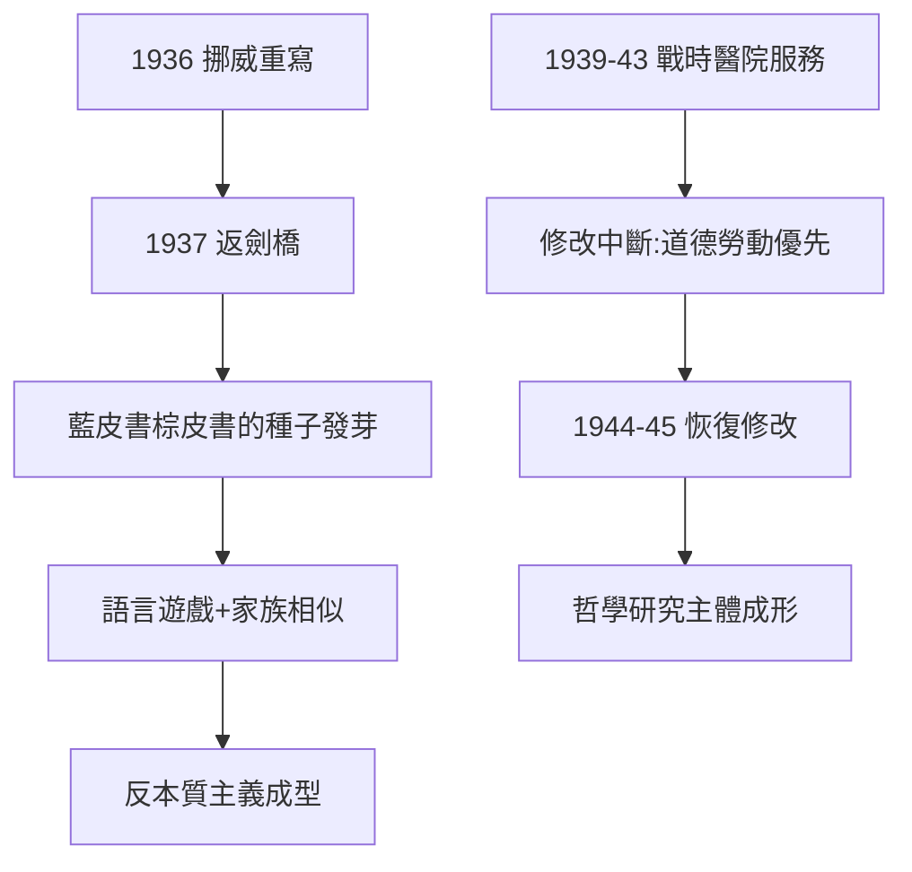
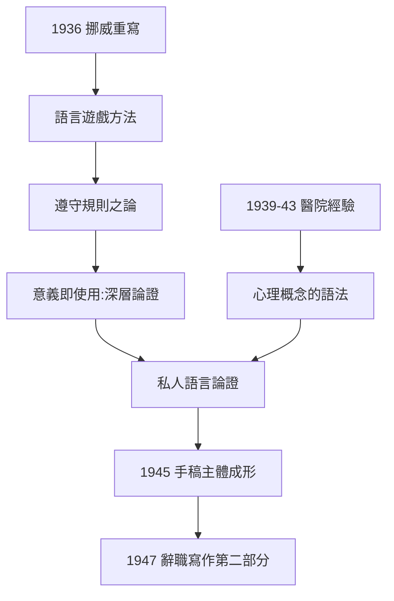

# 4.3 語言遊戲與反本質主義（1936–1945）

## 從挪威到劍橋：主文本的寫作

1936 年，維根斯坦回到挪威小屋，用德文重寫新哲學。1937 年攜手稿返劍橋，此後在教授任職與戰時服務之間持續修改——這部斷續修改至 1949 年的手稿，就是《哲學研究》。

## 戰時的另一種戰爭：蓋伊醫院（1939–1943）

二戰爆發後，維根斯坦拒絕繼續做純哲學講座，執意做「有用的戰爭工作」：

- 1939–1943：先在蓋伊醫院做運送員與藥房助手，後在紐卡斯爾皇家維多利亞醫院醫學研究實驗室任實驗助理；
- 他研究傷口休克、脈搏監測，其認真程度如同做邏輯；
- 戰時他反覆想放棄教授職位（多次提出辭職，被校方勸回）。

這段經歷延續了他一貫的模式：**每當哲學與道德衝突，他選擇以肉身投入勞動**（一戰參軍、鄉村教學、戰時醫院）。這也再次延遲了《哲學研究》的完成。

## 語言遊戲：核心學說

《哲學研究》前半部分的骨架是「語言遊戲」概念：

1. **意義即使用**：「一個詞的意義是它在語言中的用法」；
2. **語言遊戲的多樣性**：命令、提問、講故事、開玩笑、祈禱……語言是無數種活動，不是單一的描述系統；
3. **家族相似**：概念（如「遊戲」「數」「語言」）沒有共同本質，只有重疊交叉的相似性；
4. **生活形式**：語言遊戲植根於人類的共同行為——「想像一種語言就是想像一種生活形式」；
5. **遵守規則之論**：規則的意義不在於內心解釋，而在於社群實踐中的一致應用——「遵守規則是一種實踐」。

## 反本質主義：對《邏輯哲學論》的總清算

前期與後期的對照一目瞭然：

| | 邏輯哲學論（1921） | 哲學研究（1953） |
|---|---|---|
| 語言 | 單一邏輯結構 | 無數種語言遊戲 |
| 意義 | 命題的圖像 | 詞的使用 |
| 概念 | 有確定邏輯形式 | 家族相似，無本質 |
| 哲學任務 | 劃界後自我取消 | 持續的語法治療 |
| 理想 | 精確的形式語言 | 承認日常語言本自完整 |

《哲學研究》的序言裡，維根斯坦親自承認：這本書與《邏輯哲學論》的觀點「不得不發生尖銳的矛盾」，並感謝當年催生舊書的同一些力量（1.1 的道德緊張）如今催生了新書。

## 事件年表

| 年月 | 事件 | 因果意義 |
|------|------|----------|
| 1936 | 挪威小屋重寫 | 後期哲學主文本啟動 |
| 1937 | 攜手稿返劍橋 | 持續修改開始 |
| 1939–1943 | 戰時醫院與實驗室服務 | 哲學讓位於道德勞動 |
| 1944–1945 | 戰後恢復修改 | 主體部分成形 |
| 1945 | 道德科學俱樂部朗讀手稿 | 對學生的最終定調 |
| 1947 | 辭去教授，赴愛爾蘭專注寫作 | 謝幕前的最後衝刺 |

## 遵守規則之論：後期哲學的深水區

《哲學研究》最難也最深的部分是「遵守規則」論證（第 185–242 段）：

- 設想一個學生按「+2」規則寫數列：2, 4, 6…到 1000 時他寫 1004, 1008——他自稱也「遵守規則」；
- 任何有限的教學都無法在邏輯上排除這種「另類應用」；
- 結論：規則的意義不在於某種內心的把握或抽象的對象，而在於**社群中的一致訓練與實踐**——「遵守規則是一種實踐。相信自己在遵守規則不是遵守規則。」

這個論證同時完成了兩件事：

1. 為「意義即使用」提供了最深的支持；
2. 為後來的社會科學、法學（哈特《法律的概念》）、以及 AI 的「機器能否遵守規則」之辯（→ 詳見 5.3）提供了母題。

## 私人語言論證

第 243 段起提出「私人語言」的不可能：

- 一種原則上只有說話者能理解的語言（例如「用 S 標記我今日的私人感覺」）；
- 若感覺詞的標準只能是私人記憶，則「正確使用」的標準消失；
- 結論：內心表達的意義依賴公共標準——痛的語言遊戲嵌在生活形式中。

這個論證日後成為 AI 意識辯論的標準彈藥：機器的「內心報告」是否可有任何公共標準？（→ 詳見 5.3）

## 戰時醫院：道德勞動的第三樂章

1939–1943 年的醫院工作有具體成果：他在倫敦蓋伊醫院與紐卡斯爾的 Grantham 醫學研究小組協助研究創傷性休克，設計改良的脈搏記錄儀。這段經歷的意義：

- 他把「哲學的謙卑」付諸身體：天才也可以做最底層的助手；
- 醫學觀察加深了對「心理概念」的興趣——《哲學研究》第二部分對希望、疼痛、意圖的分析，與醫院經驗直接相關；
- 戰時的極端情境再次證明他一貫的模式（1914 參軍、1920 下鄉、1939 醫院）：**當世界崩潰，哲學家首先是一個人**。

## 前後期對照的深層連續性

雖然立場對立，前後期有一個不變的深層動機——**對「誠實性」的執著**：

- 前期：不誠實的形上學命題必須被沉默封鎖；
- 後期：不誠實的語法混亂必須被治療化解；
- 驅動力都是 1.1 的魏寧格命令：絕不容忍自我欺騙。

## 事件年表

| 年月 | 事件 | 因果意義 |
|------|------|----------|
| 1936–1937 | 挪威重寫 | 主文本啟動 |
| 1937–1939 | 劍橋講授修改稿 | 遵守規則之論成形 |
| 1939–1943 | 戰時醫院服務 | 心理概念觀察的素材 |
| 1944–1945 | 戰後恢復修改 | 私人語言論證定稿 |
| 1945 | 俱樂部朗讀手稿 | 對學生的最終定調 |
| 1947 | 辭職赴愛爾蘭 | 最後衝刺（→ 詳見 5.1） |

## 交叉引用

- → 詳見《圖靈傳記》第 4 章：1939 年課堂分歧的源頭
- → 詳見《卡爾納普傳記》：本質主義與建構主義的對照
- → 詳見《羅素傳記》4.3：羅素《西方哲學史》對維根斯坦的描述
- → 詳見本書 5.2：手稿的出版命運

## 小結

1936–1945 年，維根斯坦完成了哲學史上罕見的自我革命：用「語言遊戲」與「家族相似」拆毀了自己二十年前豎起的邏輯大廈。這場反本質主義轉向的思想原料，來自鄉村課堂（3.1）、維也納學派的誤讀（3.2）與藍棕皮書的實驗（4.1）。戰時醫院服務再次證明：對維根斯坦而言，**如何活著比寫什麼更重要**——這正是《哲學研究》「生活形式」概念的來源。

下一章：辭職、愛爾蘭、與《哲學研究》的出版。
