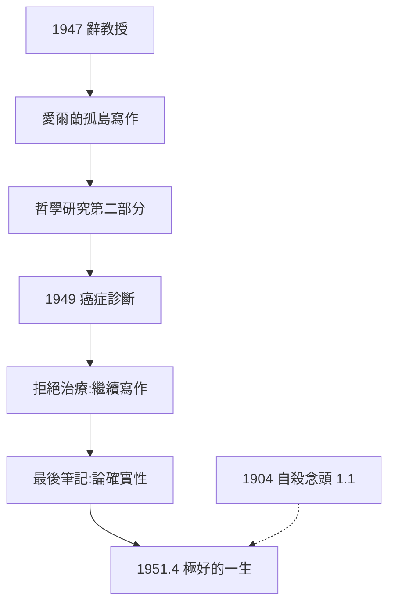
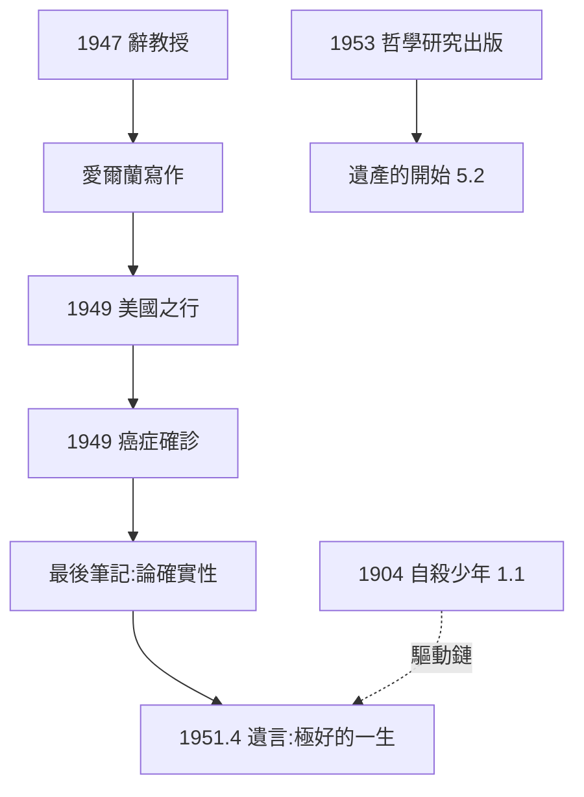

# 5.1 辭職與最後歲月（1947–1951）

## 辭去教授講座（1947）

1947 年底，維根斯坦做出決定：辭去劍橋摩爾講座教授職務。理由一如既往地非職業化：

- 他自認「腦子已經不像樣子」，不能再教書；
- 他需要絕對孤獨來完成《哲學研究》；
- 他鄙視已過二十年的學術生涯制度——他說自己從未「享受」過當教授。

辭職後的漂泊路線本身就是他的自畫像：**1947–1948 愛爾蘭（威克洛郡海邊農舍與羅斯旅館）→ 1948–1949 美國（康乃爾、史丹佛短期訪問）→ 1949 英國（與學生馬爾康姆赴美國探親）→ 1949–1950 返英**。

## 愛爾蘭：最後的寫作衝刺

在愛爾蘭的偏僻農舍，維根斯坦以驚人強度修改《哲學研究》第二部分（論心理概念：希望、意圖、理解、體驗）。此時他已意識到這本書可能寫不完——他在 1945 年序言草稿中說：這本書的價值在於它展示了哲學「能寫得多麼少」。

## 診斷癌症與最後的定調（1949）

1949 年，醫生診斷出前列腺癌已擴散。維根斯坦的反應冷靜得驚人：「祝我康復吧，我要回去工作。」他拒絕大多數治療，繼續寫作與談話。

1949–1951 年的最後思考（即《論確實性》的素材）轉向知識論：

- 我們的懷疑本身預設了某種未被懷疑的基礎（「軸承」命題）；
- 「懷疑遊戲」本身預設了確定性——「我的生活就在於我確信某些事」。

這是他對笛卡爾式懷疑傳統的最後一擊，也再次動用了「生活形式」的框架。

## 死亡：最後的日子（1951）

1951 年 4 月，他搬到劍橋馬爾康姆醫生家中由醫生照顧。4 月 27 日，他確知自己只剩幾天，對身邊的貝文太太說出了最後的話：

> **「告訴他們，我度過了極好的一生。」**（Tell them I've had a wonderful life.）

4 月 29 日，他在劍橋的聖吉爾斯教堂接受天主教葬禮——儘管他生前自認既非信徒也非天主教徒。墓碑上刻著希臘文，出自安提戈涅：「無人能否認他的靈魂未嘗遠行。」一個從 1904 年就想自殺的人（1.1），最終以「極好的一生」作結——這是全傳記最長的一條因果鏈的終點。

## 事件年表

| 年月 | 事件 | 因果意義 |
|------|------|----------|
| 1947.12 | 辭去摩爾講座教授 | 拒絕學術制度，追尋孤獨 |
| 1947–1948 | 愛爾蘭海邊農舍 | 哲學研究最後衝刺 |
| 1948–1949 | 訪問美國 | 與馬爾康姆重聚 |
| 1949 | 診斷癌症擴散 | 「祝我康復，我要工作」 |
| 1949–1951 | 最後筆記（論確實性） | 知識論新方向 |
| 1951.4.27 | 「我度過了極好的一生」 | 生命因果鏈的終點 |
| 1951.4.29 | 去世，天主教葬禮 | 劍橋送別 |

## 愛爾蘭的寫作條件

威克洛郡的居住細節顯示他對「寫作環境」的極端要求：

- 先住紅十字農舍，後遷入都柏林南郊羅斯旅館（Red Cross Inn / Farmleigh 附近的客棧）；
- 每天在旅館餐廳一角踱步沉思，被店員視為古怪的英國紳士；
- 1948 年赴美訪問期間還在康乃爾主持了著名的「哲學方法」討論會——馬爾康姆與馬爾科姆的學生輩成為美國維根斯坦傳播的火種。

## 《論確實性》的誕生

1949–1951 年的「最後筆記」由三個契機觸發：

- 馬爾康姆 1949 年造訪劍橋，談到摩爾的「常識論證」；
- 維根斯坦批評摩爾「把『我知道』當成知識論的魔法詞」，但同時認為摩爾觸到了真問題；
- 臨終前的數月在醫生家中持續書寫，留下 676 條短札（遺作《論確實性》）。

核心洞見：「懷疑」這個遊戲本身預設了不被懷疑的軸承——「我的生活就在於我確信某些事」。這是「生活形式」概念在知識論上的最後一擊，也再次反駁了笛卡爾式的懷疑傳統。

## 「極好的一生」的完整因果鏈

1951 年 4 月 27 日的遺言「告訴他們，我度過了極好的一生」，只有放在全傳記的驅動鏈上才能讀懂：

1. 1904–1908：自殺念頭的少年（1.1）；
2. 1913–1918：以戰爭與邏輯自救（2.1–2.2）；
3. 1920–1926：鄉村教學的失敗（3.1）；
4. 1929–1947：拆毀自己重建哲學（4.1–4.3）；
5. 1951：坦然接受死亡，宣告一生為「極好」。

魏寧格的「天才或死」命令（1.1）以死亡面前的和解告終——**他沒有達成魏寧格式的完美，但他達成了比完美更難的東西：與自己的和解**。

## 葬禮的細節

1951 年 4 月 29 日的葬禮在劍橋聖吉爾斯教堂舉行，由天主教儀式主持（遵從他信奉天主教的遺願表示）。伊麗莎白·安斯康姆（虔誠天主教徒）與康拉德（醫生）促成了儀式。墓誌銘用希臘文，取自索福克勒斯《安提戈涅》合唱歌：「ἀδήλητα δ' οὔτ' ἐπὶ γᾶς οὔτ' ὑπὸ γᾶς ἦλθε βροτοῖς」——「他的靈魂之力無論在地上地下，都不為凡人所度量。」

## 事件年表

| 年月 | 事件 | 因果意義 |
|------|------|----------|
| 1947.12 | 辭去講座教授 | 拒絕制度的開始 |
| 1947–1948 | 愛爾蘭農舍寫作 | 第二部分衝刺 |
| 1948–1949 | 美國之行 | 康乃爾討論會 |
| 1949.11 | 確診癌症擴散 | 「祝我康復，我要工作」 |
| 1949–1951 | 論確實性筆記 | 知識論的最後一擊 |
| 1951.4.27 | 「極好的一生」遺言 | 驅動鏈的終點 |
| 1951.4.29 | 葬禮與墓誌銘 | 天主教儀式的和解 |

## 交叉引用

- → 詳見《羅素傳記》5.3：同年羅素獲諾貝爾獎的對照
- → 詳見《圖靈傳記》第 5 章：1950–1954 年圖靈的最後歲月
- → 詳見本書 5.2：遺稿如何變成《哲學研究》

## 小結

1947–1951 是維根斯坦的「清账期」：辭職是對制度的告別，愛爾蘭是對孤獨的忠誠，最後筆記是對知識論的再進攻，「極好的一生」是對 1904 年那個想死的少年的最終回答。他死後兩年，《哲學研究》出版（→ 詳見 5.2），徹底改變了分析哲學與 AI 哲學的走向（→ 詳見 5.3）。

與羅素的長壽喧囂（→ 詳見《羅素傳記》5.3）相比，維根斯坦的謝幕短促而安靜——但他的遺產剛剛開始發酵。
