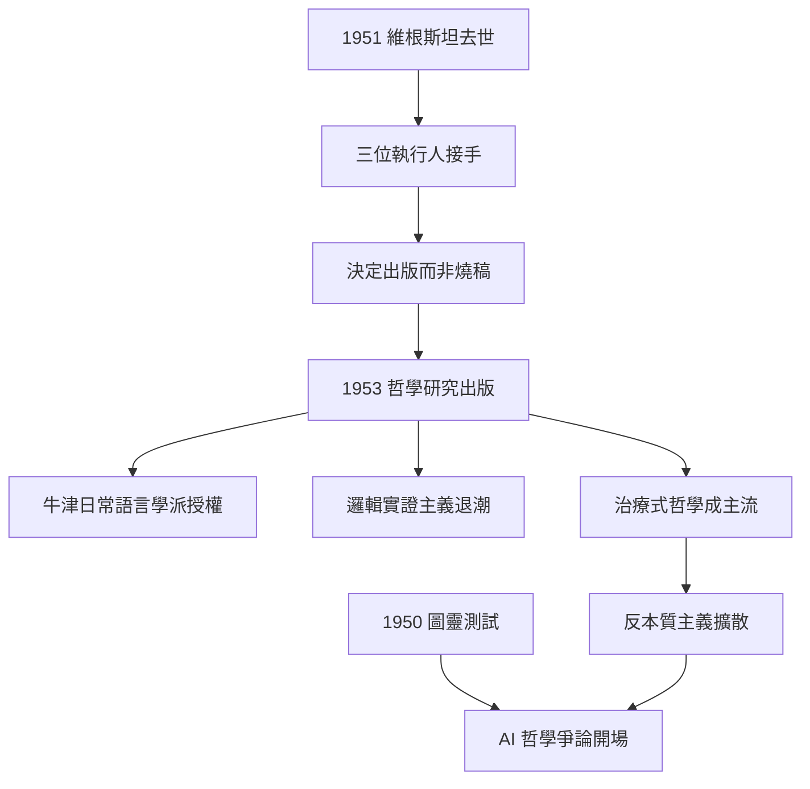
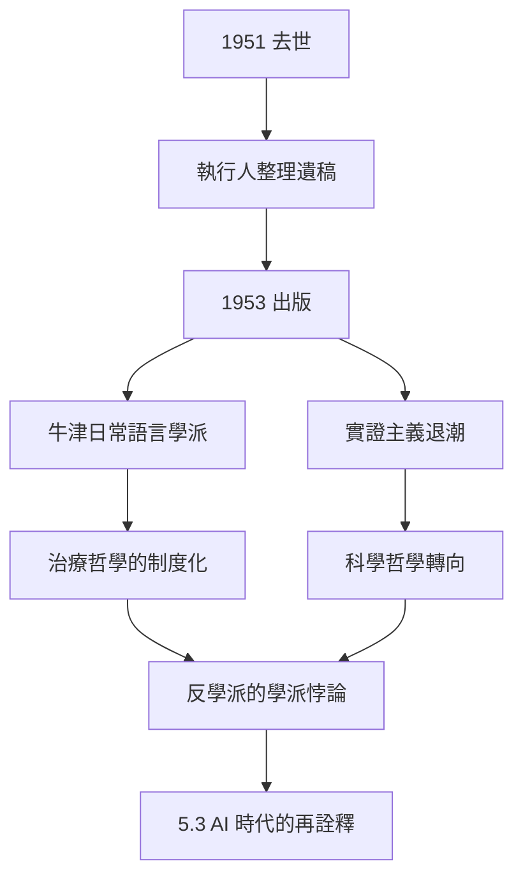

# 5.2 《哲學研究》出版（1953）

## 遺作的誕生

維根斯坦 1951 年去世時，《哲學研究》尚未定稿。他臨終前的安排是：如果原稿不夠好，就燒掉；如果出版，也必須與更舊的手稿（一般被認為是《邏輯哲學論》風格的殘篇）合訂，以示「新舊對照」。

三位學生擔任遺稿執行人，最終促成 1953 年出版：

- **G. E. 摩爾**（名義上的決策者）；
- **G. H. 馮·賴特**（組織出版）；
- **伊麗莎白·安斯康姆**（Elizabeth Anscombe，英譯者，也是詮釋權威）。

1953 年英德對照版由 Blackwell 出版，分兩部分：**第一部分**（189 篇編號段落，1936–1945 年寫作）與**第二部分**（14 個部分，1947–1949 年寫作）。安斯康姆的英譯確立了英語世界的術語傳統（language-games、forms of life、family resemblance）。

## 本書的出版如何改變哲學

《哲學研究》出版後的十年內，英語哲學的地圖被重畫：

- **牛津日常語言學派**（賴爾、奧斯汀、斯特勞森）得到來自劍橋的正面授權，日常語言分析成為主流；
- **邏輯實證主義退潮**：維也納學派的「可驗證性」教條被《哲學研究》的「語言遊戲多樣性」抽空地基（→ 詳見《卡爾納普傳記》）；
- **治療式哲學**取代**建構式哲學**：哲學家的任務從「建立理論」變成「拆解偽問題」。

## 遺產的三個層次

| 層次 | 內容 | 後續影響 |
|------|------|----------|
| 方法 | 語法診斷、治療、反理論 | 日常語言學派、後分析哲學 |
| 概念 | 語言遊戲、生活形式、家族相似、遵守規則 | 社會學、人類學、法學、認知科學 |
| 態度 | 反本質主義、反基礎主義 | 後現代思潮、實用主義復興（如普特南） |

## 與圖靈的持續對話

1950 年圖靈發表「計算機器與智能」，提出模仿遊戲（→ 詳見《圖靈傳記》第 4 章）。《哲學研究》出版時，這場爭論已經開打：

- 圖靈以「行為等價」定義智能；
- 維根斯坦以「生活形式」質疑：機器「遵守規則」是否真的是規則？「理解」是否只是行為模式？
- 這場爭論將在 AI 哲學（5.3）中持續到今天。

## 事件年表

| 年月 | 事件 | 因果意義 |
|------|------|----------|
| 1951.4 | 維根斯坦去世 | 遺稿交託三位執行人 |
| 1951–1953 | 摩爾、馮·賴特、安斯康姆整理 | 決定不燒稿，合訂兩部分 |
| 1953 | 英德對照版出版 | 後期哲學正式面世 |
| 1953–1960s | 日常語言學派鼎盛 | 治療式哲學成主流 |
| 1950s–1960s | 邏輯實證主義退潮 | 卡爾納普路線受衝擊 |
| 1950s | 圖靈測試與哲學研究同場競技 | AI 哲學的史前史 |

## 維根斯坦的出版遺囑為何如此奇怪

他生前反覆表達的出版意願是：新書（後期哲學）應與舊稿（1929–1933 年的過渡期手稿，被誤稱為「心理學哲學」部分）合訂出版，以顯示思想的**過渡與對照**。執行人最終部分遵從：

- 1953 年版由兩部分組成：第一部分（前期後期對決的主戰場）與第二部分（心理概念：看、想、體驗、意義）；
- 維根斯坦若看到 1953 年版，可能嫌它「太像學說」——他最怕的是被當成教科書。

## 安斯康姆的角色

伊麗莎白·安斯康姆（1919–2001）是出版的關鍵人物：

- 她是維根斯坦晚年最親近的學生之一，1940 年代末追隨他學習；
- 她的英譯確立了標準術語：language-games（語言遊戲）、forms of life（生活形式）、family resemblance（家族相似）；
- 她本人日後成為重要哲學家（《意向》1957），並把維根斯坦與阿奎那、弗雷格連接成新的傳統（→ 詳見《弗雷格傳記》）。

## 出版後二十年的思想地圖

《哲學研究》如何重畫英語哲學地圖，可以用四條戰線描述：

| 戰線 | 維根斯坦效應 |
|------|--------------|
| 對邏輯實證主義 | 「可驗證性原則」被語言遊戲多樣性瓦解 |
| 對羅素式分析 | 「分析即還原」被家族相似取代 |
| 對牛津學派 | 授權日常語言分析成主流（賴爾、奧斯汀） |
| 對科學哲學 | 「範式」「不可通約」等概念得力於生活形式（孔恩） |

## 「反學派的學派」悖論

維根斯坦生前說過：「我不希望我的學生成為維根斯坦主義者。」但 1953 年後的現實是：

- 「維根斯坦主義」成為標籤，甚至有「維根斯坦式的牛津」之說；
- 他反覆抨擊的「學術體制化」，在他死後以他的名義達到頂峰；
- 這個悖論正是「治療式哲學」制度化後的自我諷刺——治療一旦變成教條，就成為新的病。

## 事件年表

| 年月 | 事件 | 因果意義 |
|------|------|----------|
| 1951.4 | 維根斯坦去世 | 遺稿託付執行人 |
| 1951–1952 | 安斯康姆英譯 | 術語傳統確立 |
| 1953 | 英德對照版出版 | 後期哲學面世 |
| 1953–1960 | 牛津學派鼎盛 | 治療哲學成主流 |
| 1957 | 安斯康姆《意向》 | 維根斯坦方法的延伸 |
| 1962 | 孔恩《科學革命的結構》 | 生活形式影響科學哲學 |

## 交叉引用

- → 詳見《卡爾納普傳記》5.x：實證主義退潮的另一半故事
- → 詳見《弗雷格傳記》：安斯康姆對弗雷格的翻譯與研究
- → 詳見《羅素傳記》5.3：1950 年代英語哲學的另一極
- → 詳見本書 5.3：1953 年之後的長程影響

## 小結

1953 年的出版是一次「委託完成」：作者已死，書由學生替他寫完最後一個標點。這本書隨後承擔了維根斯坦生前拒絕承擔的角色——**運動的旗幟**。它使日常語言分析統治英語哲學二十餘年，使邏輯實證主義退潮，並為日後 AI 哲學的「反對派」提供了彈藥庫（5.3）。

維根斯坦生前反覆說自己「不想成為學派領袖」，但 1953 年之後，他被迫成為了——這是他一生最後的、也是最大的諷刺。
