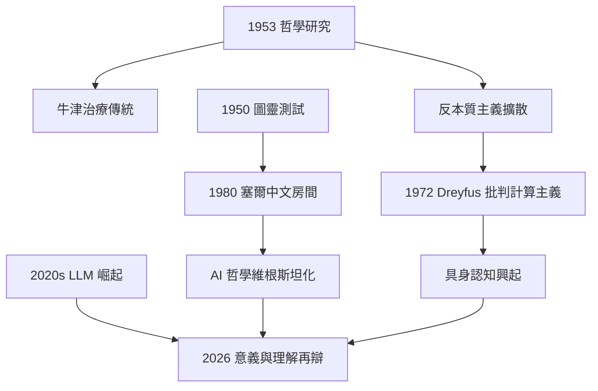
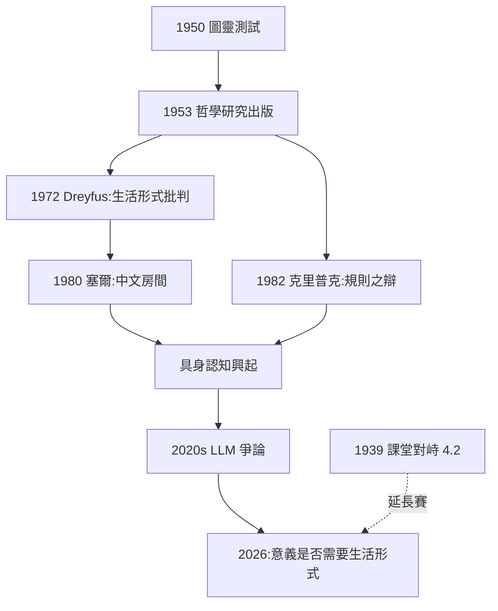

# 5.3 對分析哲學與 AI 哲學的影響（1953–2026）

## 對分析哲學：治療傳統的確立

《哲學研究》出版（5.2）後，維根斯坦成為分析哲學內部的一極：

- **維根斯坦—牛津路線**：賴爾《心的概念》、奧斯汀《如何以言行事》、安斯康姆《意向》——把哲學當成對語言用法的診斷；
- **卡爾納普—匹茲堡路線**：蒯因、塞爾、戴維森繼承弗雷格—卡爾納普的建構傳統，與治療路線持續角力（→ 詳見《卡爾納普傳記》）；
- 兩條路線的張力塑造了 1950–1990 年代英語哲學的全部議程。

## 對 AI 哲學：四個議題

維根斯坦後期哲學對 AI 哲學的影響，集中在他生前與圖靈交鋒過的幾個問題上（→ 詳見 4.2 與《圖靈傳記》第 4 章）：

1. **圖靈測試的批判**：塞爾 1980 年的「中文房間」論證直接動用維根斯坦式的語法診斷——「理解」不是行為模式，塞爾自認是維根斯坦的繼承者；
2. **遵守規則之論**：如果規則的意義在於社群實踐，那麼一台孤立機器的「規則遵守」是否成立？克里普克 1982 年的《維根斯坦論規則與私人語言》引爆了這場辯論；
3. **私人語言論證**：感知、內心體驗的報告依賴公共標準——這成為反對「機器有意識體驗」論者的標準武器；
4. **生活形式**：Dreyfus 1972 年的《計算機不能做什麼》明言受維根斯坦與梅洛-龐蒂啟發，主張智能依賴身體與情境，催生了「具身認知」與後來對深度學習的哲學反思。

## 2026 年的迴響

進入 2020 年代，大型語言模型的崛起使維根斯坦的問題重新活躍：

- **意義即使用 vs 意義即指稱**：LLM 純粹靠「使用」（語料分佈）學語言——這似乎驗證了維根斯坦，又似乎動搖了他（因為維根斯坦堅持意義嵌於生活形式與身體實踐）；
- **中文房間的復活**：對 LLM「是否理解」的爭論，基本上是 1980 年塞爾論證的 AI 化重演；
- **私人語言與機器意識**：如果一個模型報告「我感覺到疼」，我們應該如何理解這個報告？這正是《哲學研究》第一部分第 243–315 段的問題。

維根斯坦與圖靈 1939 年課堂上的分岔（4.2），在 2026 年以「符號 AI vs 具身智能」與「行為測試 vs 理解懷疑」的形式重演。

## 對其他學科的滲透

| 學科 | 借用的概念 | 代表 |
|------|------------|------|
| 人類學/社會學 | 生活形式、語言遊戲 | 溫奇《社會科學的觀念》 |
| 法學 | 規則的解釋與遵守規則之論 | 哈特《法律的概念》 |
| 認知科學 | 具身認知、反計算主義 | Dreyfus、Hutchins |
| 神學/宗教研究 | 不可說、儀式即生活形式 | 菲利普斯 |

## 事件年表

| 年份 | 事件 | 因果意義 |
|------|------|----------|
| 1953 | 哲學研究出版 | 治療傳統確立 |
| 1950s–1960s | 牛津日常語言學派鼎盛 | 維根斯坦成為權威 |
| 1972 | Dreyfus《計算機不能做什麼》 | 維根斯坦影響 AI 批判 |
| 1980 | 塞爾「中文房間」 | 圖靈測試遭遇維根斯坦式反擊 |
| 1982 | 克里普克論遵守規則 | 規則與社群實踐之辯爆發 |
| 2010s–2020s | 深度學習與 LLM 崛起 | 「使用 vs 生活形式」再辯 |
| 2026 | LLM 時代的維根斯坦復興 | 意義、理解、意識之問重燃 |

## 維根斯坦對圖靈測試的「假想批判」

有趣的是，維根斯坦本人並未直接評論 1950 年的模仿遊戲（他 1951 年已去世）。但他的概念工具為批判者提供了彈藥：

- **行為 vs 生活形式**：模仿遊戲只檢驗對話行為，但「理解」嵌在完整的生活形式（身體、需要、社群）中——圖靈測試檢驗的是一種被抽空的語言遊戲；
- **遵守規則之論**：機器「應用規則」是否等同人類的規則遵守，取決於規則的意義是否可能存在於實踐之外；
- **語法診斷**：「機器思考嗎？」這個問題本身可能是語法混亂——就像「棋子的號碼幾歲？」。

## 四個經典戰場

維根斯坦式批判在 AI 哲學的四大戰役中的角色：

| 戰役 | 年代 | 維根斯坦式論點 |
|------|------|----------------|
| Dreyfus 批判 | 1972 | 智能依賴身體與情境，非形式規則（生活形式） |
| 塞爾中文房間 | 1980 | 理解≠符號操作；句法不生語義（治療式診斷） |
| 克里普克規則之辯 | 1982 | 規則的意義在社群實踐，機器的「規則」存疑 |
| LLM 時代之辯 | 2020s | 「使用即意義」的極限測試：純分佈學習是否觸及意義 |

## 2026 年的 LLM 之辯：維根斯坦的雙面性

大型語言模型的出現使維根斯坦思想顯示出深刻的**雙面性**：

- **看似支持 LLM**：他說「一個詞的意義是它在語言中的用法」——LLM 正是從海量「用法」中學習的；「不要想，要看」的方法論也指向數據而非先天結構；
- **看似反對 LLM**：他堅持用法植根於生活形式——**「想象一種語言就是想象一種生活形式」**；一個沒有身體、需要、死亡的系統，其「用法」是否還有意義？
- 2026 年的哲學爭論（模型「是否理解」「是否有體驗」）本質上是把《哲學研究》的私人語言論證與遵守規則之論搬到矽基主體上重演。

## 當代思潮中的維根斯坦血統

- **具身認知與 4E 認知科學**：直接引用生活形式概念，反對純計算心智觀；
- **語用學轉向**：奧斯汀、格賴斯、塞爾的言語行為理論得力於語言遊戲概念；
- **維根斯坦式神學與倫理學**：菲利普斯、伯特（D. Z. Phillips）把「不可說」發展為宗教語言的治療式研究；
- **AI 對齊與機器意識討論**：2020 年代哲學家大量動用維根斯坦式語法診斷。

## 事件年表

| 年份 | 事件 | 因果意義 |
|------|------|----------|
| 1950 | 圖靈發表模仿遊戲 | 維根斯坦式批判的靶子 |
| 1953 | 哲學研究出版 | 彈藥庫開箱 |
| 1957 | 安斯康姆《意向》 | 語言行動理論的先聲 |
| 1972 | Dreyfus 批判 | 生活形式 vs 形式規則 |
| 1980 | 塞爾中文房間 | 治療式診斷的巔峰 |
| 1982 | 克里普克規則之辯 | 社群實踐 vs 機器規則 |
| 2017–2026 | Transformer 與 LLM | 意義之辯的矽基重演 |

## 交叉引用

- → 詳見《圖靈傳記》第 4、5 章：模仿遊戲與圖靈的最後思考
- → 詳見《卡爾納普傳記》5.x：句法與語義的當代爭論
- → 詳見《羅素傳記》5.1、5.3：核時代與 AI 時代的哲學反應
- → 詳見《弗雷格傳記》：意義與指稱之辯的源頭
- → 詳見本書 2.3、4.3：前期與後期文本的對照

## 小結

從 1953 年到 2026 年，維根斯坦的影響走過三個階段：**占領英語哲學**（1950s–1960s）→ **滲透社會科學與人文學科**（1970s–1990s）→ **成為 AI 時代的核心反方資源**（2000s–2026）。他生前反對建立學說、反對追隨者，死後卻成為運動的旗手——這個悖論本身就是「哲學治療」的最佳註腳。

回望全書：一個想在魏寧格陰影下自殺的維也納少年（1.1），因為一個螺旋槳（1.2）撞進了邏輯（1.3），在戰壕裡寫下「對不可說之物必須沉默」（2.2–2.3），又在鄉村課堂與戰地醫院裡找到了「生活形式」（3.1、4.3），最後以「我度過了極好的一生」謝幕（5.1）。他留給 2026 年的問題依然是那個 1939 年圖靈聽課時的問題：**規則、理解與意義，究竟是形式系統的事，還是生活形式的事？** 這個問題沒有終局——正如維根斯坦所願，哲學是永遠進行中的治療。

→ 相關閱讀：《羅素傳記》（老師與對手）、《弗雷格傳記》（邏輯源頭）、《卡爾納普傳記》（科學主義路線）、《圖靈傳記》（計算主義路線與 AI）。
