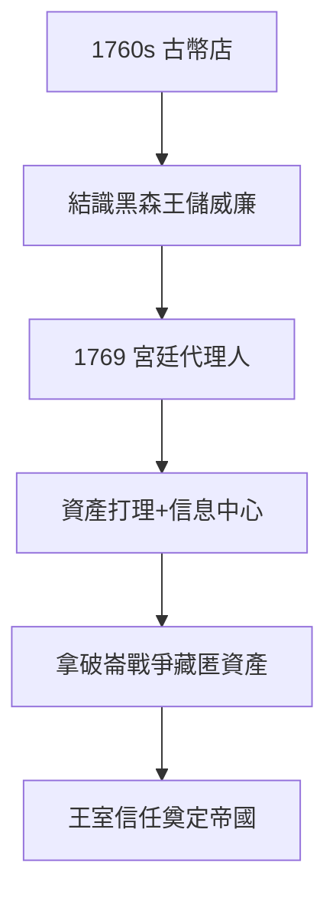

# 1.2 古幣商（1760–1780）

## 從古幣到宮廷

1760 年代，老梅耶回法蘭克福開古幣店，編古幣目錄，賣給收藏古幣的黑森-卡塞爾王儲威廉（歐洲最富的王公之一，出租僱傭軍給英國打美國獨立戰爭，賺得盆滿缽滿）。古幣是敲門磚，人脈是真貨——1769 年，老梅耶成為威廉的宮廷代理人（Court Factor）。

## 宮廷代理人的生意經

- 為王公打理資產、代收稅款、包銷軍費；
- 拿破崙戰爭時，幫威廉藏匿資產、轉移資金（見 2.3）——患難見真情，王室信任 +100；
- 佣金 + 信息：宮廷代理人是 18 世紀的信息中心——誰要打仗、誰缺錢，先知道。

## 猶太人的天花板

再有錢，仍是猶太巷的猶太人：不能擁有城外土地、要交特別稅。老梅耶的賺錢，部分是為了砸開天花板（3.3 的貴族化），部分是為了五個兒子（1.3）——**賺錢是手段，家族是目的**。

**因果**：古幣的雅好，換來王公的信任；王公的信任，換來戰爭的訂單。1769 年的宮廷代理人，是 1815 年金融帝國的種子。下一節，五支箭。
