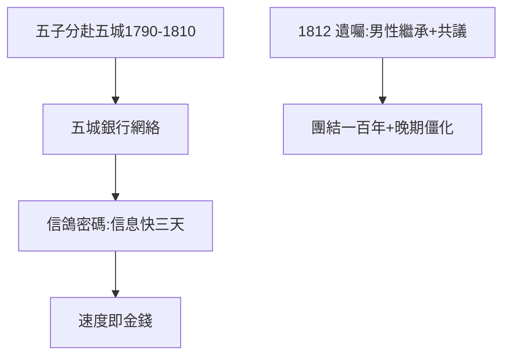

# 1.3 五支箭（1790–1812）

## 五個兒子，五座城市

老梅耶與古特勒（Guttle Schnapper）育有五子五女。1790–1810 年間，五個兒子分赴五城：

| 兒子 | 城市 | 分工 |
|---|---|---|
| 阿姆謝爾 | 法蘭克福 | 守總部 |
| 所羅門 | 維也納 | 奧地利宮廷 |
| 內森 | 倫敦 | 英國金融（最重要） |
| 卡爾 | 那不勒斯 | 義大利 |
| 詹姆斯 | 巴黎 | 法國（後來最富） |

家徽「五支箭」（散箭易折，合箭難斷）——**家族即公司，公司即家族**。

## 1812：遺囑

1812 年老梅耶去世，遺囑規定：銀行只能由男性家族成員繼承，重大決策五房共議。這個制度保證了團結一百年，也埋下僵化（19 世紀末各房離心，見 4.1）。

## 猶太家庭的動員力

對比摩根（單打獨鬥，見《摩根傳》）：羅斯柴爾德是家族軍團——五城之間信鴿 + 密碼通信，信息比政府快三天。**速度即金錢**（2.2 滑鐵盧傳說的真相）。

**因果**：古幣商的人脈（1.2）+ 五個兒子 = 跨國銀行網絡。1812 年的遺囑，是帝國的憲法。下一章，拿破崙戰爭——憲法的第一次大考。
