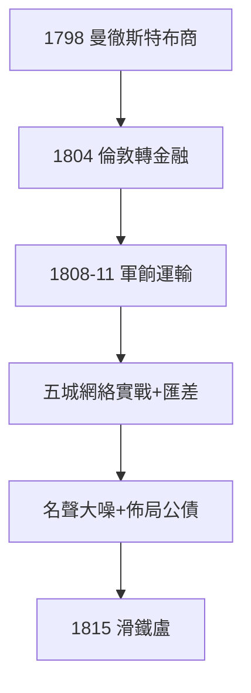

# 2.1 內森倫敦（1804–1811）

## 1798：曼徹斯特的布商

21 歲的內森（Nathan Mayer Rothschild）先到曼徹斯特做紡織貿易，賺第一桶金。1804 年移居倫敦，轉入金融——從布商到銀行家，只用六年。他的風格：快、狠、準，不講情面（連兄弟的錢都算利息）。

## 1808–11：威靈頓的軍餉

半島戰爭（威靈頓在西班牙打拿破崙），英軍軍餉運輸是難題：金幣萬里迢迢，易被劫。內森設計：倫敦籌款 → 巴黎詹姆斯兌換 → 西班牙支付——五城網絡（1.3）第一次實戰，賺佣金 + 賺匯差，名聲大噪。

## 內森的性格

禿頭、肥胖、脾氣暴躁，在倫敦交易所用手杖開路。但他敏銳：他看出英國將贏得戰爭，提前佈局英國公債（2.2 的真相）——**賭國運，是最高級的投機**。

**因果**：五支箭（1.3）→ 軍餉生意 → 公債佈局。內森把家族網絡變成戰爭機器——而戰爭的最大一注，是滑鐵盧（下一節）。
