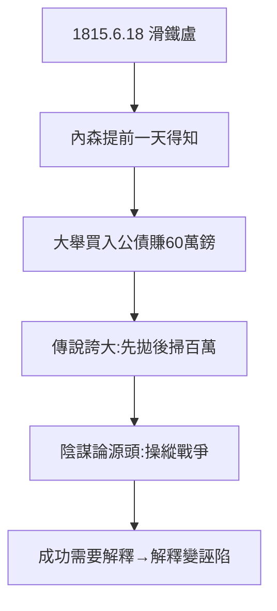

# 2.2 滑鐵盧傳說（1815）

## 傳說：信鴿與百萬英鎊

傳說 1815 年 6 月 18 日滑鐵盧戰役，內森的信鴿（或快馬）比政府信使早兩天把威靈頓勝利的消息送到倫敦，他先拋售公債製造恐慌、再低價掃貨，一天賺百萬英鎊。

## 真相：誇大，但有核

- 史學考證（弗格森《金錢世界》）：內森確實提前知道消息（快一天左右），確實大舉買入公債，賺了約 60 萬鎊（巨款，但非傳說的規模）；
- 「先拋後掃」的操作細節無實證，多為後人附會（包括反猶小冊子的添油加醋，見 5.2）；
- 核心真相不變：**信息優勢（1.3 的網絡）+ 敢下重注（內森的性格，2.1）= 暴富**。

## 傳說的代價

滑鐵盧傳說是羅斯柴爾德陰謀論（5.2）的源頭之一：「猶太人操縱戰爭發財」。賺錢的真相（信息 + 膽量）被扭曲成「操縱」——**成功需要解釋，而解釋常常是誣陷**。

**因果**：五城網絡（1.3）+ 內森的膽（2.1）= 滑鐵盧之富。而財富的傳說，又生出兩百年的陰謀論（5.2）。下一節，戰爭融資的全貌。
