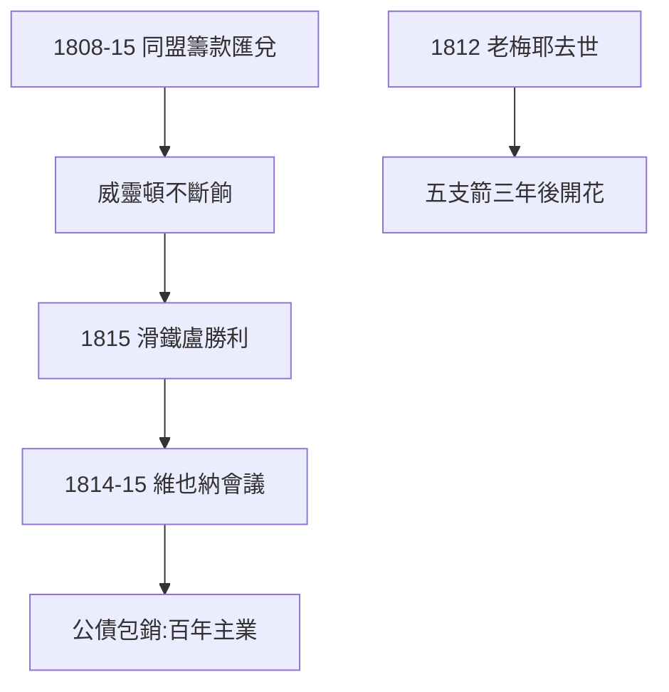

# 2.3 戰爭融資（1808–1815）

## 反法同盟的錢袋

1808–15 年，羅斯柴爾德五房為反法同盟（英、普、奧、俄）籌款、匯兌、運餉：總額超過數千萬鎊。沒有他們的網絡，威靈頓的軍隊發不出餉——**拿破崙輸給了後勤，後勤姓羅斯柴爾德**。

## 維也納會議（1814–15）

戰後分贓（維也納會議），所羅門（維也納房）與各國代表稱兄道弟，拿到奧地利、普魯士的債券承銷權。戰爭結束，和平的生意更大——公債包銷成為家族百年的主業（3.1）。

## 1812：老梅耶去世

戰爭最酣時，老父親在法蘭克福去世（1812.9.19），沒看到滑鐵盧。但他留下的五支箭（1.3），在他死後三年開花——**種樹者未必乘涼，但家族可以**。

**因果**：宮廷代理人（1.2）→ 戰爭融資 → 和平的公債生意。戰爭是訂單，和平是更大的訂單——下一章，金融帝國的全盛。
