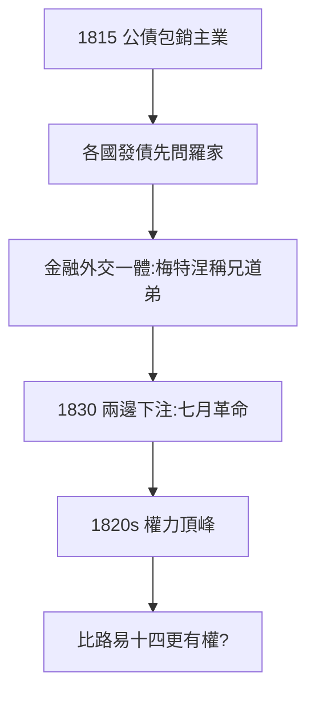

# 3.1 五城銀行網絡（1815–1830）

## 1815–30：歐洲的中央銀行

滑鐵盧後，羅斯柴爾德成為歐洲各國的「編外央行」：英國公債、法國賠款（拿破崙戰爭賠款 7 億法郎，詹姆斯包銷）、奧地利、普魯士、那不勒斯……各國發債，先問羅斯柴爾德。梅特涅（奧地利首相）與所羅門稱兄道弟——**金融與外交一體**。

## 信息帝國

- 信鴿、快馬、密碼、私人信使：五城之間的信息比政府快數天（1.3 的延續）；
- 內森死後（1836），詹姆斯（巴黎）接班為家族領袖——巴黎取代倫敦，成為中心；
- 1830 年法國七月革命，詹姆斯同時資助查理十世與路易-菲利普——**兩邊下注，穩賺不賠**（政治投機的藝術）。

## 權力的頂峰

1820 年代，全歐洲王室的債主。歌德說：「羅斯柴爾德比路易十四更有權。」——太陽王統治法國，羅斯柴爾德統治法國的債主。

**因果**：戰爭融資（2.3）→ 和平公債 → 編外央行。1815–30 是家族的黃金十五年——而黃金時代的危機（鐵路、民族主義、反猶）正在路上（3.2、4.2）。
