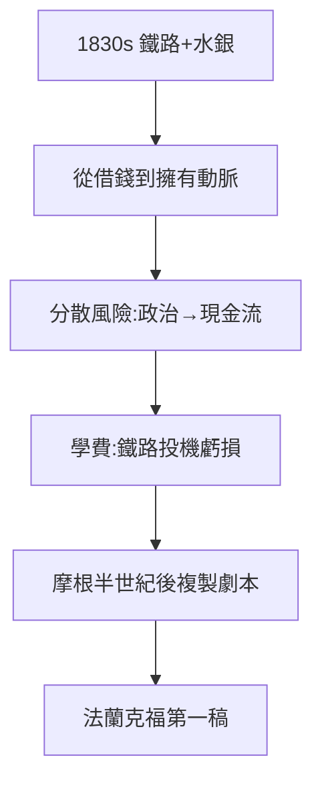

# 3.2 鐵路與礦山（1830–1860）

## 從公債到實業

1830 年代，詹姆斯（巴黎）看出鐵路是未來：投資法國北方鐵路（巴黎–布魯塞爾）、西班牙鐵路；所羅門投奧地利鐵路；家族還買下西班牙阿爾馬登水銀礦（壟斷全球水銀，煉銀必需）——**從借錢給國家，到擁有國家的動脈**。

## 實業的邏輯

- 公債生意靠政治關係（3.1），鐵路生意靠現金流——分散風險；
- 水銀壟斷：全球水銀定價權在握，墨西哥銀礦主都要看臉色；
- 轉型的代價：1830–40 年代鐵路投機虧過大錢（詹姆斯承認「交了學費」）——銀行家變實業家，總要脫層皮。

## 與摩根的對照

半個世紀後，摩根在美國複製同一劇本（鐵路重組、美國鋼鐵，見《摩根傳》2.1、3.1）——**羅斯柴爾德是摩根的老師**（摩根父親的倫敦商行就是學徒）。金融帝國主義的劇本，法蘭克福寫了第一稿。

**因果**：公債帝國（3.1）→ 實業帝國。轉型是為了活下去——而活下去的下一個課題，是身份（下一節：從猶太人到貴族）。
