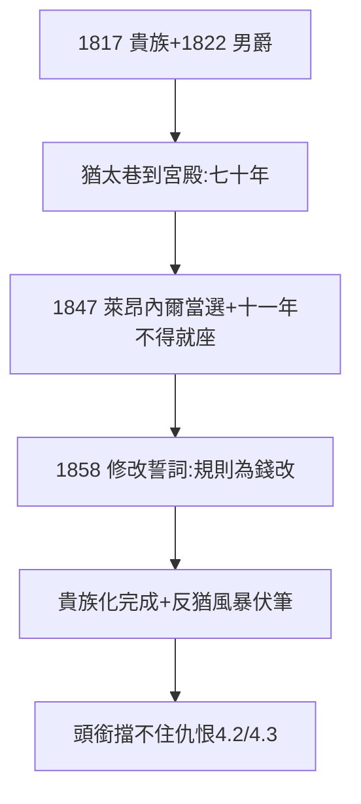

# 3.3 貴族化（1817–1847）

## 1817/1822：奧地利男爵

奧地利皇帝封五兄弟為貴族（1817），1822 年晉男爵（Freiherr）——猶太巷（1.1）的後代，七十年後成了世襲貴族。所羅門在維也納建宮殿，詹姆斯在巴黎買城堡（弗里耶爾，法國最大的私人城堡之一）。

## 1847：萊昂內爾進入議會

內森之子萊昂內爾（Lionel）當選英國議員，但因拒絕以基督教形式宣誓，十一年不得就座——直到 1858 年議會修改誓詞。**有錢買不到議席的椅子，但能買到修改規則**——貴族化的未完成與完成。

## 貴族化的代價

- 正面：砸開天花板（1.2），猶太解放的象徵；
- 反面：與王室綁定越深，反猶風暴來時越危險（4.2、4.3）——**貴族頭銜擋不住種族仇恨**；
- 家族內部：英國房（萊昂內爾）融入上流，法國房（詹姆斯）保持猶太認同——兩條路，兩種命運。

**因果**：賺錢（1.2）→ 買頭銜 → 進議會。七十年砸開天花板——但天花板之上還有天（種族）。下一章，鼎盛與風暴。
