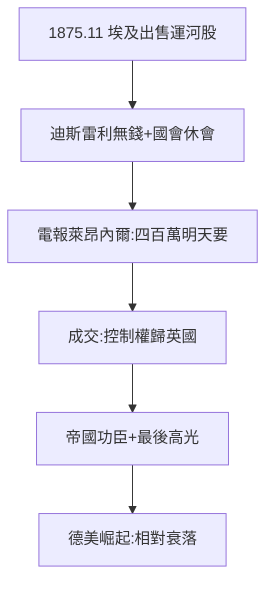

# 4.1 蘇伊士運河股份（1875）

## 1875 年 11 月：四百萬鎊的電報

埃及赫迪夫因債務被迫出售蘇伊士運河 44% 股份，英國首相迪斯雷利（猶太裔！）想買，國會休會批不出錢。一個電報到萊昂內爾（英國房）：「四百萬鎊，明天要。」萊昂內爾回電：「成交。」——**人類歷史上最大的一筆「先斬後奏」**，運河控制權歸英國（直到 1956 年蘇伊士危機）。

## 萊昂內爾的巔峰

- 1847 年當選議員（3.3），1875 年拯救帝國——從被拒之門外到帝國功臣，二十八年；
- 佣金 + 利息 + 名聲：這筆生意賺的不只是錢；
- 迪斯雷利（猶太裔首相）+ 萊昂內爾（猶太銀行家）：**兩個猶太人，決定了大英帝國的命脈**——反猶者（4.2）的口實 +1。

## 帝國的黃昏預演

蘇伊士是羅斯柴爾德最後的高光：此後德國（俾斯麥的帝國銀行）、美國（摩根）崛起，家族相對衰落。1875 年的電報，是舊時代的絕唱。

**因果**：貴族化（3.3）→ 帝國功臣。1847 年的議席之辱（3.3），在 1875 年的電報中雪恥——而雪恥的代價，是成為反猶靶子（下一節）。
