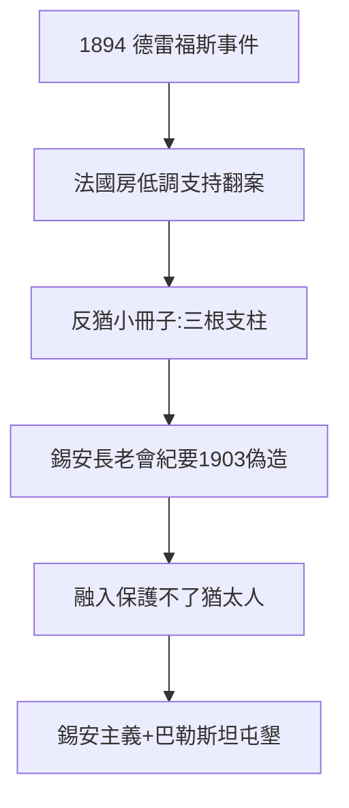

# 4.2 反猶與德雷福斯（1894–1906）

## 1894：德雷福斯事件

猶太軍官德雷福斯被誣叛國，法國分裂。羅斯柴爾德法國房（阿方斯等）處境尷尬：為德雷福斯說話，得罪軍方；不說話，對不起族人。最終低調支持翻案（資助報紙、營救）——**有錢人的政治：只能低調，不能缺席**。

## 反猶小冊子的靶子

- 德呂蒙《猶太法國》（1886，暢銷書）：羅斯柴爾德是「猶太征服」的象徵；
- 滑鐵盧傳說（2.2）+ 蘇伊士（4.1）+ 德雷福斯 = 陰謀論的三根支柱（見 5.2）；
- 俄國《錫安長老會紀要》（1903 偽造）：羅斯柴爾德是「世界政府」的金主——偽造，但流傳百年。

## 貴族化的極限

3.3 的頭銜、4.1 的功績，在種族仇恨面前歸零。德雷福斯事件證明：**融入（assimilation）保護不了猶太人**——這個結論催生了錫安主義（赫茨爾 1896《猶太國》，埃德蒙·羅斯柴爾德資助巴勒斯坦屯墾）。

**因果**：蘇伊士的高光（4.1）→ 反猶的靶心。貴族化（3.3）擋不住種族——而種族的答案，是錫安（巴勒斯坦）。下一節，最黑暗的一章：納粹。
