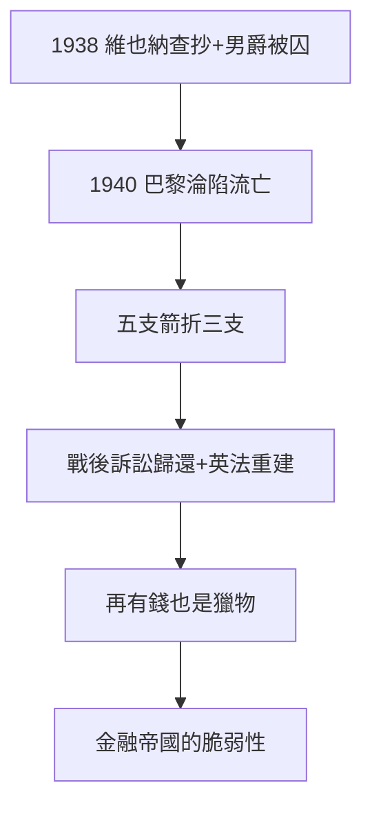

# 4.3 二戰納粹掠奪（1938–1945）

## 1938：維也納的劫難

德奧合併後，納粹查抄維也納羅斯柴爾德宮，沒收全部資產（銀行、宮殿、藝術品——包括傳世名畫），路易·羅斯柴爾德（男爵）被捕，囚禁一年，家族繳巨額贖金才放人。法國房：巴黎淪陷（1940），詹姆斯分支流亡英美，資產多被維希/納粹侵吞。

## 兩百年的終點？

- 法蘭克福房：19 世紀末已絕嗣（無男丁）；
- 維也納房：1938 年被連根拔起；
- 那不勒斯房：19 世紀中葉已關閉；
- 剩下倫敦、巴黎兩房——五支箭（1.3），折了三支。

## 劫後餘生

戰後部分藝術品歸還（曠日持久的訴訟，至今未完），銀行業務在英法重建（5.1）。納粹證明了 4.2 的結論：**再有錢，再貴族，在種族滅絕面前都是獵物**——金融帝國的脆弱性，莫過於此。

**因果**：德雷福斯的警告（4.2）→ 納粹的兌現。1817 年的男爵頭銜（3.3），擋不住 1938 年的蓋世太保。下一章，戰後。
