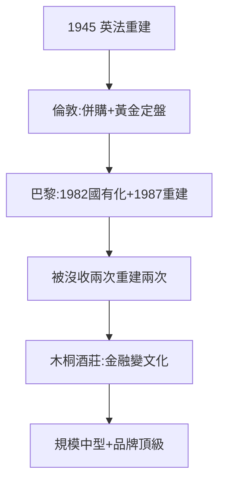

# 5.1 戰後重建（1945–1980）

## 倫敦與巴黎：兩條路

- 倫敦房（N.M. Rothschild）：專注商人銀行（併購顧問、貴金屬定價——倫敦黃金定盤價主席到 2004 年）；
- 巴黎房：1945 年重建，1982 年被密特朗國有化（喬治·蓬皮杜時代的報復？），1987 年大衛·羅斯柴爾德重建 Rothschild & Co.——**被沒收兩次（1940 納粹，1982 社會黨），重建兩次**；
- 瑞士房（埃德蒙分支）：私人銀行，低調巨富。

## 從銀行到品酒

菲利普男爵（巴黎房）把木桐酒莊（Château Mouton Rothschild）做成世界第一名莊（1973 年升一級莊，藝術酒標：畢加索、達利、趙無極都畫過）——**金融家族變文化家族**，轉型教科書。

## 規模的真相

戰後的羅斯柴爾德，在全球銀行業中只是中型（遠小於摩根大通、花旗）——帝國的規模縮水了，但品牌還在。5.2 要回答：為什麼縮水的帝國，陰謀論卻越來越大？

**因果**：納粹的掠奪（4.3）→ 戰後重建 → 中型銀行 + 頂級品牌。帝國縮水了，傳說卻膨脹了——下一節，陰謀論。
