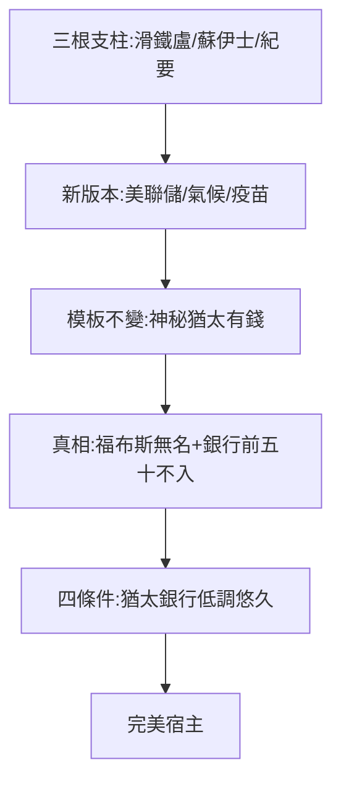

# 5.2 陰謀論與真相（1900–2020）

## 陰謀論的三根支柱（回顧）

1. 滑鐵盧：操縱戰爭發財（2.2，已考證誇大）；
2. 蘇伊士：控制帝國命脈（4.1，真相是商業交易）；
3. 錫安長老會紀要：世界政府金主（4.2，偽造文件）。

新版本：美聯儲的主人、氣候變化的幕後、疫苗的金主……——**模板不變，主角不換**：神秘、猶太、有錢。

## 真相：福布斯榜上無名

- 羅斯柴爾德家族總資產估計數十億美元量級（分散在數百後人手中）；
- 全球首富（馬斯克、阿諾特）個人資產就是其數十倍；
- 「控制世界」的家族，連全球銀行前五十都進不去——**陰謀論與資產負債表，至少有一個在說謊**。

## 為什麼是他們

- 猶太（少數易當靶子）+ 銀行（抽象易被誤解）+ 低調（不辯解易被編造）+ 歷史悠久（傳說有時間發酵）；
- 四個條件齊備，陰謀論的完美宿主——換作摩根（美國人、基督徒、高調），傳說少一半（見《摩根傳》5.3，摩根也有陰謀論，但量級不同）。

**因果**：1815 年的傳說（2.2）→ 1903 年的偽造（4.2）→ 2020 年的迷因。兩百年的誣陷史，本身就是一部反猶史——而真相（中型銀行）在喧囂中無人傾聽。下一節，蓋棺。
