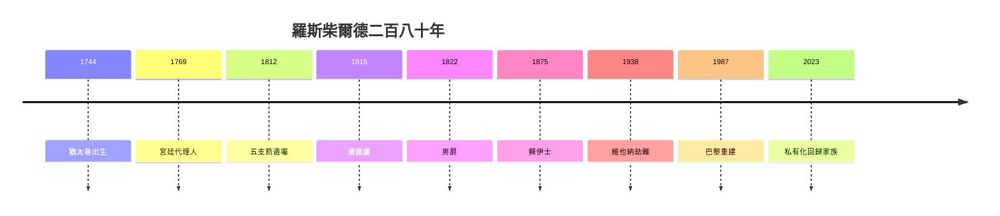

# 5.3 二十一世紀的羅斯柴爾德（2000–2025）

## Rothschild & Co.：上市又私有化

- 2012 年英法業務合併為 Rothschild & Co.；
- 2023 年 Concordia（家族控股）將其私有化退市——**兩百年後，回到家族企業**（1.3 遺囑的迴響：家族即公司）；
- 主業：併購顧問（全球頂級）、財富管理、木桐酒莊。

## 以色列與慈善

- 埃德蒙分支：巴勒斯坦屯墾（4.2）→ 以色列建國後的持續捐贈（國會大廈、最高法院大樓都是羅家捐的）；
- 英國房：沃德斯登莊園捐給國家信託；
- **從賺錢到散錢**：第三代以後的家族定律（卡內基、洛克菲勒、摩根都一樣）。

## 蓋棺：五支箭的命運

| 房 | 命運 |
|---|---|
| 法蘭克福（阿姆謝爾） | 19 世紀末絕嗣 |
| 維也納（所羅門） | 1938 納粹拔除 |
| 那不勒斯（卡爾） | 19 世紀中關閉 |
| 倫敦（內森） | 存續，併購顧問 |
| 巴黎（詹姆斯） | 存續，私有化回歸 |

**因果閉環**：猶太巷的歧視（1.1）→ 古幣的敲門（1.2）→ 五支箭（1.3）→ 戰爭的訂單（第 2 章）→ 公債的帝國（3.1）→ 貴族的頭銜（3.3）→ 反猶的靶子（4.2）→ 納粹的掠奪（4.3）→ 中型銀行（5.1）→ 永恆的陰謀論（5.2）。**兩百八十年，從被隔離者到被神話者**——而神話（世界主宰）與真相（中型銀行）之間的差距，正是這個家族真正的傳奇：**人們寧願相信它無所不能，也不願相信它只是會賺錢**。
