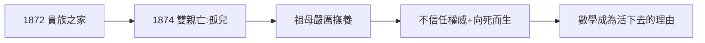

# 1.1 出生與家庭悲劇（1872–1874）

1872 年 5 月 18 日，伯特蘭·羅素（Bertrand Russell）出生於威爾斯貴族家庭：祖父是兩任首相約翰·羅素勳爵，父親是議員。但榮耀背後是連串死亡：

- 1874 年父親病死，母親隨後去世（2 歲成孤兒）；
- 姐姐、哥哥的早夭陰影；
- 由祖母（清教徒式的維多利亞貴婦）撫養，家規森嚴，情感壓抑。

## 孤兒的遺產

- 對權威的天然不信任（連家庭都是靠不住的）；
- 對死亡的早熟思考——青少年時代多次認真考慮自殺，因「想學更多數學」而活下去；
- 貴族頭銜（伯爵）+ 反叛性格的終身組合：用上議院的席位罵政府。

**因果**：兩歲的孤兒學會的第一課，是「世界不可靠」。這份不信任後來指向黑格爾（1.3）、指向戰爭（3.1）、指向核武器（5.1）。而「為數學而活」的少年，將在劍橋找到戰場。
