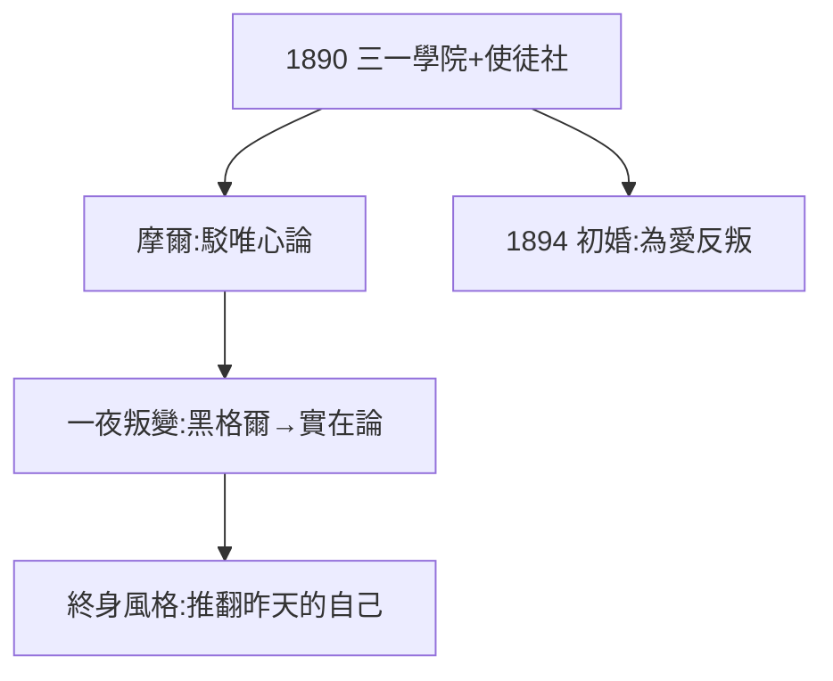

# 1.2 劍橋使徒社（1890–1893）

## 1890：三一學院

羅素考入劍橋三一學院，數學榮譽考試第七名（Wrangler），隨即轉向哲學。入選秘密社團「使徒社」（Apostles）——成員包括摩爾（G.E. Moore）、後來的懷特海、凱因斯。週六晚的討論會是他真正的課堂。

## 摩爾的影響

摩爾以一篇《駁唯心論》顛覆劍橋：常識是對的，黑格爾是錯的。羅素一夜之間由黑格爾信徒變成實在論者——這種「整夜叛變」的風格是他一生的標誌：**永遠準備推翻昨天的自己**。

## 第一次婚姻

1894 年與艾麗斯·皮爾索爾（Alys Pearsall Smith，美國貴格會家庭）結婚，不顧家人反對。十年後激情消退，和平分居——四段婚姻的第一段，模式已定：為愛情反叛，為理性分手。

**因果**：使徒社給了他論辯的武器與叛變的榜樣。從黑格爾的叛逃（1.3 詳述）只是第一次——此後他還要叛逃戰爭、叛逃婚姻、叛逃核時代。下一節，哲學上的叛逃詳情。
