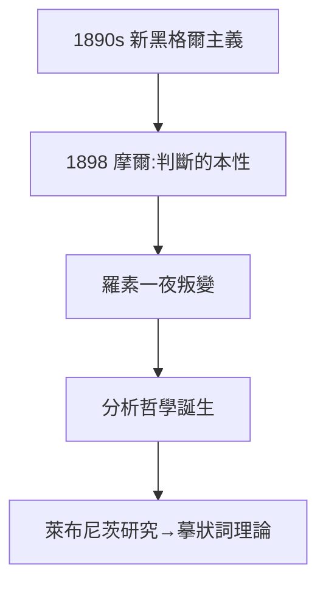

# 1.3 黑格爾到叛離（1894–1898）

## 新黑格爾主義的羅素

1890 年代初，羅素在麥克塔格特影響下信奉新黑格爾主義，博士論文寫布萊德雷。1896 年出版《德國社會民主黨》、1897 年《幾何學基礎》——仍是唯心論框架。

## 1898：摩爾的當頭棒喝

摩爾發表《判斷的本性》，論證真理不依賴心靈。羅素讀後「如夢初醒」，兩人聯手發動「反黑格爾革命」：分析哲學誕生。劍橋哲學從此由大陸形而上學轉向邏輯分析——20 世紀英美哲學的起點。

## 萊布尼茨研究

叛離期間研讀萊布尼茨（1900 年出版《萊布尼茨哲學批判》），發現關係命題不可還原為主謂形式——這直接催生摹狀詞理論（1905）與後來的邏輯原子論。

**因果**：使徒社的論辯（1.2）在 1898 年結晶為哲學革命。叛離黑格爾的羅素，把「分析」變成武器——下一章，這把武器將指向數學本身，並發現一個悖論。
