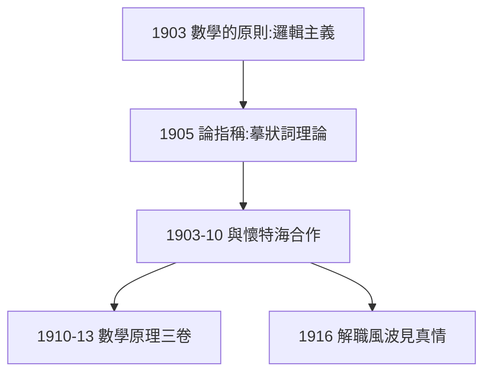

# 2.2 與懷特海（1903–1910）

## 《數學的原則》（1903）

羅素單獨出版《數學的原則》，宣布邏輯主義綱領：**數學即邏輯**。此書奠定分析哲學的另一塊基石：摹狀詞理論（1905「論指稱」）——「當今法國國王是禿頭」這類句子如何有意義，成為語言哲學的典範問題。

## 十年合作

1903–1910 年，與老師懷特海合作撰寫《數學原理》：每天工作八小時，羅素負責邏輯、懷特海負責後期部分。懷特海後來轉向過程哲學，兩人分道揚鑣，但這十年的合作是 20 世紀學術合作的傳奇。

## 劍橋解職的伏筆

羅素因反戰（第 3 章）1916 年被三一學院解職，懷特海憤而辭職抗議——學術友誼經受了政治考驗。

**因果**：悖論（2.1）提出問題，邏輯主義提出答案，合作提供人力。十年磨一劍——下一節，三卷本《數學原理》問世，哥德爾在二十年後等著它。
