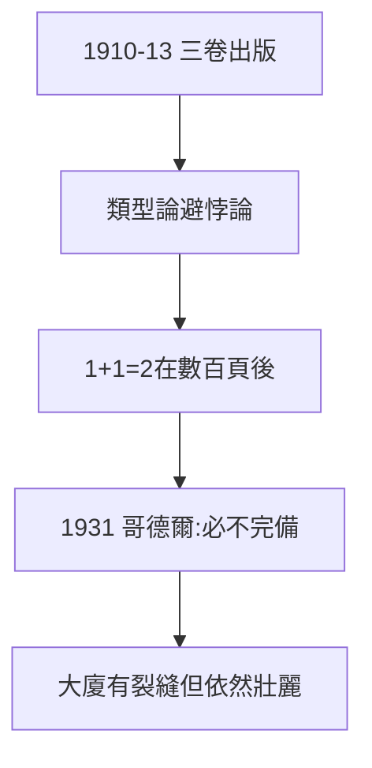

# 2.3 數學原理出版（1910–1913）

## 三卷本巨著

1910、1912、1913 年，《數學原理》（Principia Mathematica）三卷陸續出版，用數百頁符號證明 $1+1=2$（出現在第一卷末尾，*54.43）。劍橋大學出版社預估虧損 600 鎊，羅素與懷特海各貼 50 鎊才得以出版——最偉大的邏輯著作，差點因缺錢流產。

## 類型論的自救

為避開悖論（2.1），羅素提出**分支類型論**：命題按階分層，禁止自我指涉。雖然後來被策梅洛集合論取代，但「分層防自指」的思想活在計算機科學（類型系統）中。

## 哥德爾的審判

1931 年，哥德爾證明：像《數學原理》這樣足夠強的系統，若一致則必不完備——羅素十年的重建工程，被證明有不可彌補的裂縫。羅素晚年承認：「我像建了一座大廈，卻發現地基有問題——但大廈本身依然壯麗。」

**因果**：十年合作（2.2）的結晶，二十年後被哥德爾限定。但《原理》的符號、方法與問題意識，養活了整個分析哲學。下一章，戰爭爆發，羅素從書齋走向街頭。
