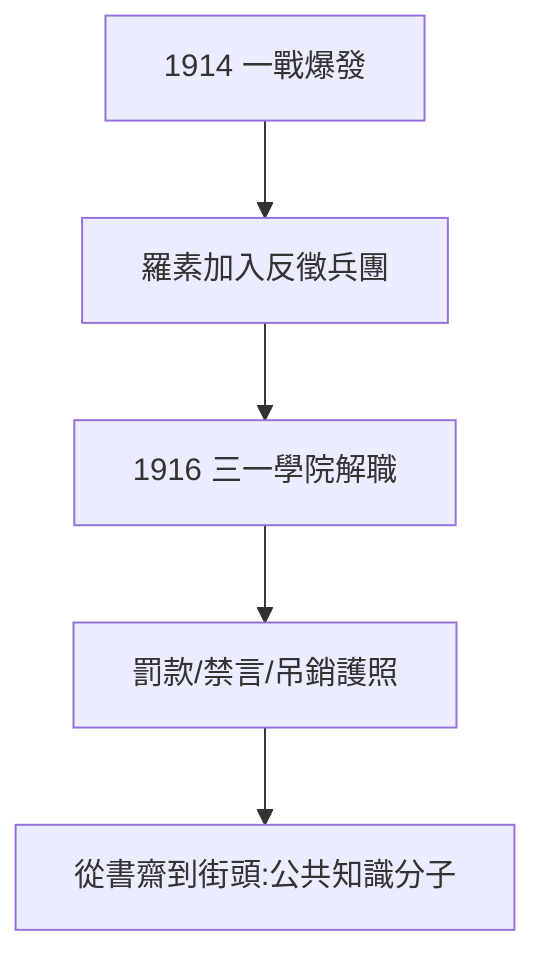

# 3.1 一戰反戰（1914–1916）

## 1914 年 8 月：第二次叛變

一戰爆發，劍橋幾乎全體主戰。羅素再次「一夜叛變」（1.2 的模式）：加入「反徵兵團」（No-Conscription Fellowship），撰寫傳單、上街演講。他說：「愛國主義是無賴最後的避難所——而我連第一個避難所都不需要。」

## 代價

- 1916 年被三一學院解職（懷特海辭職抗議，見 2.2）；
- 護照被吊銷，演講被禁；
- 被罰款 100 鎊（朋友代付，拍賣藏書抵債時無人敢買——全是題贈本）。

## 《社會重建原則》（1916）

獄前寫成：戰爭源於佔有慾與競爭，應用創造取代佔有。從邏輯學家到社會先知——反戰把他推向公共知識分子的位置，此後五十年未再離開。

**因果**：孤兒的不信任權威（1.1）+ 使徒社的叛變風格（1.2）= 戰時的羅素。解職讓他失去講台，卻得到更大的講台——全世界。下一節，監獄。
