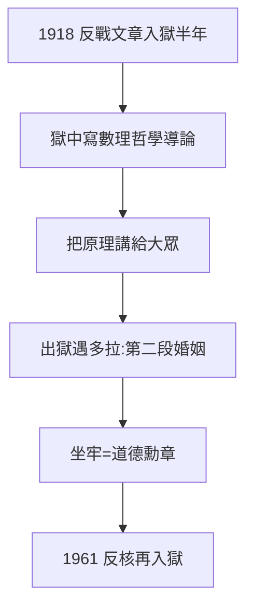

# 3.2 入獄（1918）

## 布里克斯頓監獄六個月

1918 年，羅素因一篇反戰文章（預言美軍將用於镇压罷工）被判入獄六個月。在獄中，他讀斯特林堡、寫《數理哲學導論》（Introduction to Mathematical Philosophy）——把《數學原理》的思想寫給大眾，第一版在獄中完成。

## 獄中的羅素

- 每天散步一小時，囚犯們以為他是「寫書的瘋子」；
- 典獄長准許他自帶書籍，條件是不談政治；
- 出獄時，迎接他的是第二任妻子多拉（Dora Black）——在反戰運動中結識。

## 入獄的紅利

六個月牢獄換來的是道德資本：從此「為信念坐牢」成為他的勳章。1961 年（89 歲）他因反核靜坐再次入獄一週——布里克斯頓的傳統延續了半個世紀。

**因果**：反戰（3.1）的代價變成資產——監獄生產了暢銷書與新婚姻。羅素發現：受難是最好的演說。下一節，他把演說帶到俄國與中國。
