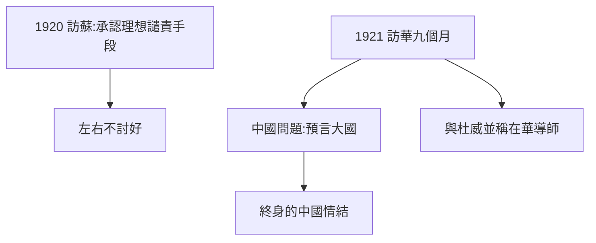

# 3.3 訪俄訪華（1920–1921）

## 1920：莫斯科的失望

羅素率工黨代表團訪蘇，會見列寧，參觀監獄與學校。回國寫下《布爾什維主義的理論與實踐》：承認蘇俄的理想，譴責其手段——「用飢餓與恐怖建設天堂」。左派罵他叛徒，右派不信他的批判——兩面不討好成了他的常態。

## 1921：中國講學

應梁啟超等邀請，與多拉訪華九個月，在北大、清華、長沙講學，主張「中國應走工業化但拒絕西方帝國主義」。他對中國的感情終身不渝（晚年仍關心中國），而中國知識界（張申府、瞿秋白當翻譯）也把他視為導師。

## 東方之行的影响

- 《中國問題》（1922）：預言中國將成為大國，警告軍閥與帝國主義；
- 與杜威（1919–21 訪華）形成「兩位導師」的格局：實用主義 vs 邏輯分析；
- 多拉在中國懷孕，兒子約翰出生——私生活與公共行程交織。

**因果**：入獄的道德資本（3.2）讓他有資格評判革命——而他誰都敢評判：列寧、軍閥、帝國主義。這種「無差別批判」是他公共生涯的底色。下一章，辦學與寫書。
