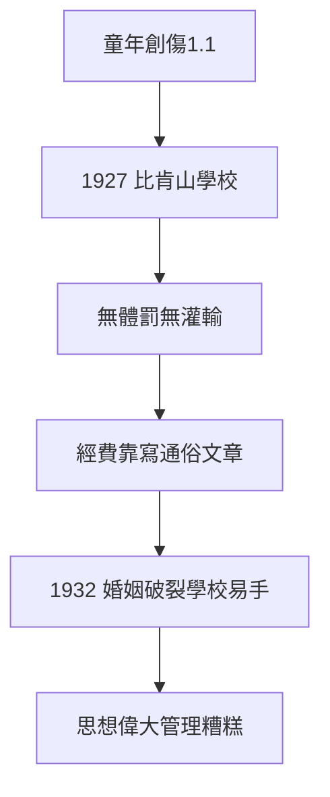

# 4.1 比肯山學校（1927–1932）

## 辦一所沒有恐懼的學校

1927 年，羅素與多拉創辦比肯山（Beacon Hill）實驗學校：無體罰、無宗教灌輸、性教育開明。理念寫在《教育與美好生活》（1926）：教育的目的是「給予求知的勇氣，而非服從的習慣」。

## 理想與現實

- 學校經費靠羅素寫通俗文章維持（《婚姻與道德》1929 的版稅）；
- 1932 年多拉出軌、學校瀕臨倒閉，羅素接手後逐漸保守化；
- 學生回憶：天才的學校，管理一塌糊塗——羅素是偉大的教育思想家，糟糕的校長。

## 遺產

進步主義教育的先驅之一。他的教育觀（反權威、重好奇）與 1.1 的童年創傷直接相關：**他要辦的，是童年時得不到的學校**。

**因果**：孤兒（1.1）要給孩子他沒有的童年；公共知識分子（3.1）要把理念變成制度。學校失敗了，書留下了——下一節，婚姻。
