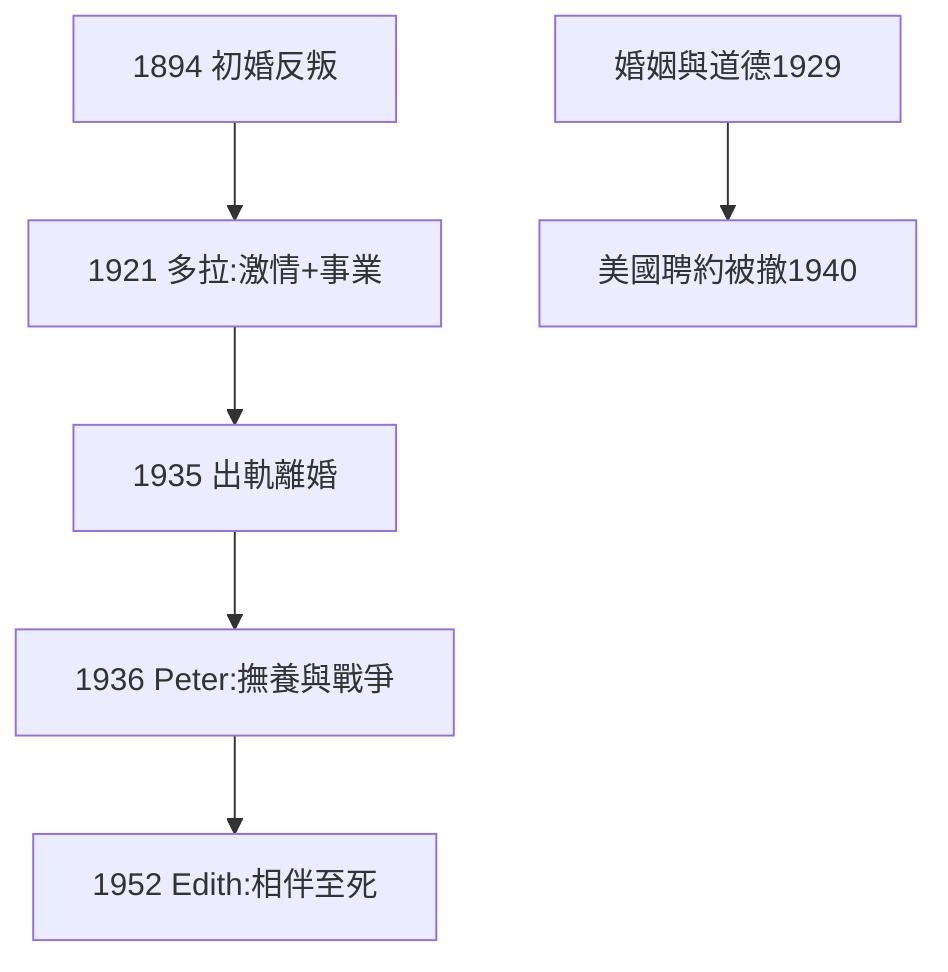

# 4.2 婚姻與情愛（1921–1952）

## 四段婚姻

| 妻子 | 年代 | 結局 |
|---|---|---|
| 艾麗斯 | 1894–1921 | 激情消退，和平分居 |
| 多拉 | 1921–1935 | 出軌醜聞，離婚 |
| 派翠西亞（Peter） | 1936–1952 | 撫養幼子，晚年分居 |
| 伊迪絲（Edith） | 1952–1970 | 相伴至死 |

## 情愛哲學

《婚姻與道德》（1929）主張：性不是罪，嫉妒可以被理性克服。評論家說他「用邏輯證明通姦合理」——美國因此拒絕他任教（1940 紐約市立學院聘約被法院撤銷，「道德不配」）。

## 理性與慾望

羅素一生被同一個矛盾撕扯：頭腦相信自由，心靈渴望安穩。四段婚姻是這個矛盾的四次實驗——全部以部分失敗告終，但第四次（伊迪絲）終於接近安穩。

**因果**：為愛反叛（1.2）的模式重複四次，一次比一次平靜。婚姻史是他理性主義的試金石：邏輯能分析命題，分析不了人心。下一節，寫書。
