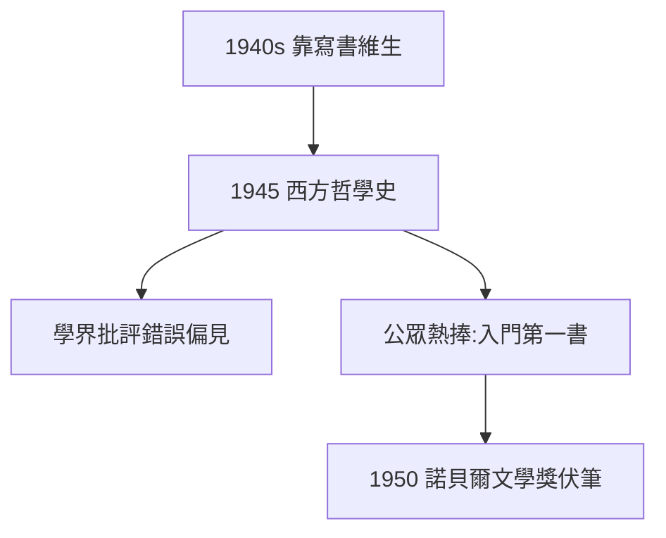

# 4.3 西方哲學史（1945）

## 為錢寫的傑作

1940 年代羅素靠寫通俗著作維生（美國講學 + 版稅），《西方哲學史》（1945）是其中最成功的一部：從泰勒斯到杜威，夾敘夾議，文筆辛辣（「亞里士多德的邏輯是形式主義的泥潭」之類的刻薄話層出不窮）。

## 學界的白眼

專業哲學家批評它錯誤百出、偏見 demasiadas（對尼采、柏格森的處理尤其草率）。但公眾愛它——連續再版，至今仍是西方哲學入門第一書。1950 年諾貝爾文學獎（5.3）一半功勞歸它。

## 通俗的辯護

羅素的回答：「哲學家有責任對同胞說話。」——從《數學原理》的無人能懂（2.3）到《哲學史》的無人不讀，他走完了一個公共知識分子的全程。

**因果**：比肯山靠版稅（4.1）→ 版稅靠通俗 → 通俗的頂峰是《哲學史》。被學院鄙視的書，贏得了世界。下一章，核子時代：最後的戰場。
