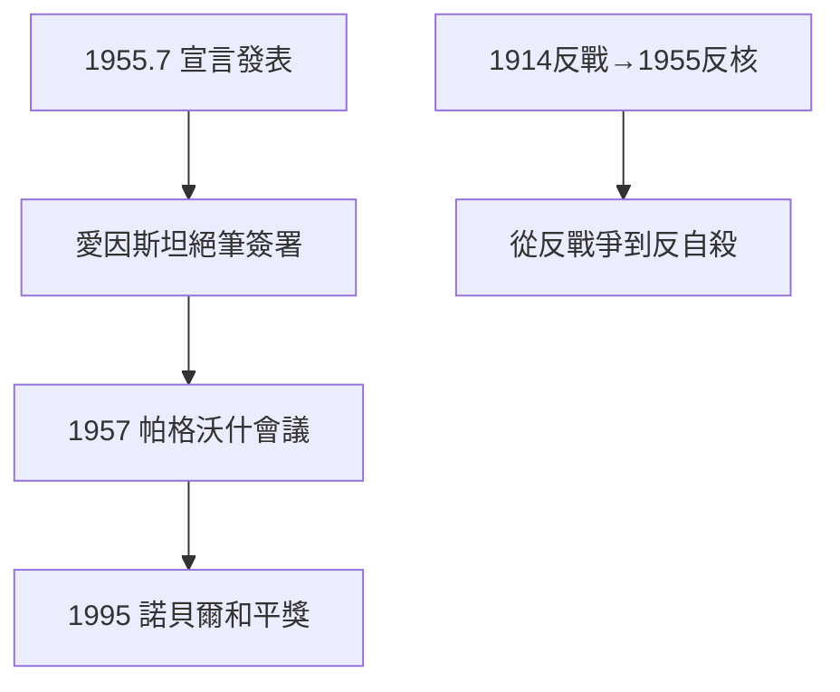

# 5.1 羅素愛因斯坦宣言（1955）

## 1955 年 7 月 9 日

羅素起草、愛因斯坦逝世前幾天簽署（4 月 18 日去世，7 月發表）的《羅素—愛因斯坦宣言》：呼籲科學家評估核武器的人類風險，「記住你們的人性，忘掉其餘」。簽署者包括玻恩、布里奇曼等諾獎得主。

## 帕格沃什會議

宣言直接催生 1957 年帕格沃什會議（Pugwash）——東西方科學家在冷戰中對話的渠道，1995 年獲諾貝爾和平獎（組織獎）。羅素一生唯一「成功」的政治行動：不是阻止戰爭，而是建立對話。

## 從反戰到反核

- 1914 反戰（3.1）：反對具體戰爭；
- 1955 反核：反對人類自殺——威脅的等級變了，反抗的等級也變了；
- 孤兒的不信任（1.1）最終指向：不信任人類自己。

**因果**：一戰反戰（3.1）→ 二戰後反核，邏輯一貫：不信任權力。但這次他找到了比街頭演講更有效的武器——科學家的集體簽名。下一節，越戰。
