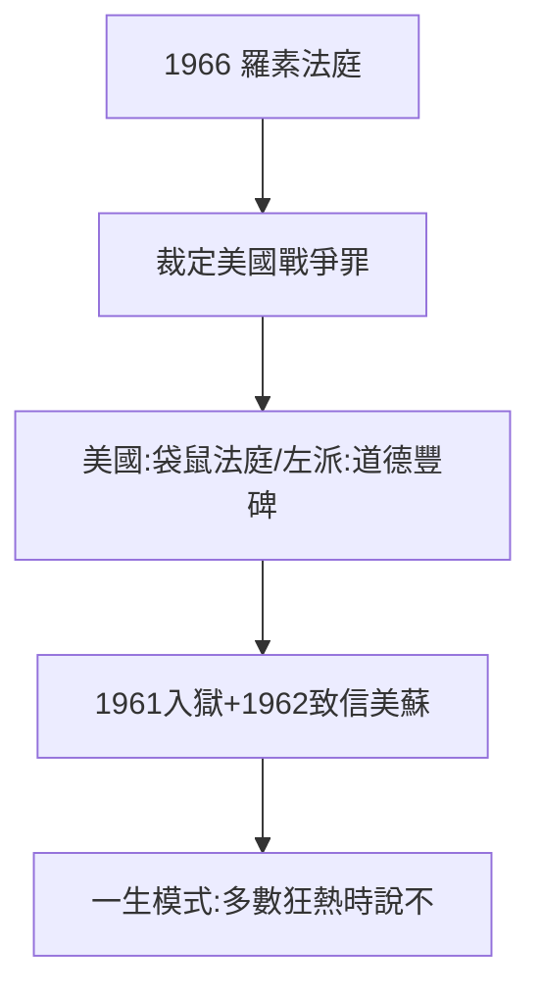

# 5.2 越戰法庭（1966–1967）

## 94 歲的審判

1966 年，94 歲的羅素發起「國際戰爭罪行法庭」（羅素法庭），審判美國在越南的罪行。薩特任執行主席，法庭在斯德哥爾摩、哥本哈根開庭，裁定美國犯有侵略與戰爭罪。美國政府稱之為「袋鼠法庭」，全球左派奉為道德豐碑。

## 最後的激情

- 1961 年反核靜坐入獄一週（89 歲，見 3.2 的傳統）；
- 1962 古巴導彈危機時同時致信甘迺迪與赫魯雪夫；
- 1967 年法庭閉幕時他已 95 歲，全程輪椅參會。

## 爭議

批評者說法庭只審美國、不審越共，是政治秀；支持者說在強權時代，總要有人記錄。羅素的回答一以貫之：「**我一生都在多數人狂熱時說不**。」

**因果**：1914 年反戰（3.1）→ 1955 年反核（5.1）→ 1966 年審判戰爭——同一個「說不」用了半個世紀。從街頭到法庭，形式在變，孤兒的不信任（1.1）沒變。下一節，謝幕。
