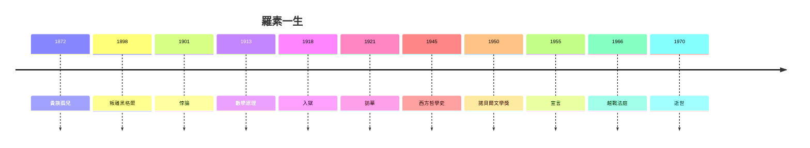

# 5.3 諾貝爾獎與謝幕（1950–1970）

## 1950：諾貝爾文學獎

78 歲的羅素獲諾貝爾文學獎，表彰「他作為人道主義理想與思想自由的鬥士的多樣而重要的著述」——注意：不是哲學獎（沒有），不是和平獎（提名多次未得），是文學獎。瑞典學院用文學的名義，獎勵了他的一生。

## 1970 年 2 月 2 日

羅素在威爾斯家中去世，享年 97 歲。遺囑：無宗教儀式，骨灰撒播。最後的著作是自傳三卷（1967–69），最後的政治行動是譴責蘇聯入侵捷克（1968）與以色列佔領（1969）——譴責到生命最後一年，左右開弓。

## 蓋棺：四個羅素

| 身份 | 代表作 | 命運 |
|---|---|---|
| 邏輯學家 | 數學原理 | 被哥德爾限定，但不朽 |
| 哲學家 | 邏輯原子論 | 分析哲學之父 |
| 作家 | 西方哲學史 | 入門第一書 |
| 鬥士 | 宣言/法庭 | 道德豐碑，爭議不息 |

**因果閉環**：為數學而活下去的少年（1.1），用數學顛覆哲學（2.1–2.3），用哲學介入政治（3.1–5.2），最後用文學獎為一生加冕。四個身份，一個内核：**永遠準備推翻昨天的自己——包括推翻獲獎的自己**。
