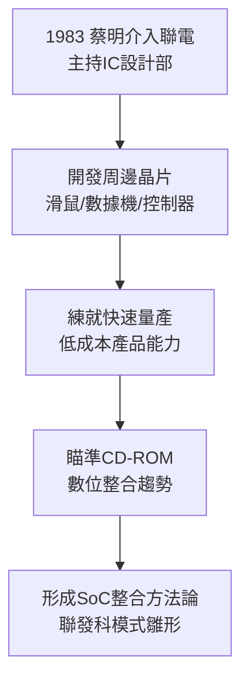

# 1.2 工研院與聯電 IC 設計的萌芽（1983-1995）

## 從工研院到聯電

1980 年，聯華電子（UMC）自工研院電子所衍生為民營公司，是台灣第一家半導體公司。1983 年，蔡明介離開工研院加入聯電，主持 IC 設計部門。當時聯電以晶圓代工與自有產品並行，IC 設計部門負責開發消費性、電腦周邊晶片，是公司內部的「小兒子」——資源少、但靈活。

蔡明介的管理風格在此成形：低調、節儉、重視數字與紀律，被稱為「省長」。他要求工程師貼近客戶與市場，而非只追製程指標。這種「市場導向的 IC 設計」文化，後來完整移植到聯發科。

## 技術累積：從代工思維到產品思維

1980 年代末至 1990 年代初，台灣 PC 產業起飛，聯電 IC 設計部門陸續開發滑鼠、鍵盤控制器、數據機、影像相關晶片。雖然規模不及聯電代工本業，卻練就一支能「定義規格、快速量產、壓低成本」的隊伍。

關鍵轉折是光儲存控制晶片的前期探索。CD-ROM 在 1990 年代初成為 PC 標配，飛利浦、索尼主導類比與解碼方案，價格昂貴。蔡明介團隊看準「數位化＋整合」趨勢：把 RF、伺服控制、解碼整合為單晶片，以 CMOS 製程大幅降價。這正是後來聯發科 CD-ROM 一戰成名的技術預演。

> 成本模型：若分立方案成本 $C_{discrete} = \sum_i c_i + c_{board}$，整合 SoC 成本 $C_{SoC} \approx c_{chip} + \epsilon$，當良率 $Y$ 夠高時，$C_{SoC} \ll C_{discrete}$，即以整合創造價格破壞。

## 因果鏈

**前因驅動：** 工研院技術外溢與 PC 產業起飛，給了聯電 IC 設計部門練兵場；蔡明介的系統整合思維，使其不滿足於單點晶片，而追求高整合度 SoC。

**後果引發：** IC 設計部門 prove 了自己的獲利能力，卻也與聯電「晶圓代工為主、避免與客戶競爭」的戰略產生結構性矛盾——設計部門越成功，代工客戶越疑慮。這一矛盾直接導致 1995-1997 年的分拆談判。
