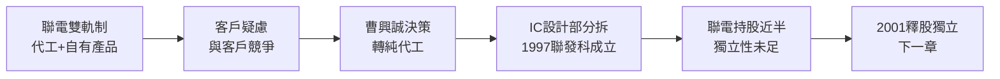

# 1.3 分拆前夜的抉擇（1995-1997）

## 聯電的戰略轉彎

1995 年前後，聯電董事長曹興誠決心效法台積電，全力轉向純晶圓代工（Pure-play Foundry）。原因有二：一是與客戶競爭的疑慮——聯電既做代工又做自有晶片，客戶（如 ATI、Xilinx 潛在客戶）不敢下單；二是資本密集度差異——代工需巨額建廠，必須聚焦。

在此戰略下，聯電旗下的 IC 設計部門（以及聯誠、聯傑等子公司）變得尷尬：留之則妨礙代工中立，棄之則可惜。曹興誠與蔡明介達成共識：將 IC 設計部門獨立出去，成立一家純 IC 設計公司，聯電以持股方式支持，而非事業部方式經營。

## 1997 年分拆成立聯發科

1997 年 5 月，聯發科技股份有限公司（MediaTek Inc.）正式成立，資本額約新台幣 9 億元左右，聯電持股近半，為最大股東，員工多來自原聯電 IC 設計部門，蔡明介任董事長兼總經理。總部設於新竹科學園區。

分拆條件相當優渥：承接原部門的技術、客戶與獲利產品，又無需背負晶圓廠折舊。這讓聯發科一起步就是「獲利中的新創」，與一般燒錢新創截然不同。但隱憂也在：股權上仍被視為「聯電集團」，客戶仍擔心下單給聯發科是否等於肥水落入聯電代工對手？獨立性不足將在 2001 年被迫解決。

## 因果鏈

**前因驅動：** 前兩節累積的設計戰力＋聯電純代工轉型壓力，共同驅動分拆；沒有聯電的母體庇護，就沒有聯發科的初始團隊與現金流。

**後果引發：** 分拆確立了聯發科「無晶圓（Fabless）＋高整合 SoC＋低成本」的基因，並把主戰場鎖定為光儲存——因為那是原部門最接近爆發點的產品線。聯電母公司持股則為四年後的釋股獨立埋下制度性導火線。
