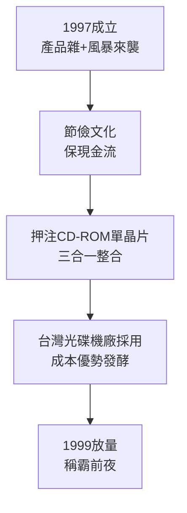

# 2.1 聯電分拆與艱難創業（1997-1999）

## 亞洲金融風暴中的起步

聯發科開業第一年即遇 1997-1998 亞洲金融風暴，PC 需求急凍。公司初期產品線龐雜：CD-ROM 控制器、DVD 前端試驗品、部分 PC 周邊晶片，營收規模小，工程師僅數百人。蔡明介立下鐵律：不做賠錢生意、不養大而無當的團隊、緊盯現金流。

與矽谷式「先搶市占再談獲利」不同，聯發科延續聯電的節儉文化：差旅從嚴、設備共用、獎金與獲利連動。這種文化在風暴中保命，卻也被批評保守。但正是保守，使其在 1998 年 CD-ROM 價格戰中活下來，而許多競爭者倒下。

## 賭注 CD-ROM 單晶片

當時 CD-ROM 控制晶片主流是多顆分立方案：RF 放大、伺服、解碼各立門戶。聯發科押注「三合一」單晶片整合，以聯電 CMOS 製程生產，大幅降低主機板面積與成本。其設計哲學是：效能夠用就好，價格與供貨速度壓倒一切。

> 市場滲透可用 Logistic 模型 $S(t) = K/(1+e^{-r(t-t_0)})$ 描述，聯發科以低價把 $r$ （擴散速率）拉高，使台灣光碟機廠（宏碁、華碩、明基、廣碩）迅速採用其方案，形成正反饋。

## 因果鏈

**前因驅動：** 分拆承接的 CD-ROM 技術＋金融風暴淘汰弱者，迫使聯發科聚焦單一爆品；聯電產能奧援（即使中立化後仍有業務往來）保障了供貨。

**後果引發：** CD-ROM 單晶片的成功驗證了「整合＋低價＋貼近台灣代工客戶」公式，團隊信心與現金大增，得以把同一公式複製到技術更難、利潤更高的 DVD 領域，引爆下一節的全球霸主之戰。
